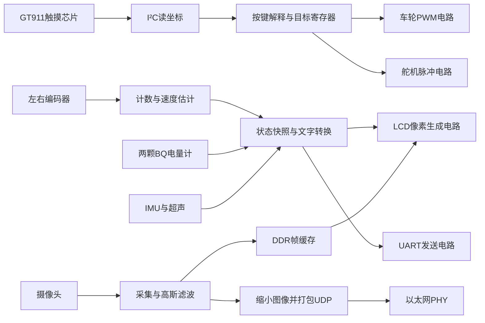

# 从数字电路到会运动的小车：用当前ACG720工程学习FPGA

这份教程写给已经学过数电、会用单片机，但还没有独立完成FPGA工程的你。主线是你桌上的这台车：触摸屏为什么能改变舵机脉宽，摄像头为什么需要DDR，几万行代码怎样落到芯片里，以及代码逻辑正确为什么仍会出现时序违例。

这里的硬件对象固定为ACG720、GW5AT-60B，工程入口为`vision_robot_ui.gprj`，顶层为`vision_robot_ui_top`。资源和时序的数值取自**2026-10-16 20:25这一次布局布线报告**。后续改代码再编译，数字会变化。文中的简化代码用于解释原理，标明了哪些是实际工程、哪些是教学示意；它们不是另一份可直接烧录的工程。

配套的[交互小实验](assets/fpga_learning_lab.html)可以调整时钟、组合逻辑延迟和流水线分段，直观看到时序余量、延迟与吞吐量的区别。它是教学模型，不是实际芯片的时序仿真。

建议第一次依次读第1～8章，先形成完整认识；第二次跟着第9～14章打开源码；以后修改工程时，把第15～18章作为操作与复习入口。你不需要先背完全部术语。

快速定位：

- [1 整车全局](#chapter1) → [2 从程序到电路](#chapter2) → [3 资源表](#chapter3) → [4 文件与编译](#chapter4)
- [5 时钟与使能](#chapter5) → [6 为什么时序会错](#chapter6) → [7 LCD流水线](#chapter7) → [8 分拍与共享运算](#chapter8)
- [9 触摸与舵机](#chapter9) → [10 车轮与闭环](#chapter10) → [11 传感器与串口](#chapter11) → [12 图像、DDR与网口](#chapter12)
- [13 跨时钟交接](#chapter13) → [14 雷达与资源预算](#chapter14) → [15 阅读路线](#chapter15) → [16 开发工作流](#chapter16)
- [17 全部64个源文件的地图](#chapter17) → [18 练习与参考答案](#chapter18)

<a id="chapter1"></a>

## 1. 先看整辆车：FPGA到底在负责什么

从使用者看，你希望“按屏幕，车轮转起来，云台转到合适的位置，屏幕显示传感器数据”。从工程看，这是一组同时工作的电路。



这张图是功能关系，不表示所有信号共用一个时钟。摄像头、LCD、DDR、网口各有时钟节奏，后面还要解决它们之间的数据交接。

代码的起点也有来源：顶层注释标明，摄像头/DDR沿用板卡第45章基础，网口沿用第59章基础；在这些已运行的接口上，再加入触摸、图像处理、执行器和传感器业务。我们不需要从晶体管或DDR物理层重新造整块板，但必须理解复用模块的接口和条件。

当前顶层参数`ACTUATOR_TEST=1`，选择执行器测试页面：MOTOR1是左轮，MOTOR2是右轮，SERVO1是底座，SERVO0是上层。车轮在这个页面按独立开环PWM测试。工程里也有速度/位置闭环的代码，但“有闭环代码”与“这次测试使用了闭环、已经调好参数”是三件事。

同样，IMU已经能输出换算单位后的六轴数据，但角速度不是姿态角；雷达定位和导航目前还属于设计计划。BQ能通信、能显示电压，也不代表电池模型和SOC已经校准。

**为什么先看全局？** 因为读顶层时，如果只看到一千行端口和连线，你很容易把它误认为一千步程序。先知道有哪些独立电路，才能看懂这些连线是在连接谁。

<a id="chapter2"></a>

## 2. 从STM32的经验，跨到“代码生成电路”

### 2.1 你熟悉的单片机，其实已经包含许多专用电路

STM32上运行C程序时，CPU取指令执行。你写寄存器配置定时器后，PWM主要由定时器硬件持续产生，CPU不用在每个脉冲边沿执行一次代码。

在当前FPGA工程里，可以把`servo_pulse_output.v`理解成“我们自己描述的一个专用定时器”。配置下载以后，计数器、比较器和输出门电路长期存在并连续工作。它们并不等待CPU轮流调用。

因此，“FPGA并行”不是所有任务都神奇地零时间完成，而是可以为不同任务安排不同电路。例如两只舵机各有自己的计数器，UART也有自己的位计数器，它们在相同的时间内各自前进。

### 2.2 一段最小代码，对应哪些真实电路

下面是教学示意，不是工程完整的舵机模块。假设`count`已经复位为0，本例省略复位连接；完整源码包含复位处理：

```verilog
reg [19:0] count;
wire pulse = count < 20'd75000;

always @(posedge clk) begin
    if (count == 20'd999999)
        count <= 0;
    else
        count <= count + 1'b1;
end
```

假设`clk`是50MHz，硬件关系是：

```text
20位寄存器保存count
    │
    ├── 比较count是否等于999999 ──┐
    ├── 加法器计算count+1 ──────┤选择下一值──→ 回到count的D输入
    └── 比较count是否小于75000 ─────────────→ pulse引脚逻辑
```

50MHz意味着20ns出现一个时钟上升沿。数满100万个周期，经过20ms；小于75000的阶段持续1.5ms，因此输出是每20ms一次、脉宽1.5ms的脉冲。

这里出现了两种“时间”：

- **功能时间**：代码安排数多少拍，得到20ms周期、1.5ms高电平。
- **物理时间**：加法器、比较器和连线必须在下一次20ns的采样期限前完成传播。

你前面困惑的时序问题，就发生在这两者的交界处。代码写出了功能时间，物理电路仍然需要满足传播时间。第6章会展开。

### 2.3 `<=`为什么不能按C的赋值顺序理解

看这个教学示意：

```verilog
always @(posedge clk) begin
    stage1 <= input_data;
    stage2 <= stage1;
end
```

每个时钟沿到来时，两个寄存器分别采样各自D端的旧值。第二行使用的是该沿到来前的`stage1`，不会立刻取到本行前面刚写的`input_data`。

若输入依次是A、B、C：

| 上升沿 | 本次输入 | 沿后stage1 | 沿后stage2 |
| --- | --- | --- | --- |
| 第1沿 | A | A | stage1先前值 |
| 第2沿 | B | B | A |
| 第3沿 | C | C | B |

这就是两级寄存过程。后面的图像流水线、同步器和UART状态机，都建立在这个规则上。

### 2.4 几个很容易从C带过来的误解

| 写法 | 在FPGA中要怎样理解 |
| --- | --- |
| `module` | 描述一种电路；实例化两次通常生成两套电路，不是运行时调用两次 |
| `parameter` | 综合前确定的常量；当前`ACTUATOR_TEST`是此类参数，改它需要重新生成配置 |
| `wire` | 连接或组合表达式的值，本身不表示存储 |
| `reg` | Verilog中可在过程块里赋值的变量类型；是否成为触发器取决于用法，不能见到`reg`就断言有寄存器 |
| `always @(posedge clk)` | 在该时钟边沿更新状态，通常推导触发器；时钟外电路仍在传播 |
| `always @*` | 描述组合逻辑；所有路径应给输出赋值，否则可能推导锁存器 |
| `if`、`case` | 常成为选择器、译码器或下一状态逻辑，不是CPU执行到这里才临时建立一根线 |
| 固定次数的`for` | 经常在综合时展开为多份逻辑；它本身不会自动“每拍循环一次” |
| `function` | 通常在调用处展开逻辑；想让多个任务共用一个运算器，需要显式安排选择和状态 |
| `/`、`*` | 可能形成很大的运算电路，也可能被常量化或映射到专用资源，不能按字符数量估面积 |
| `#10` | 常见于仿真激励；不能用它要求实际FPGA产生10ns等待，应使用时钟、计数和接口时序设计 |

现在你已经能把“代码”翻译成“保存状态的寄存器＋计算下一值的组合电路”。接下来，资源表就有了具体对象。

<a id="chapter3"></a>

## 3. 资源表里，每个数字到底对应什么

### 3.1 LUT：把布尔函数装进一个小查找表

LUT是Look-Up Table。以本器件的基本LUT4为例，四个输入有16种组合，配置时写入每种组合应输出0还是1。输入组合相当于查表地址，输出是该地址对应的结果。

例如`y=(a & b) | c`只有三个独立输入，可以装入一个LUT4。它不是先执行“与指令”，再执行“或指令”；配置完成后，电路持续给出这组逻辑的结果。输入改变后，输出经过器件传播延迟改变。

输入很多的选择器、宽位比较器、复杂译码和一部分运算，需要多个LUT连接。LUT里的配置位不是供你随便当大内存使用的空间；只有器件支持的特定分布式RAM模式才提供相应存储能力。

### 3.2 寄存器：数电课里的D触发器，成千上万个地出现

一个触发器保存一位。一个实际保留下来的32位计数状态，通常需要32个触发器；再加实现加一、清零、使能的逻辑。32位总线并不总占32个寄存器，例如它可能只是一组连线，也可能被优化掉。

本次报告的22415个寄存器包含22361个逻辑触发器和54个I/O触发器。它们分散在计数器、状态机、显示快照、FIFO控制、图像流水线和厂商IP里。它不是CPU“有22415个软件变量”的含义。

### 3.3 ALU、CLS：为什么Logic只用一半，CLS却用了八成

本器件的一个CLS包含两个LUT4和两个寄存器；四个CLS构成一个CFU。逻辑单元还能配置成算术等模式，因此报告中有LUT、ALU等细分。[高云GW5AT数据手册，第2.2节](https://cdn.gowinsemi.com.cn/DS981-1.0.5_GW5AT%E7%B3%BB%E5%88%97FPGA%E4%BA%A7%E5%93%81%E6%95%B0%E6%8D%AE%E6%89%8B%E5%86%8C.pdf)

报告里的ALU是逻辑资源按算术模式使用的统计，不是额外加在59904之外的一批CPU运算器。本次有26022个LUT、4493个ALU，另有少量分布式存储等占用，得到Logic总占用30587。

CLS统计的是已经使用的物理逻辑块。一个CLS中只使用了部分资源，也会成为一个已用CLS。并且，不是任意两个逻辑都能完美塞进同一个块：时钟、复位、使能、局部连接和布线需求都会影响组合安排。

可以用一栋楼理解：Logic像实际放入的设备数量，CLS像已经启用的房间数量。一个房间没装满，也不一定能塞进另一套设备。这个比喻只解释“装不满”，真实器件还有具体的共享控制与连线规则。

**所以空闲LUT很多，不保证新增一个大模块就一定容易布线，也不保证频率够高。**

### 3.4 块RAM：用专用存储阵列保存大批数据

BSRAM是FPGA内部的专用RAM块，适合FIFO、行缓存、查表等。它与用大量触发器拼一个数组的成本不同。

本系列每块标称18Kbit，即18432bit，原始容量2304字节；118块原始总量265.5KiB。但常用16位/8位存储模式中，一块可能配置为1024×16或2048×8，也就是2KiB有效数据。9位/18位模式也可以把额外位用作数据；不能一概把这些位称为校验位。实际要考虑宽度、深度、端口和模式。[高云Arora V存储器指南](https://cdn.gowinsemi.com.cn/UG300E.pdf)

为什么声明数组不等于一定用块RAM？因为读写时序、端口数量、复位写法也参与资源推导。当前高斯滤波模块有两行像素数组，并刻意不在复位时逐项清空RAM，而用有效控制等待新行填充。这有利于推导专用RAM，而不把整行数据变成一大群带复位的触发器。

### 3.5 DSP：芯片里已经造好的乘加电路

DSP块是内部硬化运算资源，包含乘法、加法及可选流水寄存器等。它不是额外焊在板上的DSP芯片。本次报告8个DSP的具体模式是`MULTALU27X18`。不同位宽和运算模式可能需要不同数量，不能说“剩110个，就能随意加110个任意精度乘法”。[高云Arora V DSP指南](https://cdn.gowinsemi.com.cn/UG305E.pdf)

乘一个常数也不一定使用DSP：例如乘16可以接移位后的线；其他常数可能展开成移位与加法，也可能由工具选择DSP。最终看实际报告。

### 3.6 还要关注I/O和时钟网络

I/O是连接芯片外部的接口资源。可用引脚还受封装、Bank供电、专用功能和PCB是否引出影响，不能把“还有147个未用I/O”直接理解成扩展排针上还有147个随便接的口。

PLL是已有的时钟硬件，用来产生所需频率和相位；全局时钟网络负责把时钟分配到大量寄存器。当前报告PRIMARY和LW资源均显示8/8。里面不全是八种不同频率，一些高扇出控制也可能占专用分配资源。增加一个传感器时，通常优先复用50MHz并产生使能脉冲，不为每个低速外设再创造一种时钟。

### 3.7 把这些概念放回真实资源表

| 资源 | 本次已用/总量 | 直接相除 | 要看什么 |
| --- | --- | --- | --- |
| Logic | 30587/59904 | 51.06% | 组合逻辑与算术等占用；软件表格显示52% |
| Register | 22415/60780 | 36.88% | 保存状态与流水的资源 |
| BSRAM | 35/118 | 29.66% | 存储块数量，不能只看总字节 |
| DSP | 8/118 | 6.78% | 硬化算术资源及所用模式 |
| CLS | 24068/29952 | 80.36% | 物理打包占用及布线余地 |
| I/O Port | 150/297 | 50.51% | 已使用端口及Bank分配 |

这些百分比是不同维度，不能相加成“总使用率”。也不能用50%逻辑使用率推断“运行时CPU占用50%”：配置好的电路始终在那里，是否翻转与功耗有关，但不是操作系统的CPU占用概念。

<a id="chapter4"></a>

## 4. 工程文件怎样变成芯片里的连接

现在知道电路由哪些资源构成，就可以看Gowin如何把描述变成实物。

### 4.1 先认识几种文件

| 文件 | 解决的问题 | 当前例子 |
| --- | --- | --- |
| `.gprj` | 使用哪些源文件、哪个器件、哪套工程配置 | `vision_robot_ui.gprj` |
| `.v` | 有哪些电路，输入输出怎样连接 | `src/vision_robot_ui_top.v`等 |
| `.cst` | 顶层信号接哪个封装管脚，电平标准等 | `src/lcd_interaction.cst` |
| `.sdc` | 真实时钟周期、输入输出时间、经证明的时序关系 | `src/lcd_interaction.sdc` |
| 厂商IP及配置 | DDR、PLL、FIFO等已有专用实现 | `src/vendor/`、`src/gowin_pll_45/` |
| `.vg` | 综合得到的器件逻辑网表 | `impl/gwsynthesis/vision_robot_ui.vg` |
| `.rpt.txt`、`.html` | 报告资源、布局布线过程、时序等 | `impl/pnr/vision_robot_ui.rpt.txt` |
| `.fs` | 下载到FPGA的配置数据 | `impl/pnr/vision_robot_ui.fs` |

扩展板上写的接口名、排针编号、FPGA封装球位和Verilog端口名，是四个层次。修改接线前，要沿着“模块引脚→扩展板网络→排针→FPGA球位→CST端口”核对；文件中一个变量叫RX，并不能替你证明PCB接到了哪个球位。

### 4.2 这几个阶段分别干什么

1. **展开与综合**：读取参数、实例和表达式，进行常量折叠、删除未使用电路、识别触发器和RAM、把逻辑映射为器件资源。此时已经不再按源代码行理解电路。
2. **布局**：给逻辑、RAM、DSP等选择实际物理位置。互相联系紧密的资源希望靠近，但还受到I/O位置、时钟和共享资源约束。
3. **布线**：为每条连接选择器件内部的线路与开关。不同连接会争用通道，绕路会增加延迟。
4. **静态时序分析**：按时钟和器件延迟模型检查路径是否满足采样要求。
5. **位流生成与下载**：生成并装入配置，决定LUT内容、内部连接及相关硬件模式。

报告与这些阶段的关系可参考[高云软件用户指南](https://cdn.gowinsemi.com.cn/SUG100E.pdf)。不同版本的菜单名称、选项和报告格式可能变化；当前本机工具为V1.9.11.03 Education。

### 4.3 为什么会编译很久

CPU编译通常不需要替你决定成千上万根芯片内连线的位置。FPGA工具需要寻找能装下、能接通、尽量满足期限的物理实现。某次选择造成拥挤，后续可能反复调整。

本工程20:25这轮：布局1分09秒，布线5分14秒，输出文件等之后总计6分29秒；此前一轮为20分12秒。这个改善与代码结构优化相符，但一次结果不能保证所有后续编译都同样快。70%代表某一阶段，并不表示用掉总时间的70%。

源码共64个启用的Verilog文件、约35510个物理行，其中业务部分36个文件约7895行，厂商/生成部分28个约27615行。它们是整个工程的累计，不是某一次全部新增。缩短几行文字通常不会减少硬件，改变运算结构和连接才会。

<a id="chapter5"></a>

## 5. 时钟、周期、使能：先把三个尺度分开

### 5.1 50MHz不是“每秒执行五千万行代码”

50MHz表示时钟每20ns出现一次同类采样沿。所有接到这个时钟的寄存器，都按这个节奏采样各自输入。各寄存器之间的组合逻辑在沿与沿之间传播。

当前工程常见节奏：

| 场景 | 量级 | 实际意义 |
| --- | --- | --- |
| 控制时钟 | 50MHz，20ns | 控制电路每拍保存状态 |
| LCD像素时钟 | 45MHz，约22.22ns | 连续安排像素和消隐槽位 |
| GMII发送域 | 125MHz，8ns | 网口字节数据通路节奏 |
| 车轮PWM | 20kHz，50µs | 开关一个完整PWM周期 |
| 舵机帧 | 50Hz，20ms | 发出一次位置脉冲 |
| 速度采样 | 10ms | 统计一次编码器位移差 |
| 常规遥测 | 约10Hz，100ms | 组织并发送新一份状态 |

低速功能由高速计数器产生节拍。它们不会把控制时钟自动变成低频。

### 5.2 优先用时钟使能，避免随手生成新时钟

教学示意：

```verilog
always @(posedge clk50M) begin
    if (tick_10ms)
        previous_position <= current_position;
end
```

这个寄存器的时钟仍是50MHz，`tick_10ms`只是决定这一拍要不要更新。好处是大量低速任务可以共用一个时钟域。

如果改成`always @(posedge tick_10ms)`，你把一个逻辑信号用成了时钟，会引入新的时钟路径、跨域和约束问题。某些经过专门设计的派生时钟是合理的，但不能把普通节拍随意当作时钟。

### 5.3 “只在10Hz更新”为什么也可能要求20ns算完

只要发端与收端寄存器仍接50MHz，工具默认就需要按相邻有效采样关系检查路径。你知道数据很少变化，不等于综合工具会自动把一次很长的除法分到500万个周期里。

想真正用多拍完成，应设计状态、锁存输入、逐步计算，并在完成时发布`done`。只有在功能与时钟使能关系确实证明允许时，才考虑对应的多周期约束；不能因为“数据慢”就随意放宽。

<a id="chapter6"></a>

## 6. 代码写对了，时序为什么还能不对

### 6.1 理想数字模型省略了传播过程

数电里的方程`D=A+B`告诉你稳定后的逻辑值；真实加法器需要时间把进位和结果传到末端，连线也有延迟。你写：

```verilog
always @(posedge clk)
    result <= complicated_expression;
```

这行代码描述“result在这个沿采样前方组合电路的输出”。它没有向硬件承诺“表达式一定能在任意短的周期内完成”。实际电路也不会像CPU遇到慢指令那样，自动暂停整个时钟等它。

### 6.2 一条路径的建立时间检查

```text
发端触发器Q ── 逻辑 ── 布线 ── 收端触发器D
     ↑第n沿发出新值               ↑预期第n+1沿采到新值
```

为了在下一沿可靠采到新值，数据需要提前稳定，这段提前量叫**建立时间setup**。

在最简单的同周期、同域说明里：

```text
发端clock-to-Q + 组合逻辑延迟 + 布线延迟 + setup + 不确定性
    ≤ 时钟周期 +（收端时钟到达时间 − 发端时钟到达时间）
```

等式右侧的时钟到达差叫时钟偏斜的一种记号；真实报告还区分起终点、相位、接口和器件模型。不要把教材简式机械代替完整时序报告。

例如教学假设：clock-to-Q 0.3ns、组合逻辑12ns、布线9ns、setup及不确定性合计0.7ns，总共22ns。你给20ns周期，余量约−2ns，就存在建立时间违例。

### 6.3 Slack就是“期限减去到达时间”

Setup slack为正，表示这条被正确约束的路径在该模型下有余量；为负表示来不及。它与功能仿真里算出正确数字是不同的检查。[高云FPGA设计指南：时序收敛](https://www.gowinsemi.com/upload/database_doc/38/document/5b923e5ef105f.pdf)

当前工程有一条真实例子：BQ_B的`block_data_1`寄存器到`failure_phase_4`，数据路径22.691ns，slack为−2.755ns。它属于50MHz相关检查，名义周期20ns；报告中的其余时钟和建立时间项解释了为何不是简单相减恰好−2.691ns。

这条路径不是说“BQ总线必须工作在50MHz”。BQ总线可以很慢，但读取的数据进入FPGA后，用来判断状态的一段内部组合逻辑仍可能太长。

20ns的采样沿照常到达，此时电路可能还在传播，接收寄存器可能采到旧值、混合值或进入亚稳态；时钟不会自动等待22.7ns。这不表示每次都会错误，但表示当前实现不能在所检查条件下保证可靠。

### 6.4 还存在保持时间hold，线路太快也可能有问题

收端采样沿到来后，输入还需要保持一小段时间不变，叫保持时间。若新值过早冲到收端，可能扰乱它对旧值的采样。Hold检查主要针对最短路径和时钟到达差；降低频率通常不能解决这类问题。

这也是为什么不能只优化“最快Fmax”，还必须检查hold。工具可能通过调整路由、增加延迟或改变布局处理它。对真实异步路径则需要先确认跨域结构，再使用适当约束。

### 6.5 复位释放也有时序要求

异步复位可以不等时钟沿就复位寄存器，但释放复位时仍要遵守相对时钟的recovery/removal要求。否则不同寄存器可能在不同周期开始工作，或进入不稳定状态。

当前报告还记录了DDR读FIFO复位相关的Recovery违例，例如`ready_s0/Q`到`reset_r_1/PRESET`，slack约−4.833ns。这类问题不能靠加快一个除法器解决，需要审查复位释放、时钟关系和厂商接口要求。

### 6.6 为什么有违例，上板仍然可能暂时正常

时序分析通常按规定的器件模型和工作条件检查；你眼前的单块芯片、温度、电压、当前数据模式可能暂时没有触发最差情况。有些路径的约束也需要结合真实协议审核。因此有画面是功能证据，不是全部时序通过的证据。

当前报告50MHz控制域Fmax约43.946MHz、45MHz LCD域约41.534MHz；还存在其他违例。Fmax是报告基于路径估计的能力，**不会把实际50MHz振荡器自动改成43.946MHz**，也不能作为所有跨时钟路径的唯一合格指标。

### 6.7 怎样真正解决

先确认约束是否描述真实硬件，再针对路径采取措施：缩短组合链、收窄不必要位宽、分拍运算、加流水、降低扇出、改善布局，或在允许时真正调整工作时钟。应重看修改后的路径和接口行为。

把SDC里的50MHz改成25MHz，只是改变了工具的检查目标；如果PLL和外部时钟仍旧50MHz，硬件不会因此变慢。`false_path`也只影响分析，不会修复线路。它们必须有电路与协议依据。

<a id="chapter7"></a>

## 7. 流水线：怎样既分拍，又保持每拍一个像素

### 7.1 从长运算到分段运算

假设“选区域→找字符→查字形→选颜色”的组合链总共30ns，在45MHz的22.22ns周期里放不下。中间放一个寄存器，把工作拆成两段，各段就分别接受自己的时钟期限。

代价是保存中间结果的触发器，以及端到端更晚得到结果。好处是可以让前后段同时处理不同像素。

### 7.2 本工程LCD的四级是什么

当前`lcd1024_interaction_ui.v`最后一个时钟过程能看到四组寄存关系：

1. 保存区域选择结果：`label_text_l`、坐标差、背景色，以及`de_l/hs_l/vs_l`。
2. 保存字符选择结果：`character_a`、字形坐标、颜色及相应有效/同步信号。
3. 保存字形结果：`font_b`及对应的坐标、颜色、有效/同步。
4. 保存最终`rgb`、`de/hs/vs`输出。

前一版把区域和字符选择放在同一级，本次多分出一级。这里的“四级”按四组寄存过程命名；从首级某沿采样到第四级输出，是后续三个沿的间隔。比较同一个输入像素的新旧实现，新增延迟是**一个像素周期，约22.22ns**。

### 7.3 用四个连续像素看吞吐量

| 时钟沿 | 区域寄存 | 字符寄存 | 字形寄存 | RGB输出 |
| --- | --- | --- | --- | --- |
| n | P0 | 旧数据 | 旧数据 | 旧数据 |
| n+1 | P1 | P0 | 旧数据 | 旧数据 |
| n+2 | P2 | P1 | P0 | 旧数据 |
| n+3 | P3 | P2 | P1 | P0 |
| n+4 | P4 | P3 | P2 | P1 |

流水线填满后仍然每拍输出一个像素。因此，**延迟是某个像素走完全程多久，吞吐量是每秒能连续输出多少像素**，两者不是一个量。

### 7.4 为什么颜色和同步信号必须一起走

如果颜色晚了一拍，但DE没有一起晚，LCD会把这个颜色认成另一个像素的位置；行场同步不对齐还会使整行、整帧错位。`valid`、坐标、帧起始、颜色等与数据相关的信息，都应按相同事务保持对齐。

当前改动把RGB相关信息和DE/HS/VS成组延迟；摄像头取数仍在原布局级对齐，不能随意把`camera_pop`也往后推一拍。FIFO的当前像素、取数动作和显示时间之间有专门关系，这属于接口契约。

### 7.5 像素时钟不是屏幕帧率

当前LCD总时序为每行1344个像素时钟、每帧635行，里面包含消隐；有效画面是1024×600。按45MHz计算理论扫描帧率约为：

```text
45,000,000 ÷ (1344 × 635) ≈ 52.73帧/秒
```

这只是根据时序参数的计算，不是摄像头实测帧率，也不是整机无故障保证。摄像头可按自己的速度写新帧，LCD按自己的扫描节奏读显示缓存。

<a id="chapter8"></a>

## 8. 不一定要流水：低速任务可以共用一个运算器

LCD需要每拍产生像素，适合流水。温度、电压、舵机目标这些数据更新很慢，可以让一个运算器分很多拍完成一次工作。

当前`unsigned_divmod.v`是一个32位无符号逐位除法器。它先锁存分子、分母，每拍完成一次比较/减法与移位，32次迭代后产生`done`。50MHz下，32个迭代周期约0.64µs，再加接收与发布的少量周期。

它不是每拍接收一份独立新除法的满流水除法器。`busy=1`时不能塞进另一次任务，调用方要等完成。因此它用较低吞吐量换较少电路和较短的单拍逻辑，正适合当前低速UI计算。

调用方也需要流程。下面是省略复位、声明和实例连接的教学片段，展示接口怎样配合：

```verilog
// 每个控制时钟沿执行；div_start默认只维持一拍。
div_start <= 0;
case (state)
    IDLE: if (new_request) begin
        numerator <= request_value; // 先把这一次的输入保存下来
        state <= START;
    end
    START: begin
        div_start <= 1;
        state <= WAIT;
    end
    WAIT: if (div_done) begin
        result <= div_quotient;
        state <= IDLE;
    end
endcase
```

注意上一章的`<=`规则：另一个模块在同一沿看到的是旧`div_start`，所以启动信号要经过真实的寄存关系传播。先锁存输入、再发启动，使分子在接收时稳定；完成后再一起发布结果与有效标志。用状态机把这些关系写明，比想象“先调用函数，再等待它执行完”可靠。

| 实现方式 | 大致特点 | 当前适用场景 |
| --- | --- | --- |
| 一拍组合完成 | 可能逻辑大、路径长 | 简单且确实能满足周期的运算 |
| 分成多级流水 | 延迟多拍，可设计成每拍接收新任务 | 连续像素、高吞吐数据流 |
| 同一运算器迭代 | 一次占多拍，通常不能每拍接收新任务 | 舵机换算、超声距离、低速状态转换 |

BQ状态文字也改为共享二进制转十进制逻辑。原来容易为许多字段同时生成运算，现在先拍下一份状态，依次转换，最后整体发布。这样避免屏幕混入一半新值、一半旧值。

到这里，你已经知道代码、资源、时钟、时序、流水和分拍运算之间的关系。下面沿着真实接口走一遍：这些原理怎样接到屏幕、车轮和摄像头上。

<a id="chapter9"></a>

## 9. 先走通一条最短链：触摸一次，舵机为什么会动

### 9.1 触摸芯片提供坐标，FPGA解释坐标的含义

从顶层找到`u_touch`，对应`gt911_touch.v`。触摸芯片把触点数、坐标和ID放在寄存器里，FPGA通过I²C读取。读取完成后，驱动发布一份坐标快照。

`actuator_test_control.v`根据快照检查按下、抬起、移动距离、是否为同一触点等，再把一次有效点击解释成某个动作。`button_at()`负责把坐标区域翻译成按钮编号。不是LCD像素电路“看见手指”后直接拉动舵机。

这还解释了为什么界面和控制需要分开：`actuator_test_panel.v`负责在什么坐标画什么按钮，而控制模块判断同一组几何区域触发什么动作。两边不一致，就可能出现“按这里，却触发旁边按钮”的功能错误；这种错误与建立时间违例不是一回事。

### 9.2 目标脉宽保存在寄存器里

控制模块保存两个`target_us`，分别是两只舵机的请求值。粗调/细调改变的是这个数字：CAL US模式为100µs/10µs，标定后ANGLE模式为10°/1°。实际角度换算是基于标称关系和已记录脉宽限位的命令估算，没有测轴角的反馈。

当前源码还有三个需要知道的边界：CAL US用于找范围，只夹紧在500～2500µs，不使用已经记录的机构MIN/MAX；ANGLE模式才按记录的机构上下限夹紧。MIN/MAX只存在寄存器里，掉电或复位后需要重新标定。`applied_us`初值1500也不表示真实轴已经位于中间位置。

`servo_pulse_output.v`保存另一个值`applied_us`，表示当前实际输出的脉宽。它在20ms帧边界更新，避免一段高脉冲发到一半突然改宽。

本版本还保留平缓变化：**每帧最多向目标移动1µs**。因此目标增加100µs，输出走完约需2秒；增加10µs约需0.2秒。屏幕上请求值已变，但输出逐渐跟上，是当前代码刻意保留的行为，不一定是接线或舵机故障。

### 9.3 PWM数值与真实运动之间，还隔着硬件

FPGA输出的是电平和时间；舵机内部控制器把脉冲解释成位置命令，然后自己的电机闭环拉动轴。FPGA没有收到轴角反馈，就不能知道它是否已到位、卡住、掉电或打滑。

两只舵机本体都可定位到360°，但机构允许范围可能更小；软件记录的是可用脉宽范围。未知范围时应通过小步观察标定，不能把“标称0～360°”等同于机构全范围安全。

这条链可以概括为：

```text
触摸坐标 → 有效点击 → 目标寄存器 → 帧边界与限幅 → 输出脉冲
    → 舵机内部控制器 → 实际轴角
```

前五项在当前FPGA工程内；最后实际轴角需要外部运动证据。理解这点，调试时才知道该观察哪一级。

<a id="chapter10"></a>

## 10. 再加上反馈：车轮、编码器和闭环分别做什么

### 10.1 车轮PWM控制的是驱动占空比

`tb6612_axis_pwm.v`用50MHz计数到2499，形成20kHz PWM周期。方向和占空比进入TB6612，驱动直流电机。相同占空比，在不同电池电压、地面摩擦和负载下，转速可能不同。

当前执行器测试页面最高命令为±50%，按钮每次改变5%；这个限制不是电流保护，也不是实际速度上限。

这个驱动器的停止真值表还需要看IN1/IN2。当前模块的STOP为IN1=IN2=0、物理PWM为高，表示高阻滑行；不能把“所有电机都PWM低就是同一种停止”写进通用经验。软件停止也没有断开电机电源。

### 10.2 AB编码器怎样变成位移计数

`encoder_quadrature.v`先同步异步输入，再等待状态稳定，最后检查AB的合法变化。正方向序列按当前定义为：

```text
00 → 01 → 11 → 10 → 00
```

这个完整AB周期产生四个计数，因此是四边沿计数。实际车轮向前时是正还是负，要结合线序与安装，用实测确定`invert`。

滤波不是越长越好：当前100拍约2µs。若编码器边沿快到一个状态保持时间比滤波窗口还短，合法变化也可能被丢掉。要用最高轮速、减速比和编码器分辨率估计边沿率。

### 10.3 COUNT/10MS怎样变成m/s

每10ms读取位置差：

```text
Δcount = 本次累计计数 − 上次累计计数
```

当前屏幕/蓝牙速度以`COUNT/10MS`表示，还不是m/s。若实测轮子一整圈得到N个当前解码计数、轮径D米，那么：

```text
单计数距离 = πD/N
线速度(m/s) = Δcount × πD/N ÷ 0.010
```

要特别确认厂家PPR描述的是电机轴还是轮轴、AB单边还是四边沿。把这些重复乘四或漏掉减速比，会让导航尺度完全错误，即使串口数字看起来很稳定。

### 10.4 闭环是在误差上调整PWM

`motor_axis_control.v`包含速度内环、可选位置外环、限幅、滤波及故障启发式检查。速度内环每10ms工作一次，位置外环每50ms工作一次。它把目标与反馈比较，计算新的占空比。

代码使用Q8等定点表达：例如增益整数256表示实数1.0。这样可用整数运算保留小数，不必直接上浮点电路。加减乘除仍要考虑中间位宽、符号扩展、取整和饱和。

例如8位无符号255再加1会溢出回0；有符号数的右移和除法对负数的舍入也可能不同。当前`round_q8()`为负数对称舍入付出了组合逻辑成本，最新报告仍有该相关路径的时序违例。一句函数调用可以包含许多级逻辑。

车轮闭环稳定之后，才适合把左右轮增量换成整车位姿：

```text
Δs = (ΔsR + ΔsL)/2
Δθ = (ΔsR − ΔsL)/轮距
```

再把Δs按航向投影到地图X/Y。这里只给差速车模型，当前工程尚未完成这条导航链；轮距、轮径误差与打滑都会累积，所以还需要IMU和雷达等观测校正。

<a id="chapter11"></a>

## 11. 读一个传感器，本质是一套有状态的通信流程

### 11.1 I²C为什么要有状态机

`sensor_i2c_master.v`和`bq34z100_i2c_master.v`把一次事务拆成START、地址、数据位、ACK、STOP等阶段。SCL/SDA的变化需要跨许多50MHz时钟周期，不能在一个普通组合块里“写完所有步骤”就指望引脚按顺序发生。

状态机FSM保存“现在做到哪一步”，计数器保存“本步骤等了多久”，移位寄存器保存“当前发到第几位”。这就是FPGA里实现顺序流程的常用方式：电路并行存在，流程由状态选择每拍做什么。

开漏接口发送0时拉低，发送1时释放线路，靠上拉电阻升高；不是把两个器件的推挽输出硬接在一起。FPGA内部的`1'bz`用于相应顶层I/O三态表达，芯片内部一般仍由选择逻辑实现，并非随处生成真正三态总线。

### 11.2 驱动、物理量转换、显示应分三层

以IMU为例：

```text
I²C引擎：能发送地址、读回字节
  ↓
lsm6dsv16x_demo：配置器件、检查身份、组织六轴原始数据
  ↓
sensor_demo_text：按当前量程换算并格式化为DPS/G等文字
  ↓
LCD快照 / UART发送
```

每层可能出现不同问题。ACK失败是通信问题；量程配错是数值比例问题；把DPS当作角度是物理意义问题；显示符号错是格式问题。只看屏幕上“有数字”，分不出这些层级。

### 11.3 超声：先计时，再换算

`cs100a_demo.v`产生TRIG，等待ECHO并测量宽度，检查范围和超时，随后进入CONVERT状态调用共享除法器，得到毫米结果。无有效回波和真实距离0不能用同一种状态混淆。

它是非常适合学习FSM的文件：等待外部事件时，FPGA没有停机；同一个时钟沿，舵机、UART等电路仍在工作。

### 11.4 BQ：协议正确与电量准确是两层问题

两颗BQ使用各自I²C接口，`bq34z100_gauge.v`轮询电压、原始SOC、温度等；`bq34z100_board_setup.v`负责用户触发的板级配置和读回检查；`bq34z100_status_text.v`负责状态文字。

当前外部分压电阻240kΩ/16.5kΩ对应名义比例约15.54545，初始Voltage Divider是15545。名义比例不是校准证据，每颗芯片、电阻与采样链都有误差。

本次实测A电池10.10V、芯片报9.900V；B电池11.63V、芯片报11.541V。说明当前并非单纯把十六进制转十进制写错，还需分别校准。原始SOC更需要容量、电流校准、化学模型和学习；10k B3950试用103AT温度曲线也只是未校准试读。

**2026-10-24新增满电显示基准，留待下一次FPGA修改实现：** 用户实测A满电时显示`RAW83%`，B满电时显示`RAW88%`，要求分别映射为显示100%，并在校正后的显示电量≤20%时提醒。

| 电池 | 用户实测满电RAW | 下一版显示目标 | 候选显示换算，尚未实现 |
| --- | --- | --- | --- |
| A | 83% | 100% | `min(100, 100 × RAW / 83)` |
| B | 88% | 100% | `min(100, 100 × RAW / 88)` |

这只是分别按满电端归一化的显示候选，空电端尚未测量，不代表完整SOC曲线、实际容量或库仑计学习已经校准。按未取整的候选公式，显示20%对应A原始约16.6%、B约17.6%；这两个数目前只作设计参考，实现时需统一显示取整与≤20%提醒的边界，不能直接沿用`RAW≤20%`作为校正后阈值。

上述记录之后，用户已授权下一轮FPGA修改与夜间编译，因此本轮已按满点实现显示映射：`min(100, floor((RAW×100+floor(full/2))/full))`，A的full=83，B为88。仍然不写BQ芯片校准寄存器，不安排放空电池。正常头部改为MAP，显示≤20%时改为LOW，仅提醒，不自动停车；失鲜仍显示WAIT/ERR而不误报低电。BQ信息页保留`R0Xxx`原始SOC十六进制，例如A满83显示R0X53、B满88显示R0X58。

显示和提醒共用四舍五入后的整数值：A原始17、B原始18均显示20并提醒；A18、B19显示22。这个边界与前面的未取整候选阈值不同，是实现时明确选择的“按屏幕显示值提醒”。共用原有16bit十进制转换器，新增逐次减法SCALE状态，没有推断通用乘除法或新增RAM。待本轮新位流上板后验收，仍不是完整SOC/容量模型标定。

这个例子说明：**HDL功能正确、数字通信正确、物理测量准确、最终电量估计可靠，是不同的验收层次。**

### 11.5 UART：数据慢慢发，其他电路照常运行

`sensor_demo_uart.v`的发送器按115200、8N1工作：1个起始位＋8个数据位＋1个停止位。因此一字节占10个线路位，理论有效字节率为11520B/s。

单位换算和字符串先形成一份快照，发送状态机再一字节一字节交给串行发送器。发送器的`busy`表示当前字节尚未发完。IMU和轮速是近时刻组织的遥测，并不是所有传感器在同一硬件采样沿同时测到。

把这个串口改接雷达，需要改波特率、收发协议和数据用途，并正确接TTL电平；引脚可以复用，但蓝牙模块与雷达不能同时抢着驱动同一根RX线。USB转接板可供电脑验货，直接FPGA接入应走对应TTL接口，当前工程没有USB主机去直接插它。

<a id="chapter12"></a>

## 12. 从一个像素，走到一整幅画面

### 12.1 摄像头不是每拍直接给一个完整RGB565像素

OV5640配置由厂商摄像头初始化模块完成。当前DVP数据总线为8位，一个RGB565像素有16位，需要在摄像头时钟域里按字节拼接。行、帧信号帮助判断数据边界，`DVP_Capture`输出像素、坐标及有效信息。

RGB565表示红5位、绿6位、蓝5位，共16位。`16'hF800`是一种最大红、零绿蓝的编码。位宽与排列既影响颜色，也决定存储量。

### 12.2 高斯滤波为什么只需要两行缓存

3×3滤波要看到当前像素周围三行三列。像素顺序流入时，过去两行留在RAM，当前行边到边处理，再配合少量横向移位寄存器，就能组成3×3窗口。

`gaussian3x3_rgb565.v`采用权重：

```text
1 2 1
2 4 2    合计16
1 2 1
```

乘2、乘4和除16可以通过合适位宽的移位/取位及加法实现。为了跟上连续像素，它还用流水寄存器，连同坐标和有效信号一起前进。画面边界与新帧开始时，缓存未填满的区域必须专门处理。

两行缓存可支持局部滤波，却不能保证摄像头和LCD随时独立读写整幅图像。这就是下一步需要帧缓存的原因。

### 12.3 一帧有多大，为什么放到板外DDR

800×480×16bit=6,144,000bit=768000字节=750KiB，已经超过本器件块RAM原始总量265.5KiB，更不用说RAM还被FIFO和字体等使用。

所以当前工程使用板外DDR3保存图像，`ddr3_ctrl_2port`提供封装，厂商DDR接口完成初始化、物理采样和内存事务。板外DDR容量不包含在报告“35/118块BSRAM”里面。

DDR控制器用户域约100MHz，PHY相关约400MHz；数据在时钟双沿传输等细节由接口实现。不能把“DDR400MHz”简单乘某个数，就宣称应用一定获得那个净带宽：突发、刷新、仲裁、空隙和接口效率都会影响结果。

### 12.4 FIFO负责暂存和交接，不能无限弥补速度差

FIFO是先进先出队列，保存先来的数据，供下游按自己的节奏取。写读在不同域时，需要异步FIFO结构。当前DDR和网络链路都有这类用途。

如果长期输入比输出快，再大的有限FIFO最终也会满。FIFO适合吸收短时间突发、仲裁等待或域间节奏差，不能把一个一直跟不上的消费者变快。

当前缩放模块`lcd_camera_zoom.v`还安排源图位置、行缓存与取数。想加一级显示寄存器时，必须同时问“这个像素什么时候被取走、下一级看到的是哪个坐标”，不能只检查最后颜色赋值。

### 12.5 网口为什么还要“打包”

`video_400x240_packetizer.v`把图像降采样为400×240，再按行形成载荷。每个图像UDP载荷为2字节行号＋800字节像素，共802字节，一幅240包。`ui_video_tx_mux.v`在图像发送链路中仲裁32字节UI状态包。

厂商网口电路完成UDP/IP/以太网相关组织、校验和GMII/RGMII接口。外部PHY把数字接口变为网线上的电信号。接收侧解析UI命令和DET1检测框；当前目标检测在香橙派运行，FPGA接回结果用于显示，不能把它说成FPGA已运行YOLO。

按30帧/秒举例，图像UDP载荷约`802×240×30=5,774,400B/s`；还要另算以太网等开销。这个例子用来认识数量级，不替代实际帧率和长期丢包测试。

<a id="chapter13"></a>

## 13. 多个时钟域怎样交接数据

### 13.1 相同标称频率，也不一定是同一个域

50MHz板载时钟和摄像头提供的PCLK即使频率接近，边沿也未必有固定相位关系。另一个域的信号可能恰好在本域采样窗口变化，触发器输出需要更久才能稳定，这就是亚稳态风险。

“仿真里看见0或1”不能证明真实触发器永远不会进入这种模拟过渡状态。

### 13.2 单个慢变化状态，可以用同步器降低风险

编码器输入先经过同步寄存器，再进入译码。第一拍接收外部变化，后续拍给它更多稳定时间。同步器降低亚稳态传播概率，不是绝对消除风险；它也不是去抖滤波本身。

若跨域的是一个很短脉冲，它可能落在接收域两个采样沿之间而完全漏掉。此时需要脉冲延长、翻转标志、计数或握手等设计，不能统一回答“加两个触发器就好”。

### 13.3 32位数据不能只把每一位各同步两次

假设数据从`0111`变成`1000`，各位传播与采样不同步，接收端可能一时拼出从未存在的组合。多位数值除了“每位稳定”，还需要**属于同一份数据**。

当前显示/网络状态使用握手邮箱：

1. 源端把整份数据保存到邮箱。
2. 翻转request，并保持数据不变。
3. 目的端同步request，发现新请求后，整体接收已经稳定的数据。
4. 目的端发ACK，源端同步ACK后，才允许覆盖这份邮箱。

LCD的一些状态在帧边界接收，从而减少一帧里上半部分旧数、下半部分新数的撕裂。它适合低速快照，不等于无限容量数据队列；若需要保存每个连续样本，应使用FIFO或相应队列协议。

### 13.4 数据持续流动，用异步FIFO

异步FIFO分别管理写域和读域的地址、空满状态，并通过特定编码与同步结构交换指针。它不只是“一个数组加两个时钟”。指针同步、复位、时序约束都属于实现的一部分。

目前报告中的部分hold路径位于厂商异步FIFO指针同步入口。下一步应核查该IP的CDC结构及配套约束；不能仅凭名称断言它一定功能错误，也不能把所有跨域整体切掉来让报告好看。

### 13.5 约束需要跟协议相符

本工程给已经核实的UI→网口握手邮箱数据束设置16ns最大路径时间，并只取消该范围不适用的同边沿hold检查。依据是源数据一直保持、目的端先经过三拍request同步后再采样。这个例子不是通用模板，换成另一个同步级数或握手条件后，结论需要重新推导。

对有明确相位关系的PLL派生时钟，应描述实际关系；对异步域，应先确定同步方案。复位则要同时考虑异步拉入与各域释放。**协议决定什么时间可以采样，时序约束把这个事实告诉工具。**

<a id="chapter14"></a>

## 14. 资源怎样分配：接雷达会不会把FPGA压垮

### 14.1 先分清输入带宽和算法工作量

假设候选C1以Standard模式输出5000点/秒，每点5字节，约25000B/s。460800、8N1的线路上限是46080B/s。以50MHz计算，即使串口满载，相邻字节间仍约1085个控制时钟周期。

这表明UART接收和包解析在吞吐量上不重。它**不证明当前工程所有时序都合格，也不证明通用SLAM已经容易实现**。地图匹配、搜索、内存访问和数值精度是另一组问题。具体型号证据见[雷达选型](激光雷达选型.md)。

### 14.2 先算可算的存储量

4×4m场地按5cm栅格，需要80×80=6400格：

| 数据 | 一种候选表示 | 数据本身的大小 |
| --- | --- | ---:|
| 静态占据状态 | 6400格×2bit | 1600B |
| 单帧角度分桶距离 | 720格×16bit | 1440B |
| 正弦与余弦查表 | 720项×2×16bit | 2880B |
| 8bit地图距离场 | 6400格×8bit | 6400B |

这些是候选架构估算，不是已经新增的RTL或布局布线结果。双缓存、无效标志、置信度、时间戳、搜索开放表、代价/父节点、语义任务表和RAM模式向上取整都要另算。静态图1600B很小，不表示整个导航算法只占1600B。

### 14.3 低频算法也可以显式分拍

举一个工作量估算：在里程计预测附近搜索49个平移候选、9个朝向，每个检查180个雷达点，共79380次点图评分。若理想化地每拍完成一次，50MHz下仅计算周期约1.59ms；实际还会有乘法、地址、存储端口、流水延迟和仲裁开销。若每次需要数拍，时间相应增加。

这个估算教你“把算法拆成操作数与周期预算”，不是承诺该定位器已经实现或达到1.59ms。可以先从更少候选和固定地图做起，实测误差与耗时，再增加范围。

### 14.4 比赛前更合适的架构

当前地图可以先人工测绘，程序保存墙、固定纸箱、目标点和区域任务。编码器/IMU预测位姿，雷达在预测附近匹配固定几何、校正漂移。动态障碍单独观察，先让节点路网某条边变成不可通行，再选择另一侧环路。

这需要定位，但不要求机器人一开始就探索未知场地、自动建图、闭环优化并处理任意搬动。完整在线SLAM可以作为后续扩展。有关八区地图、车体膨胀和路线见[扩展板规划第37节](扩展板规划.md#arena-plan)。

FPGA在这里的具体价值是：编码器、PWM、UART、时间戳和流式预处理可以并行且按确定节拍运行；几何评分也能安排专用定点电路。香橙派的优势是现成软件、复杂算法开发与调试便利。两者的优劣应由分工与实测说明，不能把“没有操作系统”直接换成“任何算法都更快”。

### 14.5 建立你自己的资源预算表

每次新增功能先写四列：输入速率、必须输出的期限、需要保存的数据、可否共享运算。先算FIFO/地图位数、计数器位宽和并行通道数量，再选流式、流水或迭代结构。

然后在相同器件和一致设置下比较：

```text
加入前的分模块综合报告
    → 加入后的分模块综合报告
    → 最终布局布线的资源、时序与时钟分配
```

资源变化还可能包含工具重映射，不能把每个差值都机械归因于某一行。不要设“只要每项低于80%就一定能跑”的统一阈值；目前CLS与专用分配资源已经偏紧，新增大规模地图搜索前尤其应检查。

<a id="chapter15"></a>

## 15. 按什么顺序读源码，才不会迷路

不要从厂商DDR的几千行代码开始。先读一个闭合、能对应实物动作的小模块，再逐渐向上连接。

| 顺序 | 打开的文件 | 这次只回答一个问题 |
| --- | --- | --- |
| 1 | `servo_pulse_output.v` | 哪些状态保存，哪些表达式一直在计算，脉冲怎样产生？ |
| 2 | `tb6612_axis_pwm.v` | 同一个计数器怎样产生占空比，方向变化为什么留空窗？ |
| 3 | `encoder_quadrature.v` | 异步AB输入怎样变成有方向的累计计数？ |
| 4 | `unsigned_divmod.v` | 怎样用32拍代替一条长组合除法？ |
| 5 | `cs100a_demo.v` | 状态机怎样等待外部信号、检测超时、启动计算？ |
| 6 | `actuator_test_control.v`、`actuator_test_panel.v` | 触摸动作、目标数值、显示样式为什么分开？ |
| 7 | `motor_axis_control.v`、`motor_drive_control.v` | 采样、滤波、定点、闭环与PWM怎样连接？ |
| 8 | IMU/BQ驱动，再读文字与UART模块 | 通信、物理量、显示是怎样分层的？ |
| 9 | `gaussian3x3_rgb565.v` | 两行RAM和流水怎样形成实时3×3滤波？ |
| 10 | `lcd1024_interaction_ui.v`、`lcd_camera_zoom.v` | 每个像素在哪拍取、在哪拍输出？ |
| 11 | `ui_video_tx_mux.v`与顶层邮箱 | 不同时钟怎样可靠交接一份数据？ |
| 12 | 顶层、CST、SDC、综合及P&R报告 | 最终引脚、电路、物理资源和时间能否相互对应？ |

每看一个模块，都在旁边写六行：**输入是什么、输出是什么、哪个时钟、保存哪些状态、什么时候接受新任务、什么时候结果有效**。这六行比逐句翻译语法更能帮助你真正掌握它。

顶层可以按功能区读：BQ约第182行，IMU316、超声322、UART327、LCD时钟396、DVP441、高斯461、LCD625、DDR668、网络695、触摸831、执行器844、网络状态仲裁973。行号随以后编辑会变，以实例名为可靠入口。

<a id="chapter16"></a>

## 16. 你的完整开发工作流

### 16.1 写代码前，先写接口契约

以未来雷达为例，先确定供电与电平、UART波特率、数据帧格式、校验、距离/角度单位、无效值、转圈边界，以及数据多久没来要报警。再确定后级输出字段，如`angle/distance/quality/scan_start/valid`。

不要先写几百行解析，再靠屏幕数字猜协议。接口明确以后，各模块才可以分别检查。

### 16.2 先做最小纵向链，再扩充功能

例如“UART收到一帧→校验正确→更新最近前方距离→LCD显示”。这条链能验证接口和可观测性；之后再加一整圈缓存、障碍扇区、地图匹配。

当前车轮也应按“引脚与方向→开环PWM→编码器计数→速度换算→速度闭环→位姿”的顺序。越级到导航时，前面的比例错了会被误认为地图算法错了。

### 16.3 检查分层，知道每一步证明了什么

| 层级 | 能发现什么 | 不能替代什么 |
| --- | --- | --- |
| 源码阅读/静态检查 | 端口漏接、位宽、常量、结构、遗漏文件 | 电路全部周期行为 |
| 独立整数计算 | 换算、边界、舍入的参考结果 | Verilog实现必然相同 |
| HDL行为仿真 | 复位、状态机、协议、握手、边界输入 | 实际器件传播延迟与板级电气 |
| 综合 | 可接受性、推导资源、部分结构问题 | 最终布线后的时序 |
| 布局布线与STA | 在约束和器件模型下的物理资源与时序 | 错误约束下的真实正确性、传感器精度 |
| 上板测量 | 真实接口、波形和动作 | 未触发条件、全温压范围、所有时序自动合格 |

本次教程制作只读取已有源码/报告，并检查文档、数值和教学交互；**没有替你运行HDL编译、HDL仿真或烧录**。上表仍介绍完整工程方法，后续由你在Gowin环境执行相应验证。

### 16.4 在Gowin里读报告，不只看绿色勾

在当前工程的Process树中，先看Synthesize下的Synthesis Report，再看Place & Route下的资源与Timing Analysis Report。先确认报告时间和器件，避免用旧报告判断新源码。

资源先看全局，再看模块层级；时序先看时钟是否齐全、周期是否正确，再看setup/hold/recovery等违例。打开具体路径，按起点、终点、时钟、逻辑延迟、布线延迟定位。Message是警告汇总，Console更适合看流程阶段。

当前LCD输出约束±2ns是暂定余量，尚未用完整面板时序资料验收。报告里写了约束，不等于约束本身一定正确。厂商DDR及FIFO还包含自己的接口与约束要求，学习时应保留并核查，不能为了消除警告随意修改IP。

### 16.5 一次只改变可解释的一件事

例如先改文字转换的运算结构，保留显示内容和接口，再比较资源与关键路径；不要同时改PLL、引脚、波特率、缓存深度和UI。否则成功或失败都很难归因。

编译完成以后记录：源版本、顶层参数、主要约束、生成时间、资源、最差路径和上板步骤。记录“能接收到有效数据”与记录“误差在某范围”也应分开。

<a id="chapter17"></a>

## 17. 整个工程的文件地图

下面覆盖当前`.gprj`列入的64个Verilog文件。表中“负责什么”是阅读入口，不是宣称所有功能都已上板验收。

### 17.1 36个业务文件

| 文件，均位于`src/` | 负责什么；接下来向哪里看 |
| --- | --- |
| `vision_robot_ui_top.v` | 顶层端口、模块连接、时钟/复位、模式选择与跨域邮箱 |
| `servo_pulse_output.v` | 舵机帧计数、实际脉宽及输出门控 |
| `actuator_test_control.v` | 测试页动作、车轮目标、舵机标定、停止与状态组织 |
| `actuator_test_panel.v` | 测试页按钮、区域和文字的显示布局 |
| `unsigned_divmod.v` | 有start/busy/done的共享顺序除法器 |
| `encoder_quadrature.v` | AB同步、稳定滤波、四边沿译码和累计计数 |
| `tb6612_axis_pwm.v` | 车轮方向、占空比、换向空窗与停止输出 |
| `motor_axis_control.v` | 单轮速度/位置控制、Q8运算、滤波与故障状态 |
| `motor_drive_control.v` | 两轴组织、10ms/50ms节拍等 |
| `motor_tuning_control.v` | 调参值、选择项、运行模式和目标管理 |
| `motor_uart_commands.v` | 从UART字节解析电机调参命令 |
| `motor_status_text.v` | 电机参数、反馈与状态格式化 |
| `pid_touch_controls.v` | PID页面触摸动作解释 |
| `sensor_i2c_master.v` | IMU等使用的I²C事务引擎 |
| `lsm6dsv16x_demo.v` | IMU身份、配置、六轴读取与错误状态 |
| `cs100a_demo.v` | 超声触发、ECHO计时、有效性与距离换算 |
| `sensor_demo_text.v` | 六轴单位转换与LCD/UART共用文字 |
| `sensor_demo_uart.v` | 状态快照、轮速文字与UART发送器 |
| `sensor_demo_commands.v` | UART接收及已有演示命令解释 |
| `bq34z100_i2c_master.v` | 两个BQ各自实例化的I²C引擎 |
| `bq34z100_gauge.v` | 周期采样、SETUP入口、数值与诊断输出 |
| `bq34z100_board_setup.v` | 明确触发的板级配置、等待、读回与失败阶段 |
| `bq34z100_status_text.v` | 双电池数据、原始SOC、温度和诊断文字 |
| `gt911_touch.v` | 触摸芯片启动、寄存器访问、触点快照 |
| `touch_gestures.v` | 视觉页点击、双指缩放/平移等手势 |
| `lcd1024_interaction_ui.v` | LCD扫描、像素区域、快照接收、文字四级流水 |
| `lcd_camera_zoom.v` | 源图锚点缩放、行缓存与像素取数 |
| `gaussian3x3_rgb565.v` | 两行缓存、3×3权重滤波及坐标/valid对齐 |
| `video_400x240_packetizer.v` | 降采样、图像行载荷与发送请求 |
| `ui_video_tx_mux.v` | 图像包和UI状态包仲裁、网络域邮箱 |
| `udp_ui_command_parser.v` | 从网口接收数据中识别UI控制命令 |
| `udp_detection_feedback.v` | DET1检测结果接收与显示反馈数据 |
| `rtc_calendar_valid.v` | 时间日期合法性检查 |
| `uart_rtc_set_parser.v` | UART校时文本解析 |
| `bm8563_clock.v` | RTC读写流程；实际时钟显示仍待完整复验 |
| `seg7_clock_display.v` | 板载74HC595数码管数据移出与显示编码 |

### 17.2 28个厂商/生成依赖

| 路径分组 | 启用文件 | 先理解接口，再考虑内部实现 |
| --- | --- | --- |
| `src/gowin_pll_45/` | `gowin_pll.v`、`gowin_pll_mod.v`、`pll_init.v` | LCD时钟生成及配置 |
| `src/vendor/net_pll/` | `gowin_pll.v`、`gowin_pll_mod.v` | 网口时钟 |
| `src/vendor/camera_init/` | `camera_init.v`、`ov5640_init_table_rgb.v`、`i2c_control/i2c_control.v`、`i2c_control/i2c_bit_shift.v` | 摄像头寄存器表与配置引擎 |
| `src/vendor/DVP_Capture/` | `DVP_Capture.v` | DVP字节拼接、行帧与坐标 |
| `src/vendor/ddr3_ctrl_2port/` | `ddr3_ctrl_2port.v`、`fifo_ddr3_adapter.v` | 对应用开放的DDR缓存封装 |
| `src/vendor/ddr3_memory_interface/` | `ddr3_memory_interface.v` | DDR厂商控制器/PHY实现 |
| `src/vendor/ddr_pll/` | `ddr_pll.v`、`ddr_pll_mod.v` | DDR时钟 |
| `src/vendor/` | `pll_mDRP_intf.v` | DDR相关相位接口 |
| `src/vendor/wr_data_fifo/`、`rd_data_fifo/` | `wr_data_fifo.v`、`rd_data_fifo.v` | DDR跨域缓存 |
| `src/vendor/ethernet/` | `eth_tx_ctrl.v`、`eth_tx_fifo.v`、`crc32_d8.v`、`eth_udp_tx_gmii.v`、`eth_udp_rx_gmii.v`、`ip_checksum.v`、`gmii_to_rgmii.v`、`rgmii_to_gmii.v`、`mdio_bit_shift.v`、`phy_reg_config.v` | 帧组织、收发接口、校验与PHY配置 |

厂商IP和业务代码都参与最终电路，但不必一开始逐行解释厂商PLL和DDR生成内容。先掌握时钟、复位、数据宽度、有效/请求/完成以及初始化条件，才能在它们周围正确开发。

电脑端`client.py`及`pc/`中的收图、视觉代码运行在电脑/香橙派上，不由Gowin综合为FPGA逻辑。`tools/check_*.py`是检查脚本，也不会因为放在工程目录就占LUT。只有被实际展开、连接、保留的硬件描述及相应IP参与资源映射。

<a id="chapter18"></a>

## 18. 用几个练习，确认你真的理解了

下面先用纸笔或交互小实验完成，不需要立刻烧录。

1. **改舵机脉冲**：50MHz下，1000µs高电平是多少拍？20ms周期是多少拍？如果只改参数`CLK_HZ`、真实输入时钟没改，会发生什么？
2. **读赋值时序**：`a<=in; b<=a; c<=b;`在同一个时钟块里，某个输入何时到达c？删掉b会影响哪两件事？
3. **估存储**：6400格，每格2bit；若加一个8bit距离场，各需多少字节？为什么不能直接用总字节相除就保证块RAM数？
4. **读违例**：20ns周期，一条路径的数据与建立等成本合计23ns；能否通过改UART波特率解决？把SDC改成40ns而PLL没变，会怎样？
5. **判断反馈**：屏幕角度从180变成190，是否证明舵机真实轴转了10°？速度COUNT/10MS为100，缺哪些机械参数才能换成m/s？
6. **跨域**：把16位温度总线每位同步两次，为什么仍可能读到拼接值？温度变化慢，是否就可以不设计交接？
7. **选架构**：每100ms算一次除法，与每22ns处理一个像素，为什么不应该默认用同一种运算结构？

参考思路：

1. 50000拍、1000000拍；参数只是电路设计常量，真实时间仍由物理时钟决定。
2. 首沿进a，下一沿进b，再下一沿进c；本例删去b并改为`c<=a`，少一拍和一组寄存器。只有在合并带运算的流水级时，才可能把两段运算合成更长的单拍组合链。
3. 1600B和6400B；块模式、深宽、端口与拼接取整决定实际数量。
4. 不能解决这条内部路径；只改约束会把真实硬件检查错，实际仍可能采错。
5. 不能；需要实测轮径与按当前四边沿口径的每轮总计数等参数。
6. 各位不保证属于同一份温度；慢变化降低变化次数，不替代正确协议。
7. 前者可共享迭代器，后者通常需要足够吞吐的流水数据通路。

你下一次打开工程时，可以只做一件事：从`servo_pulse_output.v`画出寄存器、比较器和连线，再对照Gowin综合后的电路视图。等代码中的`always`真正变成你脑中能画出来的电路，后面的资源和时序报告就不再只是抽象名词。

---

本教程的本地依据：当前`.gprj`和36个业务源文件、最终`impl/pnr/vision_robot_ui.rpt.txt`、`vision_robot_ui_tr_content.html`以及分模块综合资源报告。官方参考按章节就近链接。源码、实测和建议的状态记录见[README](../README.md)及[扩展板规划](扩展板规划.md)；雷达比较见[激光雷达选型](激光雷达选型.md)。
