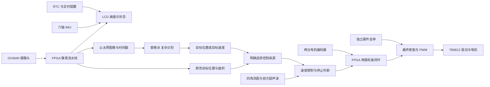
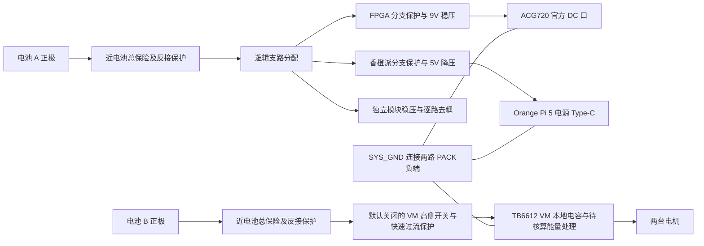
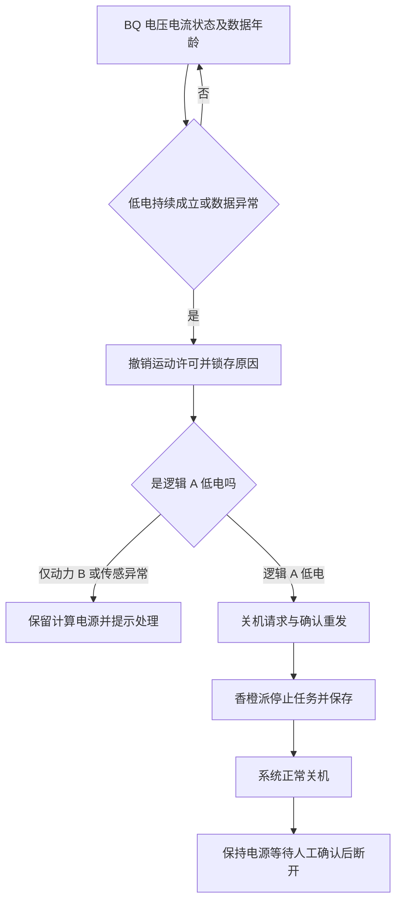
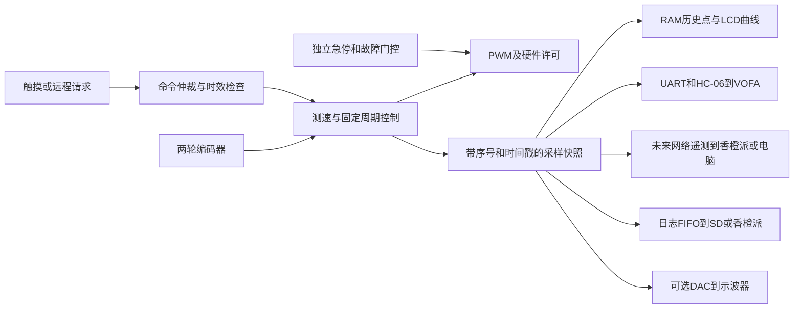

# FPGA 小车扩展板与功能规划

更新：2026-10-07。目标为小梅哥 ACG720 / GW5AT-60B 的同一小车工程。保留此前原理图、管脚表和 CST 核对结果；按用户新提供的 TOF SHUT、IMU SA0 等模块引脚信息，将总线候选调整为 **IMU＋四路 TOF 共用传感器 I²C，旧电量计方案为BQ A/B分别独立**。2026-10-06用户考虑BQ4050，随后确认两块3S电池都只有正负两线：BQ4050不能直接用于现有电池；第22节记录当时INA3221测两包电压/电流的候选；2026-10-07用户已重新决定采用BQ34Z100-G1做专用SOC，两包各一颗，14脚接法见第23节。选型已决定，外围器件、通信接地方案与原理图仍待核对。

同日补充 HC-06 蓝牙调参、LCD 实时速度曲线、RAM/SD 日志回放及局域网通信方案，见第 18 节。HC-06 复用原调试 UART 的两根 GPIO，不改变传感器共享总线或视频链路。

**当前BQ画图依据：第24节及同名PNG/SVG已改为“BAT−侧参考＋本路常供电LDO＋I²C直连FPGA”，不使用ISO1640。**此前由参考地不同推导出必须隔离的判断过于保守，修正依据见第26节。两地仅通过分流电阻相连，直连总线仍需满足压降与逻辑门限条件，不额外短接BAT−/PACK−。

**扩展板电路与引脚仍为候选方案。2026-10-06用户已开始自己设计转接板PCB，助手尚未读取/审核其EDA工程，本仓库没有交付的PCB/Gerber。**用户已授权第19节临时接线与驱动，并上板读到IMU六轴、真实超声距离及蓝牙P指令确认，最新实测见19.7节。9→10回接已通过，不再重复排查；用户说接线定义未改，疑似原杜邦线损坏/接触问题，未用表确认具体故障。电脑COM3/4仍未连接成功，手机助手链路可用于演示，不作为硬件测试前置条件。TOF六针包含SHUT，可逐个启动改地址；电平、模块内部连接及实物方向仍待核实。宿舍没有万用表，临时测试未完成电压实测；完整电源/电机/BQ仍需第16节核验。

R4 的相机/LCD/UDP 已由用户上板验证，最初排线接反的问题已解决；R5源码已有1～4倍缩放，用户已烧录过程序但具体版本/缩放结果未完整记录，不能仅凭现有 `.fs` 推断验证状态。队友提供了YOLOv8n玩偶狗权重，香橙派已运行dog＋YuNet human组合检测，仍有杂物/人物误报与角度变化问题；训练由队友继续负责。第19节新增临时传感器和蓝牙链路，当前超声仍待验证；不替用户编译或仿真FPGA，不开始画扩展板。

## 0. 产品方向：陪伴学习助手

产品方向是“能在平地跟随、在桌边陪伴学习的小车”。先服务学生，也可用于成人听力练习。物品存放/搬运功能暂不作为主线；云台留到下一阶段，不为目前的演示增加机械负担。

第一版先做摄像头人脸/玩偶检测、双击选目标与取消、学习/休息计时、可关闭的离座提醒。联网拍题答疑、语音讲解、SD 卡听力播放放在后续阶段。这里是方案，不表示这些功能已经完成。

| 功能 | 分工 | 目前状态与实现边界 |
| --- | --- | --- |
| 实时画面与触摸 | FPGA 相机采集、图像流水线、DDR/LCD；GT911 提供触点 | R4 已上板；此前 R5 已改缩放源码，等待用户编译和上板 |
| 人脸/玩偶框与选中目标 | 香橙派运行 YuNet＋YOLOv5n，再做检测关联和跟踪 | 模型接入、真正跟踪、框回传 LCD 均待编写；目前橙色 ROI 只是选点请求 |
| 跟随与避障 | 香橙派提供目标位置；FPGA 独立读取编码器、测距并控制速度，最终受急停/超时约束 | 扩展板与引脚分配先完成，再逐个传感器、架空电机测试 |
| 学习计时 | FPGA 做稳定计时与本地提示；香橙派管理学习计划、记录和语音 | 待实现。没有网络也应能暂停、结束，不随意开动小车 |
| 离座/朝向变化提醒 | 香橙派根据检测结果和用户设置判断可观察的事件 | 不把看不到脸或转头直接叫“分心”。读书、思考、遮挡都可能造成同样现象 |
| 拍题与讲解 | 香橙派 OCR/联网问答/语音；FPGA 提供清晰快照和显示通路 | 400×240 预览不能保证读清整页题目；需额外设计较高分辨率快照传输 |
| 听力播放 | 可先由香橙派读取合法获得的音频并播放；若要由 FPGA 读 SD，需要实现文件系统与音频接口 | SD 卡插槽本身不等于已有播放器；扬声器要经功放，不能直接接 FPGA 引脚 |
| 低电关机 | FPGA 测电压/电流、显示低电与通知；香橙派保存状态后正常关机 | 硬件/后台服务待实现；不会把网络收到通知当成系统已安全关机 |

学习助手的大部分语义和知识功能都在香橙派或云端；不能说换成这个用途以后，FPGA 就自动比 STM32 更有优势。FPGA 的研究重点仍是像素流与多任务同时运行时的固定延迟、独立控制和故障情况下的行为。用下面第 2 节的实测来说明作用，再决定哪些额外外设值得加入。

### 此前 R5 缩放设计与下一步显示交互

R5 沿用同一个 `vision_robot_ui.gprj`。正常模式下，双指拉开/收拢围绕两指中点缩放，两指一起移动可平移；ZOOM IN MODE 下，双击画面指定原图中心；2026-10-06按用户要求移除LCD的`+`/`−`及其他多余按钮，倍率继续用双指手势调整，见第21节。视觉调试的双击选目标只在缩放选点模式关闭时生效。倍率范围先为 1～4×，以 Q8 逆比例提供 193 个细分步长，不是只切换 1×/2×，也不是无限倍率或光学变焦。

为了不牺牲 RGB565 颜色和源图采样品质，显示使用两个完整 800 像素行缓存，调整 DDR 的读取起始行，并在每个 LCD 帧边界锁存裁剪位置与步长。摄像头写入、DDR PHY/PLL、网络全画面保持原链路。数字放大不会创造新细节；网络图像仍是 400×240。R5 尚未编译、仿真或上板，现有位流不是自动更新后的 R5。

以后香橙派返回 `dog`/`human` 框时，必须携带类别、源图坐标、时效与跟踪状态；FPGA 使用与画面相同的裁剪变换叠加框。要真正显示讲解的中文文字，还需要字库或香橙派渲染后的图层传输，现有英文点阵 UI 不会自动做到。

### 摄像头对焦暂按手动 V5 处理

用户已确认模组版本 V5。配套目录的版本说明文件名指出“V5 的自动对焦和补光灯没有硬件支持”，但同目录用户手册介绍仍写支持自动对焦，资料存在冲突。当前按用户实际可手动旋拧的镜头使用，暂不加入自动对焦驱动，也不仅凭 OV5640 芯片支持就断言该模组带电动镜头。

软件自动对焦需要镜头执行机构，例如 VCM；OV5640 的自动对焦方案还涉及固件和控制命令。[OV5640 应用说明](https://www.arducam.com/downloads/modules/OV5640/OV5640_Software_app_note_parallel.pdf) 写明了这条控制链路。现阶段先在实际人物/玩偶的常用距离调清楚并固定镜头。如果以后换带电动调焦的 DVP 模组，先确认供电、接口和控制方法，再做驱动。

拧动螺纹镜头主要调整对焦距离；数字放大改变显示裁剪。二者不能互相替代。FPGA 以后可对选区计算清晰度作为手动调焦提示或电动对焦反馈，但不能让没有执行机构的镜头自行移动。

## 1. 先说清楚：为什么使用 FPGA

如果目标只是“摄像头识别人，香橙派算结果，下位机驱动两台电机”，香橙派直接连接摄像头和屏幕、配合 STM32，完全是合理方案。不能把绕经 FPGA 的显示、网口转发或多接几个传感器本身当成优势。STM32 也有硬件 PWM、编码器计数和定时器，见 [ST 定时器文档](https://wiki.st.com/stm32mpu/wiki/TIM_internal_peripheral)。

比赛要求以 FPGA 为主体，这决定了我们要研究 FPGA 能承担什么，并不证明它一定是这类消费产品的成本最优解。要区分“适合研究和比赛”“系统中确有作用”和“市场上最划算”。闹钟、音箱和更多接口可以增加实用性，不能代替性能证据。

在学习助手用途下，建议把 FPGA 技术主线定为：**图像流水处理与独立移动控制，香橙派增加目标识别和学习交互。**简单颜色定位可作为独立演示或调试模块，不作为人脸/玩偶神经网络的替代。先做出可测量的硬件处理路径，再评价是否值得采用。

| 候选能力 | FPGA 具体做什么 | 实际用途与限制 |
| --- | --- | --- |
| 简单目标定位 | 对摄像头像素做颜色分割，统计目标区域、面积、中心位置 | 可跟随颜色标记、定位红色目标；不能把“红色区域”称作“识别了水瓶”，也不能保证在杂乱背景中正确选中目标 |
| 独立跟随闭环 | 目标水平偏差产生转向意图，前方测距限制速度，两路编码器反馈轮速 | 在不依赖香橙派视觉推理的模式下运行；目标丢失、数据过期时停止，而不是盲走 |
| 并行执行 | 像素处理、编码器计数、各传感器接口、PWM、LCD、网络各自运行 | 是否在视频/网络满负载时仍保持控制周期，需要实测；不是 MCU 不能并行，也不是零延迟 |
| 图像与传感器时间对应 | 给帧、距离、轮速打统一时间戳，记录数据有效性 | 帮助判断目标画面和障碍物距离是不是同一时刻附近的数据；传感器内部测量周期仍由模块决定 |
| 输出仲裁 | 识别结果不能直接绕过急停、测距异常和速度上限驱动电机 | 与独立硬件禁能结合，提高失联时行为的可预测性；这也是 MCU 可做的功能，不单独作为 FPGA 独有优势 |

现有高斯滤波是实际像素流水线，可以继续复用。但为了检测效果而不断叠加滤波不一定有益：用于 AI 的彩色图像和用于硬件颜色定位/调试的分支应明确区分，并记录处理配置。颜色阈值应在实拍光照下标定。

800×480、30 帧/秒的 RGB565 有效图像数据为 23.04 MB/s；400×240、30 帧/秒为 5.76 MB/s，未计空白和协议开销。这是计算示例，不是当前所有链路的实测吞吐。逐像素流水线是 FPGA 值得研究的部分，数值不能证明它已经超过香橙派或某款 STM32。

建议系统关系如下（Typora 可开启 Mermaid 渲染）：



硬件颜色模式只在明确选择并启动后运行。香橙派模式下，指令超时就停止；不能因网络断开而自动切换到另一个运动来源。切换模式、释放急停和重新上电都应重新确认启动。

## 2. 如何证明价值，避免自欺欺人

先给出测试条件和结果，再写性能结论。建议记录以下项目：

| 测试 | 要记录什么 | 能说明什么 |
| --- | --- | --- |
| 颜色定位路径 | 从曝光/帧到坐标输出的时序、帧率、错误选中情况 | FPGA 是否真正承担定位计算。逐帧面积/中心统计通常要等帧结束，不能声称微秒级完整识别 |
| 控制周期 | 例如以 1 kHz 作为初始设计目标，记录轮速控制更新间隔和抖动 | 固定周期控制是否实现；1 kHz 不保证机械系统有相同响应速度，参数需实测调节 |
| 并发负载 | 视频+网口打开/关闭时的编码器丢计数、控制周期、轮速误差 | 这些硬件模块运行是否受到图像负载影响 |
| 停止行为 | 有效障碍事件/指令超时到 PWM 与使能变化，以及车轮实际停下的时间 | 数字输出停止与机械刹停是两种指标；传感器采样周期、惯性、驱动状态都影响后者 |
| 对照方案 | 同摄像头、同算法、同分辨率、同功耗/成本统计方法 | 若要宣称优于香橙派或 STM32，必须有可比实测；只展示本方案不够 |

目前没有上述对照数据，所以只可描述设计和已实现的功能。即使测试后发现 MCU 同样能胜任，也应如实报告。项目仍可以展示硬件流水线、资源开销和可预测控制，但不夸大性价比。

## 3. 40＋4＋8＋16 不是 68 个数字 GPIO

依据官方《ACG720-138&60K通用原理图》第 1、3、7、8、11、12、15 页，以及《高云 ACG720-138&60K通用管脚分配表.xlsx》Sheet1 GPIO0 的 A219:F254。接插件总脚数包含电源、地、模拟信号和未连接脚。

| 接口 | 实际信号 | 扩展板处理 |
| --- | --- | --- |
| P7，40 针 | 36 个 GPIO、5V、3V3、两个 GND | 作为主要数字接口，36 根信号全部保留直通/测试点 |
| P3，4 针 | 两路 DAC 模拟输出、两个 AGND | 单独标为模拟输出，不接数字传感器或电机 |
| P5，16 针 | 八路 ADC 模拟输入、八个 AGND | 每路按“模拟输入＋AGND”分组；需要分压/放大/保护的前端另画 |
| P8，8 针 | USER0/1/2、5V、3V3、两个 GND、一根未标功能脚 | 可预留连接器，不将未知脚计入本期可用 IO |
| P6，8 针 | GPIO Bank 的 VCCIO 电压选择跳帽 | 保留选择功能，不当传感器接插件 |

P8 按原理图为：1=5V，2=GND，3=USER0，4=USER2，5=USER1，6=未标功能，7=3V3，8=GND。USER2 可见 H20；USER0/1 的 FPGA 端映射尚未可靠核实，本期不使用。第 6 脚不是可随意分配的 IO。

**纠正旧说明：本版官方资料中，P7 GPIO0 在 BANK2，HDMI 在 BANK7，球位没有重叠。此前“GPIO0 与 HDMI 共用”的说法没有依据，应撤回。**同时使用时仍要计算时钟、逻辑资源和视频带宽，但不存在已发现的这两组球位冲突。

GPIO0 的电压不是固定 3.3V：BANK2 的 VCCO_2 接 VCCIO，P6 可选 3.3/2.5/1.8/1.5V。按图 P6 的 7—8 跳帽选择 3.3V；实物 Pin1 方向、板卡修订和跳帽位置还需确认，并用万用表核对 TP5。软件设置 LVCMOS33 不会把错误的硬件供电自动变成 3.3V。

## 4. P7 候选分配：传感器共用 I²C，BQ 两路独立

**球位映射已经核对，功能分配仍是电路方案，没有写入 CST 或 RTL，也没有实物接线验证。**主工程 `vision_robot_ui.gprj` 指向 `src/lcd_interaction.cst`。本轮从官方 XLSX 的 Sheet1!A219:F254 读出 36 个互不重复的 GPIO 球位，与当前 CST 的 115 个已用球位比较，交集为 0；并目视检查原理图第 2、3、11、12 页。LCD、GT911、摄像头、DDR 和网口约束保留。

此前资料未证明 SHUT 引出，所以先用四条独立 TOF 总线避开同地址问题；这是保守的设计选择，不是 FPGA 必须如此。2026-10-05 用户给出 TOF 的 VIN/GND/SDA/SCL/INT/SHUT 和 IMU 的 VCC/GND/SDA/SCL/INT/SA0，现将候选简化为**传感器一条共用 I²C＋BQ A/B 各一条，共三组逻辑总线**。

四个 TOF 上电均为 0x29，需要分别控制 SHUT，逐个改为七位 0x30/0x31/0x32/0x33；IMU 按 SA0 状态选择 0x6A 或 0x6B，与它们不冲突。总线一次服务一个事务，测量可在器件内部进行，不因共享就要求四个测距过程都串行等待。线长、等效上拉、总线占用和故障恢复仍需实测；共享线路被某块拖低时，IMU/TOF 都会受影响，必须超时、数据失效和停车处理。

| 功能 | 当前候选占用的 GPIO 数 |
| --- | ---: |
| IMU＋四个 TOF 共用 SCL/SDA | 2 |
| 四路 TOF 独立 SHUT 控制 | 4 |
| IMU INT | 1 |
| BQ A、BQ B 各一组 SCL/SDA | 4 |
| 超声波 TRIG/ECHO | 2 |
| TB6612 四路方向、两路 PWM、MOTOR_REQ | 7 |
| 两台电机编码器 A/B | 4 |
| SAFE_OK 反馈、外部看门狗心跳 | 2 |
| 调试/HC-06 复用 UART TX/RX | 2 |
| 基础合计 | **28，剩余 8** |
| 两路舵机控制预留 | **再占 2，共 30，剩余 6（P7 13/14/33/34/36/37）** |

目前云台接口仅预留，不接功率负载。两路舵机占 2 根，或者两个 STEP/DIR/EN 步进轴占 6 根，二选一；选择两步进轴后基础共 34 根、剩 13/14 两根。TOF 的四路 INT 暂留连接器/本地测试点、不占 FPGA；以后若四路中断全接入，需要再占 4 根并重算云台/备用。P7 13/14 保留改回独立 IMU 总线的可能；共享接法与独立接法通过装配选项二选一，不同时焊通不同控制器输出。不为用满引脚提前选定云台。

TB6612 没有可假定的 FAULT 引脚。SAFE_OK 来自扩展板硬件门控/锁存电路；BQ 的 ALERT 本期仅留本地测试点，未分配 FPGA 脚，不能再照旧表占用 P7 38/39。未来限位或 ALERT 需要使用备用脚并重算。完整信号直通到标号测试点，预留断开电阻/焊桥供迭代，同一根 IO 的两个连接器不是两个 IO。

表中方向均从 FPGA 看。SCL/SDA 只拉低或释放，不能推挽输出高电平；BQ为两组独立原生I²C，按第24/26节条件直连，上拉SYS_3V3，BAT−采样地不通过信号接头接系统地。P7 上的电源脚不是新增电源输入，也不能承担电机/舵机电流。

| P7 脚 | GPIO0 | 60K 球位 | 建议用途 | 电气方向和默认状态要求 |
| ---: | ---: | --- | --- | --- |
| 1 | 0 | A13 | SENSOR_SCL，IMU＋四个 TOF 共用 | 双向/开漏；未启动时释放，适配后上拉 |
| 2 | 1 | A14 | SENSOR_SDA，IMU＋四个 TOF 共用 | 双向/开漏；未启动时释放，适配后上拉 |
| 3 | 2 | A15 | TOF 1 SHUT 控制 | 输出到适配电路；未配置/复位时默认关断模块 |
| 4 | 3 | A16 | TOF 2 SHUT 控制 | 输出到适配电路；未配置/复位时默认关断模块 |
| 5 | 4 | A18 | TOF 3 SHUT 控制 | 输出到适配电路；未配置/复位时默认关断模块 |
| 6 | 5 | A19 | TOF 4 SHUT 控制 | 输出到适配电路；未配置/复位时默认关断模块 |
| 7 | 6 | F13 | BQ A SCL，独立原生I²C条件直连 | 双向/开漏；释放，上拉SYS_3V3，核对地差/门限 |
| 8 | 7 | F14 | BQ A SDA，独立原生I²C条件直连 | 双向/开漏；释放，上拉SYS_3V3，核对地差/门限 |
| 9 | 8 | E13 | 超声波 TRIG | 输出；外部下拉，未配置/复位为禁止或低 |
| 10 | 9 | E14 | 超声波 ECHO，电平待确认 | 输入；外部电平适配，不主动驱动 |
| 11 | — | — | 板载 5V，不能当信号脚 | 电源/地，禁止作为 GPIO |
| 12 | — | — | GND | 电源/地，禁止作为 GPIO |
| 13 | 10 | C13 | 备用；可选独立 IMU SCL | 默认不连接；独立 IMU 选配时开漏/上拉 |
| 14 | 11 | B13 | 备用；可选独立 IMU SDA | 默认不连接；独立 IMU 选配时开漏/上拉 |
| 15 | 12 | D14 | IMU 模块 INT，INT1/INT2 对应待核实 | 输入；外部电平适配，不主动驱动 |
| 16 | 13 | D15 | TB6612 AIN1 | 输出；外部下拉，未配置/复位为禁止或低 |
| 17 | 14 | C14 | TB6612 AIN2 | 输出；外部下拉，未配置/复位为禁止或低 |
| 18 | 15 | C15 | TB6612 PWMA | 输出；外部下拉，未配置/复位为禁止或低 |
| 19 | 16 | B15 | TB6612 BIN1 | 输出；外部下拉，未配置/复位为禁止或低 |
| 20 | 17 | B16 | TB6612 BIN2 | 输出；外部下拉，未配置/复位为禁止或低 |
| 21 | 18 | D17 | TB6612 PWMB | 输出；外部下拉，未配置/复位为禁止或低 |
| 22 | 19 | C17 | MOTOR_REQ，进入硬件许可门控，不能直连 STBY | 输出；外部下拉，未配置/复位为禁止或低 |
| 23 | 20 | E16 | 左轮编码器 A | 输入；外部电平适配，不主动驱动 |
| 24 | 21 | D16 | 左轮编码器 B | 输入；外部电平适配，不主动驱动 |
| 25 | 22 | B17 | 右轮编码器 A | 输入；外部电平适配，不主动驱动 |
| 26 | 23 | B18 | 右轮编码器 B | 输入；外部电平适配，不主动驱动 |
| 27 | 24 | C18 | SAFE_OK，硬件许可/故障锁存状态反馈 | 输入；外部电平适配，SAFE_OK 缺失按禁止处理 |
| 28 | 25 | C19 | 调试/HC-06 FPGA_TX，接模块 RX | 输出；空闲高，3.3V 逻辑；不与电源脚混接 |
| 29 | — | — | 板载 3V3，不能当信号脚 | 电源/地，禁止作为 GPIO |
| 30 | — | — | GND | 电源/地，禁止作为 GPIO |
| 31 | 26 | F16 | 调试/HC-06 FPGA_RX，接模块 TX | 输入；电平待核实；蓝牙和 USB TX 选择其一 |
| 32 | 27 | E17 | 云台 1 舵机 PWM；或轴 1 STEP | 输出；外部下拉，未配置/复位为禁止或低 |
| 33 | 28 | D20 | 备用；选择轴 1 步进时为 DIR | 默认不连接；DIR 启用时外部电阻确定方向 |
| 34 | 29 | C20 | 备用；选择轴 1 步进时为 EN | 默认不连接；EN 启用时外部电阻设为禁止态 |
| 35 | 30 | E19 | 云台 2 舵机 PWM；或轴 2 STEP，二选一 | 输出；外部下拉，未配置/复位为禁止或低 |
| 36 | 31 | D19 | 备用；选择轴 2 步进时为 DIR | 默认不连接；DIR 启用时外部电阻确定方向 |
| 37 | 32 | F18 | 备用；选择轴 2 步进时为 EN | 默认不连接；EN 启用时外部电阻设为禁止态 |
| 38 | 33 | E18 | BQ B SCL，独立原生I²C条件直连 | 双向/开漏；释放，上拉SYS_3V3，核对地差/门限 |
| 39 | 34 | F19 | BQ B SDA，独立原生I²C条件直连 | 双向/开漏；释放，上拉SYS_3V3，核对地差/门限 |
| 40 | 35 | F20 | CTRL_HEARTBEAT，外部硬件看门狗输入 | 输出；外部下拉，未配置/复位为禁止或低 |

原理图的 P7 为 20×2 排针，奇数/偶数是相邻两列，不是先数完一整列。图纸中 11=5V、12=GND、29=3V3、30=GND 已核实；插头看接触面还是焊接面会造成镜像，必须以实物 Pin1 标识和断电通断检查确认。36 个球位都属于实际 P7 引出，不能从芯片空余球位任意添加排针信号。

硬件电平优先 3.3V，P6 的 7—8 在图纸中选择 3.3V，TP5 是 VCCIO 测点。它控制 BANK2，包括该 Bank 的其他板载脚；断电确认跳帽和修订版，再测 TP5。`LVCMOS33` 约束不会改变跳帽电压。未完成这些检查前，本表不是可直接通电的接线表。选配步进后 EN 的有效电平须按驱动模块重新确定；备用脚不是随意默认拉高的信号。

## 5. 连接器分组：完整引出，电源和地写清楚

保留已有 TB6612 模块，扩展板承担接插件、电平适配、电源分配和独立禁能。下面给出**扩展板侧候选针号**，不是客服模块排针顺序；模块侧必须按实际丝印/导通关系做转接。每个连接器标 Pin1、信号、供电电压及允许电流；动力和信号口采用不能误插的不同外形。

| 连接器 | 候选 Pin1 → 最后一针 | 对应 P7 / 注意事项 |
| --- | --- | --- |
| J_TOF1～4，各 6Pin | 1=VIN/V_TOFn，2=SYS_GND，3=SDA，4=SCL，5=INT，6=SHUT | SDA/SCL 共用 P7 2/1；四个 SHUT 经适配分别接 3/4/5/6；INT 留本地测点、本期不接 FPGA；供电禁止默认 5V |
| J_IMU，6Pin | 1=VCC/V_IMU，2=SYS_GND，3=SDA，4=SCL，5=INT，6=SA0 | SDA/SCL 共用 P7 2/1，INT 接 15；SA0 在适配处选 0x6A/0x6B 的固定状态，不占 FPGA；CS 未引出，核对模块 I²C 硬件设置 |
| J_US，4Pin | 1=V_US，2=TRIG，3=ECHO，4=SYS_GND | 9/10；此顺序与 CS100A 文档四针定义一致，仍须确认实物观察方向；V_US 拟 3.3V |
| J_ENC_L/R，各 4Pin | 1=V_ENC，2=SYS_GND，3=A，4=B | 23/24、25/26；拟 3.3V，供电/输出需确认；电机两根功率线单独走 |
| J_TB_A/B，各 6Pin 或模块座 | 1=3V3_LOGIC，2=SYS_GND，3=IN1，4=IN2，5=PWM，6=STBY_HW | 16/17/18、19/20/21；第 6 针两路共用门控后的 STBY，不能各接主动输出；22 只送门控 |
| J_BQ_A/B 系统侧，各 4Pin | 1=3V3_SYS，2=SYS_GND，3=SCL，4=SDA | 7/8、38/39；3V3只供总线上拉，SYS_GND接PACK−，**不是BQ本地供电/地，不接BQ_GND** |
| J_SERVO1/2，各 3Pin | 1=SYS_GND，2=V_SERVO，3=PWM | 32、35；独立受保护稳压支路供 V_SERVO，预留默认断电负载开关，核对舵机信号门限 |
| J_PAN1/2，各 6Pin 候选 | 1=驱动逻辑供电，2=SYS_GND，3=STEP，4=DIR，5=EN，6=限位预留 | 与舵机二选一；两轴信号候选 32/33/34、35/36/37；第 6 针本期 NC |
| J_DBG，4Pin | 1=SYS_GND，2=FPGA_TX，3=FPGA_RX，4=NC | 28/31；外部 USB 串口 VCC 不接，核对 3.3V 电平 |
| J_BT，HC-06 4Pin | 1=5V_LOGIC，2=SYS_GND，3=BT_RX，4=BT_TX | BT_RX 经适配接 FPGA_TX=P7 28；BT_TX 经适配接 FPGA_RX=P7 31；与 J_DBG 接收输入作选择连接，不能把两个 TX 输出短接 |
| J_ESTOP，4Pin 候选 | 1=低压许可电源，2=NC 触点回线，3/4=辅助触点反馈预留 | 主 NC 回路直接控制硬件锁存；P7 27 接 SAFE_OK，不能把此四针当 VM 急停大电流线 |
| J_WD，本地 4Pin/测试点 | 3V3_SYS、SYS_GND、CTRL_HEARTBEAT、SAFE_OK | 40、27；看门狗/门控留在扩展板上，线断或心跳停即禁止 |
| J_SPARE1～3，各 4Pin | SYS_GND、3V3_LOGIC、备用信号两根 | 分别 13/14、33/34、36/37；选配独立 IMU/步进后相应组不再空闲 |
| P5 模拟输入转接 | 八组“Analog_Inn＋原板 AGND”，可组合四组 4Pin | 0～3.3V 输入域，另加核算后的前端；不拿原板 AGND 作电机回流 |
| P3 模拟输出转接，4Pin | 原板两路 DAC 输出＋对应 AGND | 逐针复制原理图连接，不能当 GPIO 或功率输出 |
| P8 预留转接 | 按原板八针定义保留并标识未知脚 | 本期不作为 GPIO 预算；P6 仍为电压跳帽，不转作模块口 |

IMU/TOF 接口按用户列出的六针信号调整：IMU 第六个信号为 SA0，不再虚构第二路 INT；TOF 第五/六信号为 INT/SHUT。这里只确定候选接口定义，用户给出的顺序还须与实物观察方向/Pin1 对照，不能据此保证连接器不镜像。SA0 是地址选择脚，应按 VDDIO 电平和模块自带电阻确定固定状态，不悬空，也不直接接未知的 VIN。INT 只是事件通知，不是 SDA/SCL；TOF 本期轮询无需接 INT，IMU 单个 INT 对应芯片 INT1 还是 INT2 仍待核实。

HC-06 按用户已用过的 5V 供电、115200 波特率安排，不擅自改成默认波特率或重发 AT 配置。5V 来自受保护的逻辑支路，近模块预留去耦；供电电压不等于 UART 电平，核对实际底板 TX 输出及 RX 门限，再装配 3.3V 直通/输入缓冲。蓝牙天线朝板边，按模块要求留净空、避开电机/电源和金属遮挡。J_BT/J_DBG 候选针号是扩展板定义，模块侧按实物丝印转接。

BQ采样区域保留各自BAT−低电流参考地，SDA/SCL由系统侧上拉后条件直连，不再使用隔离器。独立采样组件的4Pin中SYS_GND只接PACK−，不能接BAT−。电池/负载另走额定电流合适的动力端子，BAT− 采样地不经过这个 4Pin 接到 SYS_GND。BQ 的 NTC 每块留 2Pin，ALERT、REGIN、REG25、BAT、SRP/SRN 留本地测点。

每路模块电源预留可断开的供电焊桥/受控负载开关及本地去耦，便于排查单模块，避免模块断电后仍被 SDA/SCL/INT 反向供电。确认模块稳压器、上拉和供电后，选择带掉电保护的适配器；0Ω 直通仅在电平已确认时装配。P7 的板载 5V/3V3 与扩展板自己的稳压输出不能直接并联，用单一供电源或经过验证的电源选择电路。

## 6. 开关、LED、按键和 LCD 怎么发挥作用

不要做“每个开关对应一种随意效果”的功能拼盘，围绕测试、模式和故障解释来用。这些板载资源使用自身的固定连接，不需要占用 P7 的新传感器信号。

| 板载资源 | 建议用途 |
| --- | --- |
| SW0 | 允许运动开关，关闭则禁止运动；不是替代硬件急停 |
| SW1 | FPGA 简单视觉模式 / 香橙派识别模式；切换后重新确认启动 |
| SW2～SW3 | 调试预览选择：原图、灰度、高斯、边缘。AI 发送分支配置需单独记录，不能随意跟着预览改变 |
| SW4 | 图像标记/传感器数值叠加 |
| SW5 | 台架低速限制模式 |
| SW6 | 事件/时序记录开关 |
| SW7 | 定时提醒开关；不设置“关闭安全保护”的开关 |
| S0 | 保留当前全局复位功能 |
| S4 | 保留当前高斯切换功能；之后若改变，应更新 UI、说明和数据配置 |
| S1～S3 | 后续开始/暂停、菜单确认、取消/提醒消音，长短按去抖；具体映射待界面确定 |
| D0～D7 | 后续显示心跳、相机、DDR、通信数据有效、测距有效、轮速控制、目标有效、停止/故障 |

上述是规划，当前 R4 的 LED 诊断含义仍以源码为准，不能假设已经改好。当前 PHY 初始化完成不等于网络已连通，目标被双击也不等于跟踪算法已经接入。

LCD 保持四块不重叠区域：摄像头/目标标记；四角和前方距离；左右目标与实测轮速；模式、数据年龄、停止原因。增加一页“硬件处理调试”，显示原图/分割结果、目标像素数、坐标和流水线状态，比只写“已高斯滤波”更便于验证。

## 7. 闹钟、音箱、SD 和两路 HDMI

### 7.1 闹钟可以做，而且已有适合的硬件

官方原理图第 9 页有两组四位数码管，即**八位数字**，不是只能显示两位。通过两个 74HC595 驱动，FPGA 信号为 SEG7_DIO=M18、SEG7_RCLK=C2、SEG7_SCLK=F4。

同页有 BM8563T RTC 和 CR1220 电池位。教程第 34 章名为《基于I2C接口的PCF8563数字时钟显示》，可以参考读时间、校时、显示逻辑，但实际芯片/寄存器先核对。RTC 的 INT/CLKOUT 没有接 FPGA，时间和报警状态需要轮询；掉电保持取决于实际电池。RTC、EEPROM 和音频配置共用板载 I²C（M13/M16），后续驱动不能各自同时占用总线。

板载无源蜂鸣器 BEEP=N19，已有晶体管驱动。最小功能可以是“时钟/番茄钟＋数码管＋蜂鸣提醒”，无需先买扬声器。官方第 13、19/20、34 章分别提供数码管、蜂鸣器、时钟参考。此功能可先独立验证再整合，其中RTC时钟与数码管已在2026-10-06写入同一主工程源码，待用户编译/上板，见第20节；番茄钟和蜂鸣提醒仍未实现。声音提醒时小车默认停着，不设计无人确认就追着睡觉的人移动。

### 7.2 会移动的小音箱可做，但需要声音输出设备

原理图第 14 页是 ES8388：蓝色 IN 为线路输入，绿色 OUT 为模拟音频输出，没有独立扬声器功放。MIC1 是两针接口，不代表已经有麦克风。

你已买的 **2828、4Ω/2W 裸扬声器可以先保留**，做提示音不需要急着换。接法是“ES8388 绿色 OUT → 功放模块输入 → 扬声器”，不能直接接 GPIO，也不建议直接挂在板卡音频输出上。可选带音量调节的 PAM8403 模块；它在 5V、4Ω、10% 失真条件下可输出 3W，所以不能对 2W 喇叭满音量长期播放，需要限制音量/输出功率。功放供电单独核算。PAM8403 是桥接输出，喇叭接同一声道的 `L+ / L-` 或 `R+ / R-`，两端都不能接 GND，也不能把左右声道输出并联。参考 [PAM8403 原厂手册](https://www.diodes.com/datasheet/download/PAM8403.pdf)。

最实用的声音内容是倒计时结束、靠近障碍、目标丢失和低电量提醒。语音合成/语义识别可由香橙派承担，FPGA 做定时播放、音量/混音或简单音频处理，但这些需要音频传输和 ES8388 配置。复杂语义任务不能因为加了音频口就自动成为 FPGA 功能。

### 7.3 SD 是 microSD/TF，需要驱动和文件系统

第 15 页 J8 是 microSD 插座。未来可放提示音、字体、配置和日志；插卡本身不会自动支持 MP3 或录像。先考虑 PCM/WAV 提示音，比在 FPGA 上新增 MP3 解码省工。日志第一版直接发到香橙派存储，后续再实现 SD 写入。

用户提出板上速度曲线回放，现按第 18 节先做 RAM 短时记录，再做 SD 长日志。可先使用板载 J8，无需为了此功能新增扩展板卡座；SD 驱动/文件系统尚未实现。

### 7.4 HDMI 保留为大屏调试输出，不是通用传感器接口

本地当前工程未使用 HDMI；后续可先把它作为显示器、投影仪或采集卡的视频输出。接口有 ESD、电源开关和 DDC 适配。[高云官方板卡说明](https://www.gowinsemi.com.cn/university/board/17)称双路支持输入/输出；没有独立 HDMI 接收芯片不能据此断言 FPGA 不能接收。具体接收仍需匹配 FPGA 收发实现、时钟、约束及接口电路，本次没有验证或实现。本项目不用改屏，也不通过 HDMI 插座接激光、电机等普通模块。

软件可复用已有像素生成逻辑，但仍要加 TMDS、时钟、串化和正确约束。以后比赛展示时可在借来的大屏上显示处理对比和传感器调试页。两口都空着没有问题，不需要为了“用满板子”购买两块屏。

### 7.5 ADC 可以服务电池和电机状态，而非硬加示波器

第 15 页 ADC128S102 的模拟供电为 3.3V，因此按图正常输入为 0～3.3V；八通道是轮询复用转换，不是八路同时采样。若以后加入电池电压分压、电流传感器/采样放大和必要保护，可检测低电量、过载与堵转征兆。需要模拟前端和实测阈值，不能直接接电池或电机端。第一版先预留模拟接口，待运动稳定再决定是否值得实现。

## 8. 当前用途与推进顺序

定位沿用第 0 节的“智能陪伴学习助手”：计划在可测试的室内区域跟随、保持距离，用户停下时停车；提供番茄钟、听力播放，后续探索拍题/语音讲解。当前真正的识别、目标跟踪和电机跟随尚未接入，不把 UI 选择框称作识别结果。

前提是机械稳定性、跟踪可靠性、避障盲区、距离和停止行为经过验证。四角单点测距不能据此承诺任意室内自主导航；看不到脸也不能直接判断用户分心。

原有功能设想的优先级（当前视觉训练由队友负责，暂不执行训练或部署）：

1. 现在：审核并冻结电路、接插件和引脚；再开始画板或写驱动，保留已通过的图像链路。
2. 硬件验证：逐个传感器、独立急停、架空电机/编码器，之后才做低速闭环；先证明不会误启动。
3. 视觉反馈：等待队友权重与测试结果，接入 human/dog 检测、双击跟踪/取消及显示回传。
4. 移动跟随：视觉反馈和硬件保护分别验收后，联合测试目标丢失、测距失效、失联与停车距离。
5. 学习功能与后续：计时/听力播放，再按需要考虑云台、拍题/语音、SD 和 HDMI 调试。

验收时应优先展示真实已跑通链路和可验证模块，不承诺几天内补齐所有扩展。没有接通电机时就展示定位坐标、传感器数值和停机使能，不把这些称作已完成移动跟随。

## 9. GitHub 工程：可以学习什么，不能直接照搬什么

已阅读一手仓库说明，下面是参考，不是已经在 ACG720 验证的工程。优先复用本地官方教程的当前板卡驱动；第三方工程的球位、PLL 和 RAM IP 不能直接拿来烧录。

| 工程 | 可借鉴的实际内容 | 移植注意 |
| --- | --- | --- |
| [RT216/fpga-pid_motor](https://github.com/RT216/fpga-pid_motor) | Tang Primer 25K 四路编码器测速、PWM、UART 目标转速、PID | 用高云 3p3z IP，原驱动为 AT8236，需改为实际 TB6612 控制和禁能逻辑；适合研究控制结构 |
| [delhatch/Red_Tracker](https://github.com/delhatch/Red_Tracker) | FPGA 检测红色区域，找最大区域中心并显示十字线 | Cyclone IV＋D8M，不是本板 OV5640；舵机控制只是作者列的后续想法，不是现成完整跟随车 |
| [iharbour-heyaonan/FPGA_image_process](https://github.com/iharbour-heyaonan/FPGA_image_process) | 灰度、阈值、Sobel、腐蚀/膨胀等 Verilog 图像模块 | 原用 Vivado/Xilinx 行缓存 IP，需改高云 RAM；本地第 39～43 章已有更接近本板的教学参考 |
| [WangXuan95/FPGA-SDcard-Reader](https://github.com/WangXuan95/FPGA-SDcard-Reader) | SD 原生 1 位模式，读 FAT16/FAT32 文件/扇区 | 是读取器，不能当成已经完成日志/照片写入；后续做声音文件读取时再研究 |
| [Sipeed PT8211 例程](https://github.com/sipeed/TangPrimer-20K-example/tree/main/PT8211) | 高云平台音频 DAC 驱动参考 | 本板是 ES8388，初始化和音频接口要按本地第 35 章适配 |
| [hdl-util/hdmi](https://github.com/hdl-util/hdmi) | HDMI 视频/音频编码输出 | Gowin 支持在其说明中仍标 WIP；不能因为用了 SystemVerilog 就认定能直接用，优先参考本板第 29 章 |

引用代码时保留作者和许可证，并核对 IP 的使用条件。并未下载或合并这些工程到当前项目。

## 10. 本轮资料边界与冻结条件

已重读现有三份说明、主工程入口和 CST，核对官方原理图/管脚表，并读取客服 TOF/CS100A 资料和实际 LSM6DSV16X 代码。本轮只更新本文，未画原理图/PCB，未写传感器/电机驱动，未编译或仿真。已解决的排线、相机、显示和网络链路不重新排查。

用户说明模块信息应以已有资料包为准，其他资料可能无法取得。此前检查 TOF 汇总目录、STM32 readme、Arduino ZIP 成员、IMU 驱动及 syscfg，没有发现本款 TOF/IMU 模块的完整原理图或逐针电平表。TOF050C/TOF400C 的资料不能代替 TOF200C；Adafruit 示例也不能证明客服模块与 Adafruit 板电路一致。2026-10-05 用户提供三款模块针脚名称，补上了 SHUT/SA0 的引出信息，现按共享传感器总线推进候选设计；**仍缺的电气参数保留待确认，不要求用户必须再找到客服资料才能继续纸面设计。**

| 已核实的内容 | 仍需实物/选型确认的内容 |
| --- | --- |
| 36 个 P7 GPIO→球位、四个电源/地脚、当前 CST 无重叠 | 板卡修订、排针 Pin1、转接板朝向及尺寸、P6 实际跳帽、TP5 电压 |
| TOF 的 I²C、默认地址、代码使用 XSHUT；用户确认模块包含 INT/SHUT | 实物 Pin1/观察方向、VIN/VIO、上拉电压、SHUT 内部连接/门限/默认态 |
| IMU 为 LSM6DSV16X，例程使用 I²C/INT2；用户确认模块包含 INT/SA0 | 实物 Pin1/方向、稳压和上拉、CS/SA0 配置、模块 INT 对应芯片 INT1 或 INT2 |
| CS100A 文档供电 3～5.5V、TRIG/ECHO 时序 | 本模块版本、Echo 电压与 Trig 门限 |
| TB6612 原厂逻辑/VM 范围、停止真值表和电容参考 | 模块 STBY 是否拉高、是否允许外部门控、实际去耦和散热 |
| 指定 BQ34Z100-G1、0x55、低侧采样接地要求 | 电池 BMS/充电端口回路、每路分流值、直连地差/门限/掉电行为、NTC、ChemID/校准条件 |
| 用户电池标签为 3S、11.1V、满电 12.6V、2800mAh | 两块实物是否相同、持续/峰值电流、截止电压、既有降压模块型号 |
| 电机 MG513XP28_12、用户曾用 TB6612 驱动 | 六线顺序、霍尔供电/输出、真实减速比、峰值电流与驱动热裕量 |

用户预计能借到万用表，**还没有确认已借到或测过**。可以先完成有待选项的电路框架；未知针序或电压不能通过软件猜出来，首次接线/通电检查见第 16 节。保留同一工程和本文，不另建版本文件夹、ZIP 或说明书。

## 11. 已收到的传感器资料：接口和初始化怎么安排

### 11.1 TOF200C：四个 VL53L0X 的地址管理

本地资料为 `TOF200C资料/vl53l0x.pdf`、`TOF200C尺寸图.pdf` 和 STM32/Arduino 例程。STM32 例程里的 USART 9600 是向电脑打印测距日志，不是传感器通信。芯片通过 I²C 访问，上电七位地址为 **0x29**。手册里的 **0x52/0x53** 是已加读写位的总线字节，不能再把 0x52 当七位地址左移一次。

本地 `VL53L0X_general/readme.txt` 明确写 SCL→PA3、SDA→PA2、XSHUT→PA5；`vl53l0x.h/.c` 定义 PA5 并执行复位/改地址。尺寸图目视仅见六个 2.54mm 孔，未标功能；2026-10-05 用户补充模块六针为 VIN/GND/SDA/SCL/INT/SHUT，故不再把“有无 SHUT 引出”列为缺口。候选按 SHUT 对应 VL53L0X 的 XSHUT 控制设计，实际连接和电平待核实。示例使用推挽 GPIO 的写法不能照搬到 FPGA I²C。

本期候选改为四个 TOF 和 IMU 共用传感器总线。四个 SHUT 分别控制，在初始化完成前关断所有 TOF，再逐个启动改地址。预留逐模块供电断开/复位能力；共享 SDA 卡死时先禁止运动，把受影响设备的数据判无效，再按有超时的恢复流程处理，不能继续信任旧距离。若最终 SHUT 控制不可用，可另选总线开关或重新分路，不能直接让四个 0x29 同时在共线上应答。

共享启动过程为（控制电平和上电默认态须在电路冻结前确认）：

1. 电平适配电路先保证四个 XSHUT 都处于低电平。
2. 只释放第一块，等芯片启动，再按 ST 初始化流程把七位地址改为 0x30。
3. 依次释放其余模块，改为 0x31、0x32、0x33，每次确认应答。
4. 完成校准/测量设置后，读取距离、状态和数据年龄；失败时显示无效，不能保留旧距离当成最新结果。
5. 传感器掉电/复位后地址恢复默认，需要重新执行分配。遇到总线异常，应先禁用移动，再恢复传感器。

上述共享方案使用 SCL/SDA 两根线、四根 SHUT，共六根 IO；IMU 加到同一 SDA/SCL 不再新增总线引脚，只有 INT 另占一根。地址管理依据 [ST 多 VL53L0X 应用说明 AN4846](https://www.st.com/resource/en/application_note/an4846-using-multiple-vl53l0x-in-a-single-design-stmicroelectronics.pdf)。先以 100kHz 调通，再看线长和上升时间是否适合 400kHz。四块都带上拉时电阻会并联，例如四个 4.7kΩ 合起来是 1.175kΩ；再接 IMU 还可能多一组，必须核对所有模块电路、总线电容及允许的灌电流。

用户提供针脚名称仍不说明 VIN 允许电压或模块稳压/电平转换。裸 VL53L0X 供电和 IO 规格不能直接代替整模块规格。SHUT 应通过符合模块 IO 电压的电路控制；适配电路必须在 FPGA 尚未配置、复位或逻辑断电时默认把四块关断，完成地址分配后才启用正常采集；不能只靠 RTL 拉低，也不能假设一个下拉必定压过模块上拉。供电及默认控制方式确认后再定器件，不能只加一个未知电压的上拉就接入。

测量不是只读一个寄存器就结束：还要移植 ST 初始化、校准、测量预算、状态读取等流程。文档正文默认预算为 33ms，不同模式会不同；第一轮明确设定预算，并实测四块的有效更新率。标称“2m”有反射率/环境条件，不能作为黑色物体、强光等情况下的可靠保证。四角视场交叉时还要检查光学互扰，必要时错开启动测量。

### 11.2 新版 HC-SR04（CS100A）：先考虑 3.3V 供电

本地文件为《72366 HC-SR04 最新版 超声波测距模块 宽电压3-5.5V 工业级 传感器.pdf》。它支持 **3～5.5V**，不能直接套老版 HC-SR04 的必须 5V 接法。第 3 页按图示方向的四针是 VCC、Trig、Echo、GND。

本期拟采用 3.3V 模块电源；先核对实物版本和 Echo 实际电压，再接 FPGA。手册没有给出 Trig 的高低门限、Echo 的高低电平保证值，因此不能把“3.3V 供电”写成未测量的直连保证。

时序先设计为 Trig 高 20µs，捕获 Echo 上升/下降沿，按往返时间计算距离。两次触发间隔采用 **至少 70ms**，等回波结束或超时后才进入下一次。无回波时可能输出约 66ms 的脉冲，要判无效，不能把它换算成约 11m 的有效距离。温度会影响声速，第一轮用手册 340m/s 换算并注明条件。

如果最终用 5V 供电，Echo 要经过合适的分压或 5V 容忍缓冲；例如按规格选用 3.3V 供电的 [SN74LVC1G17 施密特输入缓冲](https://www.ti.com/lit/ds/symlink/sn74lvc1g17.pdf)，核对输入门限和掉电行为。Trig 也要满足模块门限。**不要给 3.3V Echo 无条件使用 5V→3.3V 分压器**，否则高电平可能被压得过低。

### 11.3 LSM6DSV16X：例程中的 SPI 属于 OLED

你确认的正确例程是 `Examples/lsm6dsv16x-oled-hardware-spi`。已核对 main、syscfg 和驱动：IMU 使用 **I²C**，SPI 是 OLED 的接口，不是 IMU 的接口。TI MSPM0 的 PB2/PB3/PB9 不适用于 FPGA，当前共享方案使用 P7 1/2 的 SCL/SDA、15 的 INT；13/14 保留为可选独立总线。

| 例程设置 | 核对结果与移植方式 |
| --- | --- |
| 地址/器件 ID | 七位地址 0x6A；WHO_AM_I 寄存器 0x0F，应读到 0x70 |
| 接口 | I²C，原例程配置 1MHz；第一轮 FPGA 调试可从 100/400kHz 开始 |
| 量程 | 加速度 ±4g、陀螺仪 ±2000dps，可作为初始配置参考 |
| 更新率 | 加速度/陀螺仪 60Hz；不是 FPGA 轮速控制必须同步降为 60Hz |
| 姿态相关 | 启用芯片内置 SFLP 60Hz，FIFO 连续模式；例程解析四元数后转欧拉角 |
| 中断 | INT2 为加速度数据就绪脉冲，读数据/FIFO 的条件仍按例程与手册处理 |

裸芯片 VDD 为 1.71～3.6V，VDDIO 为 1.08～3.6V，见 [ST LSM6DSV16X 原厂手册](https://www.st.com/resource/en/datasheet/lsm6dsv16x.pdf)。I²C 模式要求 CS、地址选择脚正确设置；0x6A/0x6B 取决于地址选择。确认模块稳压器、上拉和焊接配置前不能直接把供电针接 5V。

用户给出模块仅一个 INT 和一个 SA0：SA0 为地址选择，不是另一条数据线；按模块电平固定为低/高，分别选择 0x6A/0x6B，不悬空。CS 未引出，仍需核对模块自身的 I²C 模式配置。例程使用 INT2，不足以证明模块上丝印 INT 一定对应 INT2；若实际连 INT1，后续软件中断路由应相应调整，而不是凭文件夹名接线。

先交付“读 ID、配置、读取六轴原始值、状态与时间戳”，然后验证 FIFO/SFLP。C 例程中的浮点四元数/欧拉角计算不能原样变成 Verilog；姿态显示可选择软核计算、专门定点实现或香橙派计算，按实际资源和工期决定，不预先承诺已经完成。

内置 SFLP 的融合由 IMU 完成，不归功于 FPGA；六轴无磁力计，yaw 是相对航向、会漂移。移植时补上 I²C 返回值、初始化/复位超时、失败状态，不照搬无超时等待。保留原始 16 位六轴数据或 32 位 mg/mdps，避免原例程转成整数 °/s 后丢失小角速度精度。总线恢复也采用开漏释放/拉低，不能用推挽 SCL 顶住模块。

### 11.4 为什么传感器可以共用，两个 BQ 暂时分开

把 I²C 理解成“大家共用的一条小路”，地址是门牌；地址不同只是能区分谁应答，不保证线长、电压、速度和故障行为合适。

共线是常规接法，STM32 和 FPGA 都能采用。每个模块接口都标 SDA/SCL，只表示它使用 I²C，不意味着必须配一条独立总线。扩展板可把各口的 SDA 接到 SENSOR_SDA、SCL 接到 SENSOR_SCL，配置合适的上拉/电平适配后由一个主控按地址访问；不要让多个控制状态机同时驱动这一组线。分别测量和轮流传输是两回事；共享总线要做调度，但无需为了读取一块的测量结果而停止其他芯片内部测量。

| 设备 | 首版选择 | 能否共享及理由 |
| --- | --- | --- |
| 四个 TOF200C | 共用传感器总线，SHUT 分别控制，改为 0x30～0x33 | 用户确认 SHUT 引出后采用常规逐个改地址；上电全为 0x29，不能未经初始化就同时访问；复位后重新分配 |
| LSM6DSV16X | 接到同一传感器总线，SA0 固定，地址 0x6A/0x6B，INT 独立 | 与 TOF 新地址不冲突；共享降低接口数量。以后总线负载/故障影响不合适时，可利用预留 13/14 再分开，不把分开当成必须 |
| BQ A / B | 各一条，均0x55，原生I²C条件直连 | 固定地址不能改成 0x40/0x41。若以后共用主总线，必须加通道选择，MUX不能替代地差预算，也不允许短接BAT−/PACK− |
| CS100A、两路霍尔 A/B | TRIG/ECHO、四路脉冲输入 | **都不是 I²C**，不能接 SCL/SDA；按边沿/脉宽采集 |

初始总线频率先用 100kHz，共线 IMU/TOF 采用双方都支持的速度，波形验证后可整体升到 400kHz，不能因为 IMU 示例为 1MHz 就把 VL53L0X 也带到 1MHz。BQ 手册第 8 页允许最高 400kHz，并要求 STOP 到下次 START 的总线空闲时间至少 66µs；有重复 START 的读事务按专门时序处理，不能把通用快速 I²C 控制器原样套用。[BQ I²C 时序与地址](https://www.ti.com/lit/ds/symlink/bq34z100-g1.pdf)

每条总线核对模块自带上拉，再选择系统上拉；两侧电平转换/隔离时各自计算。上拉太小会让器件拉低时电流过大，太大让信号上升太慢。可用 `Rmin=(Vpullup−VOLmax)/IOL`、`Rmax≈tr/(0.8473×Cbus)` 检查边界，最终看波形；这两个公式仍需要器件和电容数据，不能凭固定“4.7k”通用装配。传感器电源来自主支路，I²C 上拉不承担模块供电。

首版不新增 SPI IMU 驱动；六轴 IMU 的姿态融合仍来自 IMU/后续计算，不表示 FPGA 已有绝对航向。为防触摸/相机总线被外设拖死，扩展总线不直接拼到原板 GT911、摄像头或板载 RTC 的现有总线上。

## 12. 电机、降压和默认禁能电路方案

### 12.1 MG513XP28_12 与 TB6612 是否匹配

旧文档记录的商品图参数为 MG513 系列：12V、额定 0.36A、堵转 **3.2A**，列了 10/20/30/60 等减速比；先前给的串号是 `MG513XP28_12`，本轮没有重新取得实物铭牌或测过电流，最终编码器换算需以实际购买规格为准。[轮趣 MG513X 厂家页面](https://wheeltec.net/product/html/?223.html)及其 [参数表](https://wheeltec.net/kindeditor/attached/image/20251121/20251121160211_37337.jpg)另列 28:1 型号，不把相近型号的减速比强行混用。

**按你们电赛已实际使用过这一组合，本期继续使用 TB6612，不以更换驱动为前置条件。**同时按原厂边界设计：TB6612 的 3.2A 仅允许 10ms 单脉冲，不是持续堵转能力；工作范围表在 VM≥4.5V、无 PWM 条件下为每通道 1.0A。原厂没有给它承诺可用的调节式限流/故障输出，过去轻载运行成功不能代替持续堵转保护。落实上电禁能、加减速斜坡、编码器无运动超时停止和电源保护；软件超时也不宣称能替代电流保护。[东芝 TB6612FNG 手册](https://toshiba.semicon-storage.com/info/docget.jsp?did=10660)。

旧文档记录商品图给电机推荐 11～16V 供电，**不能把上限 16V 套给 TB6612**：其 VM 推荐范围最高 13.5V，15V 为绝对最大。本期 VM 按 3S 电池的 12.6V 正常最高电压及回灌尖峰核算，不假设普通降压器能够吸收电机回灌。具体电源、保险丝与过载处理仍需核对。

P7 保留 TB6612 七根控制信号，继续使用已有模块；外部保护和禁能另设计，不以更换驱动作为推进前提。

旧文档引用的厂家 [编码器参数表](https://wheeltec.net/kindeditor/attached/image/20251121/20251121160212_30101.jpg)记录霍尔款 13ppr、供电 3.3～5V、输出内置上拉到 VCC；本轮未重新核实图片与实物对应关系。若确认对应这款，优先编码器电源 3.3V。两个电机动力端与编码器电源是两套线路，**不能把 12V 电机电源接到编码器 VCC**。六线颜色/次序不能猜。

计数换算为“编码器每通道周期数 × 实际减速比 × 解码倍数”；若确为 13ppr、28:1、四倍频，则输出轴一转约 1456 个计数。若实际是 30:1 等规格，就重新计算。PPR 定义、真实减速比和方向通过实测校准，固件保留可调参数。

### 12.2 两电池供电树：先按此核算，不视为最终电源设计

电池 A 拟给 FPGA、香橙派及小信号模块，电池 B 拟给电机。两块正极不并联。两电池降低电机启动直接拉低主板电源的机会，但非隔离驱动控制仍需要共地，地线也会带来干扰。BQ 加入后，旧图里“负载直接回电池负极”的接法撤销：**负载回 PACK−，经分流回 BAT−**，见第 13 节。



| 支路 | 候选目标与接法 | 冻结前必须核对 |
| --- | --- | --- |
| A→FPGA | 独立支路拟 9V，接官方 DC 口 | 官网整板范围 6～12V，满电 12.6V 不能直接；整板/LCD/相机功耗、模块余量、DC 极性、低压掉压行为 |
| A→香橙派 | 已有模块若合格则复用，输出稳定 5V | 输入覆盖电池最高值及瞬态、至少 4A 的持续供给能力及热/线缆余量、启动跌落、输出过压保护；不能把 12V 直接接 Type-C |
| B→TB6612 VM | 3S 受保护动力支路 | 12.6V 已接近 13.5V 推荐上限，反接器件与急停开关是否阻断回灌、能量如何吸收、峰值电流 |
| 逻辑与编码器 | TB6612 VCC 优先 3.3V，编码器优先核实 3.3V | VCC 允许 2.7～5.5V；VCC=5V 时高门限为 3.5V，FPGA 3.3V 不保证有效；电机 12V 不接编码器 |
| TOF/IMU/超声波 | 分支电源、局部去耦、电平适配 | 超声波拟 3.3V；TOF/IMU 模块 VIN 和上拉仍未确认，不能把芯片规格当模块规格 |
| 后续舵机/步进/功放 | 专用受保护电源端子和稳压支路 | 舵机堵转/步进相电流、驱动功率电源、逻辑门限；不从 P7 的 3V3/5V 承载功率 |

[ACG720 官方输入范围](https://www.gowinsemi.com.cn/university/board/17)与本地第 12 页电源图分开看：J4 的 `VCC12` 只是网名，不证明整板可长期用 12.6V。9V 普通降压在电池接近 9V 时可能失去稳压；选模块后决定允许掉压范围、提前关机或升降压，不在没有参数时承诺全放电过程稳 9V。香橙派按 5V/4A 电源能力预算，不表示持续消耗 4A；见 [Orange Pi 5 官方 Wiki 的电源准备项](https://www.orangepi.cn/orangepiwiki/index.php?title=Orange_Pi_5)。

3S/2800mAh 描述电压和容量，不代表最大放电电流。以 5V×4A=20W、假设效率 90% 举例，12V 侧约 1.85A，低压时输入电流还会变大；再加 FPGA 和模块功耗。该例不是实测续航或负载。

### 12.3 保护、去耦与回灌：每种器件承担明确任务

| 电路功能 | 拟采用的处理 | 不能代替的功能 |
| --- | --- | --- |
| 接线短路/线缆过载 | 近每块电池正极放总保险，分支保护；按线径、额定/峰值电流、直流分断能力和 I²t 选型 | 普通保险/PTC 通常太慢，不能保证 TB6612 不被短时峰值损坏 |
| 反接 | 带方向防呆的连接器＋经过核算的 MOSFET/反接保护电路 | 单 MOSFET 体二极管不保证反向电流阻断，保护不能只看正接压降 |
| 电机过流 | VM 支路增加快速限流/过流锁存，高侧开关默认关闭，故障同时撤销 STBY | TB6612 热关断不是可设定限流；BQ 的慢速电流数据不能担当逐 PWM 周期保护 |
| 板卡输出过压 | 5V/9V 模块优先选有 OVP/限流/温保者，必要时外加受控断开 | 降压器故障可能让输入到输出，额定“5V”本身不等于故障时保护 |
| 供电局部瞬变 | 核对 TB6612 模块上 VM/VCC 各自 10µF＋100nF，靠近芯片；扩展板 VM 口预留额外储能位置 | 大电容不能修正过流、电平错误或接地旁路 |
| 减速/反转回灌 | 核对电池/BMS接收能力、开关反向路径，必要时主动制动能量支路；TVS 仅在窗口和能量合格后使用 | 普通 buck、保险丝、反接保护都不自动吸收回灌 |

快速过流电路可用“高侧电流检测＋比较器＋故障锁存＋高侧关断”，或选适合的 eFuse/控制器；是**TB6612 外部保护，不更换驱动**。VM 总电流只是两通道合计，而且 H 桥短刹/PWM 续流时电流可能在桥内循环，不能把 VM 测量宣称为两相独立限流。若要求逐路保护，需要两路输出电流检测（或适合 PWM 共模的霍尔/放大器）及相应关断链，不能在现成模块已共接 PGND 时随意塞两个低侧电阻。阈值、延迟、启动容许时间按实际模块热条件和电机波形选，留出正常启动空间，同时满足驱动峰值时间限制；未定这些参数前不做持续堵转实验。

电容初始可预留 100～470µF 的 VM 储能封装，数值是调试起点而非定案。按纹波、温度、ESR、直流偏压衰减、耐压、浪涌充电和保护开关能力选型。原厂 VM/VCC 的局部参考电容见 [TB6612 手册第 7 页](https://toshiba.semicon-storage.com/info/docget.jsp?did=10660)。降压模块的输入/输出电容必须符合其手册的稳定性要求，不能换成“越大越好”。

对 TB6612，TVS 应同时满足正常最高电压不误导通、实际浪涌电流下的钳位电压加走线尖峰低于器件耐压并有余量，还要核算脉冲能量和重复发热。12.6V 正常电压与 15V 绝对最大之间窗口很窄，**本轮未选出可保证满足窗口的 TVS**。禁止仅按“12V TVS”文字选料；必要时调整 VM 供电/制动能量策略，再核算。急停开断或 BMS 断开后电池可能无法吸收能量，负载侧电容和钳位仍须存在，不能靠上游电池兜底。

电机 M+/M− 绞合，编码器线与地配对，避开像素排线和 I²C；电刷抑制用小陶瓷/RC 吸收位置按测量选择，不在可反转的两端随意并单向续流二极管或大电解。FPGA 输出预留发送端串联阻尼电阻，输入可选掉电保护/5V 容忍的施密特缓冲，器件门限核对后定；串联电阻不是电平转换。

### 12.4 默认禁止启动与独立急停

规划两个层次：FPGA 负责命令时效、传感器有效性、速度限制和编码器控制；**板外硬件电路直接决定是否给驱动许可**。硬件急停不等网络、LCD 或 FPGA 时钟执行代码；目前均未实现，也不声称达到某个安全等级。

```text
PERMIT = MOTOR_REQ AND ARM_LATCH AND NC_LOOP_OK
         AND POWER_OK AND WATCHDOG_OK AND NOT OC_FAULT
VM_ENABLE = PERMIT
STBY_HW = PERMIT AND VM_SETTLED
```

这是一条原理图逻辑要求，不是已经写好的代码。常闭急停许可回路断开（按急停、插头拔掉、断线）直接异步清除 ARM_LATCH、拉低 STBY；比较器过流、欠压/看门狗超时同样清除锁存。VM 高侧开关使能也受硬件锁存约束，默认关断，不靠 FPGA 输出维持安全默认态。门控/锁存选有确定上电状态的器件，配置电源监控与外部电阻。

POWER_OK 检查逻辑电源和开关前的动力电源；VM_SETTLED 来自开关后的电源良好检测/规定稳定等待。先开 VM、确认稳定后才释放 STBY，故障时两路许可立即撤销；不能用尚未开启的 VM 作为 POWER_OK 唯一来源形成启动死锁。稳定等待及关断顺序待选开关/模块后核对，不能只连接一个与门就宣称完成电源时序。

| 状态 | 硬件必须出现的结果 |
| --- | --- |
| FPGA 未配置、复位、插头脱落、逻辑电源未稳定 | MOTOR_REQ、PWMA/B、方向经外部下拉；STBY=0，VM 开关关闭 |
| 控制更新停止/FPGA 时钟停止 | 外部看门狗超时，锁存禁止；心跳只能由完成有效控制周期的状态机更新，不能另起永远翻转的计数器假装系统健康 |
| 急停、过流、欠压 | 不等 I²C/网络，硬件先撤销 STBY 并关断许可；输出高阻滑行，实际停车距离需测 |
| 急停释放、网络恢复、电压回升 | 锁存仍禁止；不能恢复旧 PWM 或旧运动命令 |
| 重新启动 | 故障消除，命令新鲜，FPGA 确认零输出；人工 ARM 边沿仅在 MOTOR_REQ=0 且硬件健康时允许，随后新的启动请求才放行 |

ARM 用扩展板本地按钮/许可电路，不必增加 P7。P7 27 读取 SAFE_OK，40 送控制心跳。外部看门狗并不能保证检测任意 FPGA 内部错误，但能覆盖控制停止/无心跳；常闭回路加锁存也不能检测所有短接故障，应按测试边界表述。

STBY=0 是高阻待机，**不是主动刹车，也不保证车轮立刻停**。PWM=0 且 STBY=1 的某些状态是短刹；不能把这两者混写成同一种停止。正常减速可用斜坡/经核实的短刹，失控急停优先撤销许可。VM 开断时序、回灌、惯性、坡面运动须核算和实测；若需要机械保持，另加机械机构。

必须检查成品模块是否把 STBY 固定拉高；若固定高，未经适配不能宣称硬件禁能有效。急停触点只承受许可回路小电流；切 VM 用额定 DC 电流合格的功率开关，不让细信号开关承受电机电流。逻辑 A 电源在急停时保留，以便显示原因和香橙派正常关机。

## 13. 两颗 BQ34Z100-G1的采样与接地依据（最新引脚说明见第23节）

### 13.1 功能和电池参数

**本节保存BQ34Z100-G1的BAT−侧参考接地依据；2026-10-07用户重新确认该芯片，14脚说明与接地适用条件见第23节。此前将隔离作为首版前提过于保守，现已取消ISO1640，修正依据见第26节；第13.2的采样分域继续保留。**此前INA226不是当前自动采用方案；本次INA3221建议来自用户明确允许重新推荐，并与专用SOC电量计区分。BQ 是电量计，用电压、电流、温度和电池模型估计 SOC；不是充电器、BMS、均衡器或电机快速保护。不能直接沿用 INA226 模块针序/电路。

每块电池独立一个 BQ 和一只分流，分别记录 A（计算/显示）和 B（动力），不能用一个芯片把两块独立电池当同一个包。3S 的串联不把容量变成 8400mAh；2800mAh 是现有标签值，实际有效容量和截止条件需验证。BQ 测的是整个包，不能由总电压推断每一节都没有过放，原电池 BMS 仍要保留。

### 13.2 低侧分流与共地：BAT− 和 PACK− 不能混用

每路拓扑如下。这里的 BAT− 指接入该电量计的电池包输出负极；若包内有 BMS，不擅自拆包接电芯负极或绕开 BMS。

```text
电池包正极 ─ 总保险/反接保护 ─ PACK+ ─ 分支保护 ─ 全部负载正端
                                                     负载负端
                                                         │
电池包负极 = BAT− ── [本路 R_SENSE] ── PACK− ───────────────┘
                     │              │
                 Kelvin SRP     Kelvin SRN
                     │              │
                     └── 对称输入滤波 ── BQ

BQ 的低电流 VSS/采样参考 → 本路 BAT− 的 Kelvin 取点
系统 SYS_GND             → 本路 PACK−
```

**A 的 PACK− 与 B 的 PACK− 在计划的系统电源分配处连接为 SYS_GND；A/B 的 BAT− 不另接系统地，也不互相直接连接。**FPGA、香橙派、TB6612、编码器和普通传感器全部使用 SYS_GND。电机高电流沿 B 的本地粗回路到 PACK−_B、经 R_B 回 BAT−_B，不通过 P7 地脚或 FPGA 板卡。控制参考地连接可靠，不能让唯一共地路径是杜邦线、USB 外壳或网线屏蔽层。

采样地属于另外的功能域：本参考采用TI的BAT−侧方案，BQ低电流地在分流的 BAT− Kelvin 点单点连接，SRP 靠 BAT−、SRN 靠 PACK−；这不等于把整车模拟地随意切开。每个地符号明确命名 `BQ_A_GND/BQ_B_GND` 与 `SYS_GND`，不可全部命名 GND 后被 PCB 自动短接。依据 [BQ 数据手册第 3、54～56 页](https://www.ti.com/lit/ds/symlink/bq34z100-g1.pdf)及 [EVM 第 5 页接线、第 20 页原理图](https://www.ti.com/lit/ug/sluu904/sluu904.pdf)。

若把 BQ 模块 GND（BAT− 侧）用普通四针线接 FPGA GND（PACK− 侧），它会提供分流的并联通路，使电流测错，甚至让细信号线承受电池电流。USB 转串口、EV2400、台式电源负端、示波器接地夹、充电器和金属机壳也可能造成同样旁路。**两条独立 I²C 只解决同地址；不自动解决地旁路。**

### 13.3 通信和供电域：原生I²C条件直连，本路LDO保留

BQ34Z100-G1原生支持I²C，本版取消ISO1640。A/B分别由P7候选7/8和38/39连接各自SCL/SDA，两组各自上拉至SYS_3V3。FPGA只拉低或释放，读回SCL处理拉伸；BQ配置No LED，避免通信脚被改作LED输出。不额外连接BQ_GND与SYS_GND，两地通过本路分流获得参考。该P7预算不代表已写CST/驱动。

本版以两端最坏充放电及瞬态的`|ΔGND|≤50mV`为候选地差目标，含分流及回流铜箔压降；另叠加输出低电平及信号走线压降核对双方VIL/VOL和引脚允许范围，具体见24.2。该目标不是已验证电流额度，电机尖峰与采样滤波不会自动消除通信地差。达不到预算时须重新选择分流/回流或审查适合接口，不凭有无隔离芯片判断整机抗扰已通过。

BQ前级稳压仍由本路电池正端（经保护）及BAT−供电，REGIN用本路TPS70933输出，REG25自用并去耦。SYS_3V3只用于总线上拉；不得将本地LDO输出并联到系统3.3V，也不得用一根系统地线短接分流。BQ、LDO和固定分压的BAT侧自耗不经过分流，仍需核算待机误差。现在没有隔离器电池侧的持续mA级负载。

两颗七位地址均固定0x55，写/读地址字节0xAA/0xAB；独立总线仍占四根GPIO，本期不用MUX。若以后用MUX，逐次只选一颗，其通道选择不能替代地差预算或防止地旁路。上拉只用可掉电SYS_3V3，任意缺电池/热插拔状态尚待验证。

### 13.4 分压、分流和模拟前端

| 电路 | 本期要求 |
| --- | --- |
| REGIN | 正常工作输入 2.7～4.5V，3S 需前级稳压；12.6V 禁止直接接 REGIN；REGIN 近端 100nF，REG25 按引脚/应用图用 1µF 核对，不按布局概述中的不同值随意换 |
| BAT 电压采样 | 采用 TI 多串电池外部分压/转换，并配置 VOLTSEL、串数和 Voltage Divider；BAT 测量 ADC 域为 0.05～1V，不能因引脚绝对最大 5.5V 就把 BAT 接 3.3V 或 12.6V |
| VEN | TI 分压开关控制输出，按参考图设计；不是自由 FPGA GPIO，不为省事随意短接 |
| R_SENSE | 每块单独低侧分流；`V=I×R`、`P=I²×R`，同时满足差分 ±125mV、热/瞬态、压降、零点分辨率和精度；优先低温漂四端采样电阻，不能仅照抄 EVM 的 10mΩ |
| SRP/SRN | 从电阻两端独立 Kelvin 细线引出，对称滤波放近 BQ；功率流不能穿过 Kelvin 小焊盘或细线 |
| 温度 | 每路预留 NTC，装到代表电池温度的位置；不让电机/降压器发热假装为电池温度 |
| ALERT | 本期轮询，留本地焊盘；输出脚受 LED/通信配置影响，不能把某个脚永久叫 ALERT 后盲接 FPGA；将来接FPGA前另核对输出类型、参考地差、上拉及掉电行为 |

BAT 分压可用 `Vbat_pin=Vpack×Rlow/(Rhigh+Rlow)` 初算，但最终按 TI 转换电路、开关漏电、ADC 负载、最高正常/故障电压、容差及校准因子选值；不能只凭理想分压比例冻结。R_SENSE 举例：10mΩ、6A 时为 60mV、0.36W，只说明如何算，不是允许两台 TB6612 通道持续跑 6A；实际分流、电池和保护的裕量另外审核。

充电器接系统侧 PACK+/PACK− 才能让充电电流经过分流，且须是适合该 3S 电池/BMS 的充电器；若电池有独立充电口且接在上游，会漏计充电。当前端口拓扑未知，第一版先按断开外部调试地的方式审查充电回路；不能把 BQ 当充电控制器，也不能直接改电池包线。

### 13.5 SOC 配置和学习流程：焊好不等于电量准确

按 [BQ34Z100-G1 技术参考手册，附录 D](https://www.ti.com/lit/ug/sluubw5/sluubw5.pdf)规划：核对 3S/电池化学体系和容量参数、截止条件与硬件分压；校准电压、零电流偏置和电流增益；确认 NTC；根据电芯/日志选 ChemID；按 TI 的充放电与静置要求完成学习，再检查学习状态与独立放电测试，保存适用于该硬件的配置。

两块电池各自校准/学习，不能默认所有电池误差一样。学习用合适充电器、受控负载、仪表和明确截止条件，不用车轮堵转充当放电设备。EV2400/bqStudio 为计划中的调试工具，尚未确认持有；也没有完成 ChemID、学习或可发布的 SOC 精度数据。

BQ 的电流转换时间约 1 秒，适合电量统计，不是电机短路保护速度。SOC 尚未验收时显示“未校准/学习未完成”，可先验证 V/A/温度/状态是否合理；不凭包电压线性映射出一个看似精确的百分比。

### 13.6 低电提醒与香橙派正常关机（计划）

电池 B 低电：禁止运动并锁存原因，逻辑 A 保留供电。电池 A 低电：先停车，再由 FPGA→香橙派发送带版本/序号/原因的关机请求，香橙派停止采集、保存文件、执行系统正常关机。阈值依据 BMS、稳压器最低输入、压降和实测关机时间制定，包含持续时间/迟滞与足够余量，不等 BMS 已断电才通知。



请求 ACK 仅表示收到，不等于 Linux 已关完；首版不自动切香橙派电源。未来自动切电须有可靠完成判据、功率开关和断线/超时策略。当前 32 字节 UI 状态包、视频协议、客户端和 RTL **没有实现低电关机**；后续新增独立消息，不随意改变已跑通的 802 字节图像行格式。逐渐低电可以提前处理，拔插头/保护突断不能靠通知保证关机完成。

## 14. 电感、电容、LC 和 TVS：用学生能理解的方式说明

电容像靠近用电点的小水箱，电压突然变化时能短时吸收/补充电荷；小陶瓷处理快变化，大储能电容处理较慢的电流需求。粗估 `ΔV≈I×Δt/C`：若要用 1000µF 给 2A 负载支撑 1ms，理想情况下仍会掉约 2V，还没算 ESR。因此“大电容”不能保证香橙派不断电。它有浪涌、纹波发热和耐压要求，也不能无穷吸收制动能量。

电感像抗拒流量突然改变的部件，电流变化越快，它产生的电压越大：`V=L×di/dt`，储能 `E=L×I²/2`。降压器靠开关、电感和反馈把高电压变成稳定低电压，不能把电感单独当“降压元件”。电机绕组和长线本身也有电感；开断电流却不给能量出路，正可能产生尖峰。

| 元件/组合 | 可以做什么 | 设计时必须注意 |
| --- | --- | --- |
| 去耦电容 | 缩小芯片附近高频供电回路 | 放置比单纯增加容量重要，长细线使它来不及供电；两端接正确参考地 |
| 串联电感 | 配合电容抑制某些频段噪声 | 额定电流、饱和、直流电阻、发热；大电流饱和后滤波能力变化，输入电流阶跃可能增大压降 |
| 磁珠 | 在一定频段提供损耗抑制高频噪声 | 它与理想电感不同，规格要看频率和偏置电流；不能作为保险或万能电机隔离 |
| LC 滤波 | 对一定频段形成低通，`f0=1/(2π√LC)` | 有谐振；低 ESR 电容可降低阻尼，和 buck 的控制环/输入负阻抗互相影响。按模块手册/阻抗和波形决定是否加阻尼，不先塞一组 LC |
| TVS | 对有界的瞬态过压进行钳位 | 不是稳压器，实际钳位高于标称；看工作/击穿/钳位电压、浪涌波形、重复能量和走线电感，不能长时间吞下制动功率 |

能量核算可用 `Ecap=½C×(Vhigh²−Vlow²)`：电容只允许很小的电压涨幅时能吸收的能量也很小。把 VM 正常电压、驱动允许峰值、负载惯性能量及电源是否可回吸放在一起计算，再选电容/钳位/制动支路。当前不确定电源和电机波形，LC/TVS 只保留可评估的位置，不视为已通过的保护。

## 15. PCB 放置与布线原则（供下一步原理图评审使用）

**目前没有完成的 PCB 文件，也没有 Gerber 或已选定板层/铜厚。**下面是布局约束，不能当生产图。优先四层用于连续系统参考地和布线；若成本要求两层，先验证地铜连续性和功率回路，不凭“两层够用”跳过检查。

| 区域 | 放置与走线 |
| --- | --- |
| 电池/动力区 | 电池端子、保险/反接、高侧开关、VM 大电容、TB6612 座、电机端子靠一侧，缩短大电流路径；宽线/铜皮、多过孔的载流能力按铜厚、温升和电流计算，不预先写死一个线宽 |
| 电机高频回路 | 去耦正端→VM→H 桥/电机→PGND→去耦负端尽量紧凑；PWM 续流也在本地区域闭合；再用粗分支回 PACK−_B 和分流，避免绕一圈经过 P7 |
| 降压区 | 靠输入/输出端子布置，开关“热回路”紧凑，SW 铜面积小，反馈远离电感/SW 和电机线；不能把多个功率模块挤在 IMU/BQ 边上 |
| 系统数字区 | P7、输入缓冲、总线适配、独立门控/看门狗靠近；SYS_GND 作为连续参考，信号尽量不跨地缝，换层旁放参考地过孔；ESD 回流在接口附近安排 |
| IMU 区 | 机械上靠车体稳定位置、离电机/减速箱振动和发热源；轴向丝印固定，局部去耦与短 I²C，避免安装孔、板弯及大电流热源影响；位置不是单纯“离所有东西越远越好” |
| 两个 BQ 采样区 | 各靠近本路分流，分流靠动力回路而 BQ 靠安静一侧；远离热源/开关节点。各自低电流地按 TI 在 BAT− Kelvin 点单点连接，系统 PACK− 铜不跨接到采样岛 |
| Kelvin/电压/NTC 模拟采样 | 电阻焊盘内侧直接取 SRP/SRN，对称并行短线，滤波贴近输入，避开 PWM、SW/时钟；电压分压与基准回到所属采样域，不从载流铜末端随便取地；NTC 线远离电机线 |
| 模块和云台接口 | 带方向/锁扣、供电丝印、可断开连接；大电流电源与控制分开。传感器总线分支尽量短，长线增加电容，避免把车角杜邦线随意串成环；舵机/步进和共享/独立 IMU 的选配方式标在丝印/装配表上 |

普通逻辑/IMU 的“模拟区和数字区”主要靠摆放和回路管理区分，**不为了抗干扰随意切 SYS_GND**。本版BQ的BAT−/PACK−分域用不同网名和受控铜皮保持，仅经分流连接；这不等于必须安装通信隔离器，不能用“整板必须一片地”又把分流短接。这两个原则不矛盾。[TI 电机布局指南第 3～7、19～22、30～34 页](https://edgeworker.ti.com/lit/pdf/slva959)

P5 原板 AGND 已有自己的连接方式，转接时按图保留，不把它拿来作电机功率地或 BQ BAT− 跳线。SDA/SCL按第24节短线连接及门限预算布线，避免共享电机回流和参考地骤变；供电、地铜、安装金属和仪器地不得形成绕过分流的通路，不靠随意切系统地抗扰。

制造前先审核封装、实物排针方向、孔径、连接器额定电流、安装高度、螺丝/支撑柱导电关系，以及 LCD/相机/网口插拔空间。原理图 ERC 和 PCB DRC 能找部分错误，不能替代接地拓扑、回灌和热设计人工检查。后续实际画板才执行这些检查，本轮没有跑过 ERC/DRC。

## 16. 借到万用表后的接线与通电检查

用户预计能借到表，借到之前保持纸面设计。万用表先验证静态电压/接线；它通常看不到微秒尖峰、PWM 电流和控制延迟，这些最终需要示波器/逻辑分析仪及合适测量方式，不能因为静态电压正常就宣布抗干扰合格。

| 阶段 | 必须检查/测量 | 未满足时的处理 |
| --- | --- | --- |
| 全部断电、电容放完 | P7/P6 Pin1 与相邻脚，DC 正负极；各电源无硬短路；模块针序可确认；各负载地到 PACK− 的连接及不存在额外 BAT− 旁路 | 表的蜂鸣档会对毫欧分流和并联铜线都响，**不能单凭蜂鸣证明无旁路**。分流边界/USB/仪器地逐线检查，必要时在装配前断开设计测试连接做通断核验 |
| 先只测降压器，不接主板/模块 | A/B 包端电压；9V/5V/3V3 输出与极性；换输入电压/受控负载时是否保持目标；测接收端电压而非只测模块端 | 未核对型号、输出/热能力和保护前不接香橙派或 FPGA；调压电位器设好后固定 |
| 单独给 ACG720 正确电源 | TP5/VCCIO 约 3.3V，P7 11 的 5V 与 29 的 3V3，基于原板功能核对 | P6 不匹配不接 GPIO；不修改已验证的视频约束去“适应”未知供电 |
| 单模块低风险测试 | V_TOF/V_IMU/V_US/V_ENC，空闲 SCL/SDA 上拉电压，Echo/霍尔可能输出的电压，模块掉电时有无倒灌 | 万用表不足以测门限或瞬态：核对器件规格，必要时示波器确认；不明 5V 输出不直接 FPGA |
| BQ 各路单独测试 | REGIN 在允许范围、REG25 约 2.5V、BAT 分压在测量域；已知电流下 SRP/SRN 极性与幅度、无电流偏置；BAT−/PACK−无分流旁路，检查最坏充放电地差、I²C高低电平和掉电状态 | 校准用准确电压/电流参考；共地仪器不得跨分流。表的电流档不能直接跨电池正负测电流 |
| 不接电机先查禁能 | FPGA 未配置/复位/急停断开/心跳停止时 STBY 低、VM 开关禁止；ARM 不会自动恢复旧请求 | 任何状态会误使能，先修电路，不能靠“上电后赶紧点停止” |
| 架空电机、限流电源、低占空比 | 单轮再双轮，编码器方向/计数，启动电流、温升、实际电平，急停/看门狗/失联行为 | 不做无监控持续堵转；逐步加负载，峰值/回灌看示波器，未验证不落地自动跟随 |

最少要测：两块包端电压、5V/9V 支路输出与板端压降、3V3/VCCIO、传感器/编码器供电与上拉、TB6612 VM/VCC/STBY、BQ REGIN/REG25/BAT 和已知电流下分流压降。记录测量条件和结果，不能把“计划测量”写成已测。

接示波器时先查探头地是否接大地，多路探头地通常内部相连；普通接地夹不能分别夹 BAT− 和 PACK−。根据拓扑用合适的差分/隔离测量设备，不随意断开仪器保护地。EV2400/USB 配置时也先审核是否形成分流旁路，必要时断开系统其他接地连接或采用经过确认的隔离方式。

## 17. 现阶段状态与下一步

| 状态层次 | 本轮事实 |
| --- | --- |
| 已上板验证 | 用户已确认 R4 相机、LCD、UDP；香橙派 10 秒 311 完整帧、0 不完整帧、0 坏包是一次短时实测，不扩写为长期无故障 |
| 本次用户实测 | IMU WHO_AM_I=112（0x70）、valid=1、error=0、成功样本计数增长；用户确认手机蓝牙助手双向通信正常，电脑COM3/4问题暂不排查 |
| 2026-10-06 后续实测通过 | 超声回接后，恢复模块获得52～108mm等有效读数（另有一次517mm）；成功样本数525→546；蓝牙cmd_count=2、last_cmd=80（P）、rx_errors=0，详见19.7节 |
| 已写源码，待用户验证 | R5 同工程 1～4 倍缩放、锚点和平移；旧 `.fs` 不表示最新 R5；本轮未动这些源码 |
| 设计方案 | 本文的总线、引脚、连接器、电源、BQ、独立急停与 PCB 约束 |
| 尚待验证 | 超声已读出距离，但精度、固定目标重复性、跳变/无效比例、66ms无目标处理及不同目标条件仍需实测；不因链路成功承诺稳定避障 |
| 未实现 | 电机闭环/跟随、急停实物电路、BQ SOC/低电关机、速度曲线/回放、SD 日志、扩展板原理图和 PCB、数码管 RTC 时钟驱动 |

视觉训练继续由队友负责：旧狗 120 张＋新批次 `20261004_222416_4bde36/dog_plush` 180 张＝狗目录原始照片 300 张；不表示 300 张全部标注或全为正样本。旧标签 109 个，旧耳机线 105 张、vera 225 张；新采集 400×240、2fps、5 秒，profile=unconfirmed、filter=unknown，未逐帧确认滤波。后续已收到队友的YOLOv8n玩偶狗权重（此前YOLOv5n是计划），用户确认香橙派运行了dog＋YuNet human组合检测，仍有高分误报；细节见《视觉模型与数据检查》。双击目标关联、跟踪/取消和电机跟随仍是后续工作，不把看不到脸判断为分心。

本期候选引脚采用 IMU＋四路 TOF 共用传感器总线、四路 SHUT、两路独立原生BQ I²C、默认硬件禁能、两路舵机预留及六根备用；两轴步进可替代舵机并重新占用四根备用。下一步是把选定拓扑转成电路图，逐项补上模块电平和实物方向、稳压/保护料号与阈值、直连地差/门限/掉电处理、供电预算和回灌能量计算，复核后冻结。电路/引脚未冻结前不开始PCB；第19节临时驱动是用户为验收明确授权的单独验证，不表示扩展板已冻结。

FPGA 的价值仍按第 2 节测试：图像流水线吞吐与延迟、视频满负载时多路采集和编码器是否漏计、PWM/控制周期抖动、独立急停与故障响应延迟和实际停车距离。STM32 的定时器/PWM/编码器也能胜任很多任务；没有相同条件对照，不宣称 FPGA 更快、更安全或更便宜。外部急停门控本身也不是 FPGA 独占优势。

本轮资料核查来源：本地 ACG720 原理图第 2/3/11/12/15 页、管脚 XLSX Sheet1!A219:F254、实际工程 CST；TOF200C 两份 PDF、STM32 readme/驱动、Arduino ZIP；CS100A PDF/Arduino 例程；LSM6DSV16X main/驱动/syscfg。官方在线来源为 [ST 多 TOF 应用说明](https://www.st.com/resource/en/application_note/an4846-using-multiple-vl53l0x-in-a-single-design-stmicroelectronics.pdf)、[LSM6DSV16X 数据手册](https://www.st.com/resource/en/datasheet/lsm6dsv16x.pdf)、[TB6612 原厂手册](https://toshiba.semicon-storage.com/info/docget.jsp?did=10660)、[BQ 产品页](https://www.ti.com/product/BQ34Z100-G1)、[BQ 数据手册](https://www.ti.com/lit/ds/symlink/bq34z100-g1.pdf)、[BQ 技术参考](https://www.ti.com/lit/ug/sluubw5/sluubw5.pdf)、[BQ EVM](https://www.ti.com/lit/ug/sluu904/sluu904.pdf)。客服包没有证明的模块电平仍待确认，芯片资料与板级资料不混写。

## 18. HC-06、实时速度曲线、记录回放与局域网

### 18.1 LCD 曲线、DAC 电压和无线调参是三项独立功能

可以同时保留电脑 VOFA、板上曲线和无线启停，不必三选一。速度先从编码器得到数字量，送给 LCD/通信/记录；DAC 只是可选的另一种输出。变量统一写 `TARGET_SPEED` 和 `ACTUAL_SPEED`（实际速度），左右轮分别记录，不能只画一个总速度掩盖其中一轮的问题。

| 用途 | 数据怎样走 | 需要实现什么 |
| --- | --- | --- |
| 电脑 VOFA 实时调参 | 编码器→测速/PID→UART→HC-06→电脑蓝牙虚拟串口 | FPGA UART、遥测编码、命令解析/反馈和超时处理；用户的 STM32 经验可复用 |
| 板上 LCD 实时曲线 | 同一组目标/实测数字值→历史点缓存→LCD 绘图 | 坐标轴、比例、两色曲线、图层/页面；**不需要 DAC** |
| 示波器观察模拟波形 | 数字速度→比例/偏置映射→板载 DAC→示波器 | DAC 驱动与电压校准；输出不直接让 LCD 出现曲线 |
| 短时回放 | 数字采样记录→片内 RAM 环形缓存→同一个 LCD 绘图器 | 记录/冻结/浏览状态机、读写缓冲和时间轴 |
| 长时日志/回放 | 数字记录→FIFO→SD 或香橙派文件→回放 | 文件格式、存储驱动、错误/断电处理；有插槽不等于已完成 |

实时性分三层：编码器/PID 的更新周期、遥测/记录采样周期、屏幕刷新周期。LCD 可以实时滚动，不天然比 VOFA 慢；真正的延迟取决于测速窗口、缓存、绘图和传输。电脑蓝牙也会有缓冲/抖动。控制不应等待屏幕、无线链路或 SD；不得把一帧 LCD 更新周期当成 PID 运行周期。



### 18.2 HC-06 先复用原调试接口，不增加 GPIO

| HC-06 引脚 | 扩展板/FPGA 连接 | 边界 |
| --- | --- | --- |
| VCC | 受保护的 5V_LOGIC | 按用户这块模块的 5V 输入安排，含在 A 支路功耗中；不接电机 VM |
| GND | SYS_GND / PACK− 系统侧 | 不接 BQ 的 BAT− 采样域 |
| RX | FPGA_TX，P7 28 / C19 | 从 FPGA 发数据；实际 UART 逻辑电平核对后接 |
| TX | FPGA_RX，P7 31 / F16 | FPGA 接收电脑命令；不因 VCC=5V 就认定 TX 为 5V，也不未经核实假定安全 |

按用户已使用的 **115200** 设计，8N1 为待核对的常用候选，不把它说成这块模块实测配置。四针即可做双向通信；电脑配对后选实际出现的虚拟 COM 口。HC-06 没引出连接状态脚也能使用，但用应用心跳和命令年龄判断失联，不能用“UART 写出了字节”证明电脑在线。[HC 串口蓝牙厂商手册第 8～10 页](https://www.hestore.eu/en/prod_getfile.php?id=8279)

原 J_DBG 保留，J_BT 复用同一 UART：通过两路选择跳帽/开关选蓝牙或 USB 串口。FPGA TX 向多个接收端发送通常可行，但 **HC-06 TX 和 USB 串口 TX 都是主动输出，不能直接并到同一个 FPGA RX**。如果将来确需两路独立同时操作，再占两根备用并定义控制权；本期不增加 UART GPIO，仍为基础 28 根＋两舵机预留＝30 根、六根备用。

VOFA 首版建议四通道 FireWater 文本：左目标、左实测、右目标、右实测。FPGA 内部采用有符号整数/定点速度即可，不必为了画曲线先实现浮点 PID。可把输出轴 rpm×100 的整数发出，例如：

```text
d:10000,9800,10000,10100
```

每行末尾必须是真正的换行字节；上述例子分别表示 100.00、98.00、100.00、101.00rpm，VOFA 若直接画整数则标注单位为 0.01rpm，或由电脑转换量纲。将来需要小数文本，再实现整数转十进制与小数点插入。此为候选遥测格式，尚无发送源码。[VOFA FireWater 官方协议](https://www.vofa.plus/docs/learning/dataengines/firewater/)

115200、8N1 每个字节占 10 位，发送方向理论上限 11520B/s；若按每条含四速度的消息不超过 64B、50 条/秒预算，则最多 3200B/s，留出状态/确认余量。这里是 UART 预算，不是蓝牙实测吞吐/延迟；丢帧、缓冲和重连还需测。JustFloat 可减少带宽，但要求正确的小端 IEEE-754 浮点表示，不能把定点整数的字节直接冒充 float；先不为此引入浮点运算链。[VOFA JustFloat 官方协议](https://www.vofa.plus/docs/learning/dataengines/justfloat/)

遥测上行与控制下行分别设计。下行候选包括 STOP、START、左右速度、PID 参数、心跳；界面按钮发送命令后，FPGA 应回报已接收/已应用或拒绝原因和参数版本，不能只看按钮变色。具体帧格式、校验、序号和应答方式待冻结；参数整体校验后在控制周期边界一次应用，第一版仅停车状态改 PID，避免一半新参数、一半旧参数。VOFA 内置控件可发命令，但按钮字节格式仍要与 FPGA 解析器配套。[VOFA 官方接口与控件说明](https://www.vofa.plus/docs/learning/)

### 18.3 LCD 怎样画目标与实测速度

先做独立“轮速调试”页，不把所有曲线挤进相机页：左/右轮可选择，显示目标/实测数值、两色曲线、PWM、误差、停止原因、参数版本和样本年龄。GT911 触摸提供暂停图像滚动、选轮、横轴时间范围、纵轴量程和查看历史点；这些是界面方案，尚未写 RTL。

每次记录目标与实测的同一份快照，然后把速度映射成像素纵坐标：`y = 底边 − (v−vmin)×图高/(vmax−vmin)`，越界截断并标识。横坐标按样本时间推进，连续点连线；缺样本时保留空档，不把断流画成平滑正常曲线。用固定量程/可选量程，避免纵轴每次自动改变让 PID 波动看起来忽大忽小。

无需存每一幅曲线截图，只存数字采样点。优先片内 RAM 双口缓存：写口追加样本，读口供显示；跨时钟用快照握手/异步 FIFO，不能直接跨域读正在变化的多位速度总线。显示在帧边界锁存窗口/读指针，避免一帧上半和下半使用不同历史窗口。

超过显示宽度的历史区间，每个像素列可用最小/最大包络保留尖峰；少量点直接连线。仅每 N 点取一个可能漏掉短时过冲；快速 PWM 电气纹波仍需要示波器，低速轮速曲线不能代替。

示例预算：1024 条×32B＝32KiB；100Hz 记录可保留 10.24 秒，50Hz 可保留 20.48 秒。32B 候选记录为序号 uint32、相对时间 ms uint32、四路速度 int32（rpm×100）、两轮 PWM int16、状态 uint16、保留 uint16。控制周期/测速窗口/记录率各自制定，不因为画图而提高无新测量的“实际速度”更新率；样本要带测速有效性/年龄。该 RAM 预算需结合用户以后编译资源报告确认，不称已分配。

记录率高于无线显示率时，先完整记录，再选择合适的遥测率；丢遥测不能阻塞记录，记录满时按选定策略覆盖或报告丢样本。序号、时间戳保留在原始日志，VOFA 按到包点数画图不一定代表真实采样时间，做过冲/响应时间测量时以原记录时间轴为准。

### 18.4 RAM 与 SD 回放：记录数据，不自动重演动作

RAM 是短期历史，断电丢失；SD 是长期文件。原有 DDR3 主要服务相机/LCD，不能仅凭“有内存”就把日志任意写到其空白地址。先用独立片内缓存；以后真的扩到 DDR，要划定日志地址范围、增加仲裁与带宽验证，不覆盖图像缓冲或改动 DDR 校准。

回放复用同一个曲线绘图器，只把数据源换成历史记录：提供 LIVE/REPLAY 大字标识、暂停、拖动时间位置、原速/快放及真实记录时间；回放按记录时间戳，不能只按 SD 读取速度。首版进入 REPLAY 时禁止运动，历史目标速度/START/心跳只用于显示，**绝不作为当前电机命令或有效传感器数据**。看历史不意味着控制电路在重放当时的 PWM。

长日志先由电脑/香橙派落盘，之后再做板载 J8 的 SD 写入。SD/FAT 有忙等待和不固定的写延迟：控制采样→FIFO→块写，存储满/卡拔出/写错误时显示原因、统计丢样本，不阻塞编码器/PID或独立急停。按实测最大忙时间核算 FIFO，平均吞吐够不代表永不堵塞。日志文件按块带长度/序号/校验，尾部被断电截断时应保留此前完整记录。

首版采用候选固定长二进制记录，另加文件头：格式版本、单位/缩放、轮径/减速比/编码器换算配置、控制/测速/记录周期、左右 PID 与参数版本、起始时间和停止原因；参数变化作为事件记录。电脑端以后可导出 CSV，不要求 FPGA 同时实现 CSV 格式化和复杂文件管理。用 FAT 文件便于电脑读取但要有文件系统；若先做原始扇区日志，不能把它称为电脑直接可读文件。现有工程尚无 SD 写入/FAT 驱动，本轮不执行存储或驱动实现。

### 18.5 DAC 用来给示波器输出两路“速度电压”

本轮重读/目视核对官方原理图第 15 页：U40 是 **TLV5618ACD，两通道 12 位 DAC**，P3 1=OUTA、2=AGND、3=OUTB、4=AGND，三根串行控制为 DIN/SCLK/CS。官方 XLSX 对应 60K 球位 P5/P4/P2，与当前 CST 的已用球位无交集；这些是原板固定线路，不占新增 P7 引脚，尚未添加顶层端口/CST/驱动。

可选“左轮目标→DAC A、左轮实测→DAC B”，再切换右轮；两个通道不能同时独立输出左右四条曲线。DAC 输出模拟电压，外接双通道示波器/采集器才能观察，LCD 或 VOFA 接数字数据更直接。原板 TLV5618A 外部参考标为 LM4040-2.0，输出关系 `Vout≈2×Vref×D/4096`；参考实际电压、有效输出范围和负载须测后确定，不当成通用 0～3.3V 输出。[TI TLV5618A 数据手册](https://www.ti.com/lit/ds/symlink/tlv5618a.pdf)

若要表示倒车负速度，需加电压偏置，例如把 −vmax～+vmax 映射为经核实范围内的 1～3V；DAC 不会直接输出负电压。映射应标明零速电压、单位、饱和与更新率，实际模拟电压只有映射意义，不能拿来替代 PWM 驱动电机。P3 AGND 按原板接地，用示波器时仍遵守第 16 节 BQ/仪器地约束，不把地夹跨到 BAT−。仅为板上速度显示无需接 DAC，本期它是可选调试接口。

### 18.6 FPGA 网口可以用，无线局域网由香橙派转接

VOFA 官方支持串口和 TCP/UDP，可以保留同一个电脑工具。ACG720 本项目的网络是有线以太网，不因为有网口就具有 Wi-Fi；无线方案可让香橙派充当桥接应用：[VOFA 官方接口说明](https://www.vofa.plus/docs/learning/)

```text
电脑 VOFA/控制界面 ←→ 蓝牙 ←→ HC-06 ←→ FPGA UART

电脑 VOFA/控制界面 ←→ Wi-Fi/电脑热点 ←→ 香橙派应用
                                             │
                                    eth0 有线 UDP
                                             │
                                      FPGA 192.168.10.2
```

无线 LAN 是后续方案，需要香橙派开机和接收/转发服务，不是当前已验证链路。已有 FPGA→192.168.10.3:6102 图像不改；未来低带宽速度遥测新增独立包类型/端口候选（如 6103，尚未占用/实现），不把它伪装成 802 字节图像行或复用 32 字节 VUI1 定义。发送仲裁需保证新增遥测不会造成视频 FIFO 溢出，接收端独立解码/转发。

实际源码已有 UDP 5001 接收和 `VRB1` 八字节 UI 命令，电脑查看器向 192.168.10.255 发送请求；目前它处理滤波/UI/停止意图等，**没有电机速度/PID 控制、可靠命令确认或运动权限协议，停止意图不等于电机已停**。跨 Wi-Fi 后要由香橙派应用转发到 FPGA 有线网段，不能假设热点广播自动穿过路由；原实现使用广播绕开 FPGA 侧 ARP，未来单播/路由方案另审。

若电脑直接用网线接 FPGA，也可规划速度 UDP→VOFA＋命令返回；这无需香橙派中继但要接网线。蓝牙/UDP 只是载体，界面显示和控制协议可以相同，不必把有线局域网、蓝牙和 LCD 都做成不同套速度定义。

### 18.7 多入口不能互相抢控制，STOP 和失联独立处理

先只启用一个控制来源（本地调试、HC-06 或香橙派网络之一），其他入口可看遥测。模式切换时先停车并撤销旧目标，重新人工确认；不能网络断了自动切到蓝牙旧命令。任一允许入口的有效 STOP 可以撤销运动许可，START/速度/调参仅由当前拥有控制权的入口提交，受硬件 ARM 和健康状态约束。远程 START 不能清除常闭急停、过流或硬件禁止锁存。

通信调参首版先停车修改 PID，核对符号、尺度、范围、上限/积分限幅和版本，再统一应用。通用命令帧设计含明确类型/长度、合法值检查、校验、会话/序号以及实际应用确认，拒绝半帧、旧会话重放和重复启动。心跳/控制租约按本地单调时间判断，不能仅有遥测发出就判远端健康；例如 100ms 心跳、300ms 超时仅为待测试候选，最终按车辆风险/链路延迟确定，重连不自动恢复运动。

记录通信超时停车、停止请求处理延迟、实际车轮停止距离及视频满负载时控制抖动。蓝牙/LAN 的停止按钮用于操作，不能作为物理急停替代；外部门控仍不依赖上位机、LCD、SD 或 Linux。没有实测之前不承诺蓝牙延迟或本地曲线一定比电脑快。

### 18.8 本期实施顺序与状态

1. 现在只把 HC-06 4Pin、5V/地、电平适配和 UART 选择连接加入扩展板电路规划，保留六根备用；PCB/驱动继续等电路与引脚冻结。
2. 硬件保护验证、架空电机后，实现编码器/PWM/测速闭环；先用 HC-06＋VOFA 四速度调试，停车调 PID。
3. 共享同一组速度快照，增加 LCD 实时曲线、RAM 短时冻结/回放；同步验证控制不被显示/通信阻塞。
4. 先让电脑/香橙派存长日志，再实现 SD 写入和板上长时回放；DAC 按是否有示波器决定，不作为必需项。
5. 有需要才增加香橙派 Wi-Fi↔FPGA UDP 的无线网关，与蓝牙采用统一的控制权/超时规则，不同时开展全部通信入口。

第18节记录扩展板与后续闭环方案；2026-10-05补写第19节临时源码，2026-10-06用户已上板读到IMU、超声距离及HC-06手机P指令确认，见19.7节。PID、速度曲线、DAC、SD和网络网关仍未实现。FPGA可以让控制、图像和显示分任务运行，但STM32也能做UART、DAC、曲线和日志；优势依旧用并发时漏计、抖动和故障响应测试证明。

## 19. 临时验收接线与传感器蓝牙测试（2026-10-05）

本次用户授权先用杜邦线验证 IMU、超声波及 HC-06，不等待扩展板最终冻结。仍使用 **`vision_robot_ui.gprj` → `vision_robot_ui_top`**，不新建工程或版本文件夹。新增源码登记在该工程里；此前的 `.fs` 不包含本次新驱动，必须由用户重新编译、烧录。这里完成的是源码和静态检查，**没有替用户编译、仿真或上板测试**。

### 19.1 临时接线：用 P7 实际排针，不用芯片球位猜线

P7 是两列、20 排的 40 针接口：第一排 1/2、第二排 3/4，以此类推；不能先沿一列数完。先对照实物 Pin1 丝印。以下针号与官方原理图、60K 管脚表核对，且本次只追加约束，没有重新分配 LCD、摄像头、DDR、网口或触摸针脚。

| 模块针脚 | 接板卡 P7 物理针 | FPGA 信号 / 说明 |
| --- | --- | --- |
| IMU VCC | **29，3.3V** | 此次用 3.3V 供电；不接 5V |
| IMU GND | 30 或 12，GND | 与板卡共地 |
| IMU SCL | **1，A13** | `sensor_scl`，100kHz 开漏 |
| IMU SDA | **2，A14** | `sensor_sda`，100kHz 开漏 |
| IMU SA0 | GND | 固定七位地址 0x6A；源码也尝试 0x6B，不能因此让 SA0 悬空 |
| IMU INT | 暂不接 | 本次轮询，不依赖模块 INT 对应 INT1 还是 INT2 |
| 新版 CS100A VCC | **29，3.3V** | 客服手册支持 3～5.5V，本次选 3.3V |
| CS100A GND | 30 或 12，GND | 与板卡共地 |
| CS100A TRIG | **9，E13** | `ultrasonic_trig`，50µs 高电平（修订后） |
| CS100A ECHO | **10，E14** | `ultrasonic_echo`，仅接 3.3V 电平 |
| HC-06 VCC | **11，5V** | 按用户已用过的带底板模块供电方式 |
| HC-06 GND | 12 或 30，GND | 与板卡共地 |
| HC-06 RX | **28，C19** | `bluetooth_tx`，FPGA 发 → 模块收 |
| HC-06 TX | **31，F16** | `bluetooth_rx`，模块发 → FPGA 收 |

**5V 和 GND 的实际接法**：原板使用已正常工作的供电方式时，P7 11 提供板载 5V，12 为 GND；29 提供板载 3.3V，30 为 GND。可用小分线端子把 29/30 分给 IMU 和超声，11/12 给蓝牙；供电线和信号线不要混接。此处只接这几个小信号模块，不给电机、舵机或香橙派供电；不要把外部降压器输出又并到这些板载电源脚。

P7 所在 BANK2 的 VCCIO 必须为 3.3V，官方原理图 P6 的 **7–8 跳接对应 3.3V**；P6 是电压选择跳线，不是模块电源接口。断电接线，按丝印检查针序和跨接位置，保留原来已工作的视频连接。

IMU SDA/SCL 需要上拉到 **3.3V**；优先使用模块已有上拉，若模块未装上拉，则分别加约 4.7kΩ 到 3.3V作为短线100kHz的初始值，后续仍按负载和波形校核。本次 `PULL_MODE=NONE`，不能依赖 FPGA 弱上拉当可靠 I²C 上拉。不要为调通而把 SDA/SCL 改为推挽输出。

用户目前在宿舍无法借表，并补充超声电平“应该是 3V3”。上述超声接法限定为客服资料对应的宽电压新版，采用 3.3V 供电，**没有实测 Echo 电平**；不是仅凭开发板原理图就能保证所有外接模块版本安全。实际若是只能 5V 供电的老版或输出 5V，不能按本表直连；3.3V Echo 不再额外做 5V→3.3V 分压。HC-06 的 5V 是底板供电，UART 按 3.3V 逻辑连接；[HC 厂商串口手册第 8～9 页](https://www.hestore.eu/en/prod_getfile.php?id=8279)给出了与 3.3V MCU 交叉 TX/RX 的接法，它不能替代对不同底板版本的确认。

### 19.2 源码做了什么

| 文件 | 行为 |
| --- | --- |
| `src/sensor_i2c_master.v` | 100kHz、开漏、重复 START 和连续读取；检查 ACK，事务 20ms 超时；必要时最多九个恢复时钟后 STOP，不会一直占住其它任务 |
| `src/lsm6dsv16x_demo.v` | 读 WHO_AM_I、复位、配置并读回、检查数据就绪，完整读取六轴；地址先 0x6A 再 0x6B；失败约 1 秒后重试，陈旧数据撤销 valid |
| `src/cs100a_demo.v` | 50µs TRIG、触发间隔至少100ms；从触发开始逐时钟捕获Echo边沿；等待上升沿最多70ms、高电平最多70ms；完整约66ms无目标脉冲判无效 |
| `src/sensor_demo_commands.v` | 115200、8N1 UART 接收，同步和中心采样、检查起始/停止位；接受 P/F/S/N |
| `src/sensor_demo_uart.v` | 先统一快照，再输出18列数字CSV＋CRLF；逐字段整数转十进制，没有浮点姿态计算 |
| `tools/watch_sensor_demo.ps1` | Windows COM 口查看、发测试指令，把实际收到的数据追加到 `dataset/sensor_demo.csv` |

IMU 是 **LSM6DSV16X**，参考实际用过的本地 `D:\M0\mspm0-modules-main\Examples\lsm6dsv16x-oled-hardware-spi\Drivers\LSM6DSV16X`。文件夹名的 SPI 属于 OLED。用户提供的 [DELIVERY_CAR_M0](https://github.com/Vera-loves-program/DELIVERY_CAR_M0) 本次公开访问返回404，不能据此判断工程完整性；不等待该链接，使用已有本地例程及 ST 寄存器定义。

初始化先写 `FUNC_CFG_ACCESS(0x01)=0x04` 触发全局复位，等10ms再有界轮询bit2清零，与本地C例程的全局复位一致；依据 [ST LSM6DSV16X官方手册第56页](https://www.st.com/resource/en/datasheet/lsm6dsv16x.pdf)。随后设置加速度 ±4g、陀螺仪 ±2000°/s、两者60Hz；`CTRL3(0x12)=0x44` 开启 BDU/地址自增，`CTRL6(0x15)=0x04`，`CTRL8(0x17)=0x01`，`CTRL1/2(0x10/0x11)=0x05`，每项配置读回检查。这款芯片的 ODR 编码与旧 LSM6DS3 不同，不能混用。WHO_AM_I 寄存器 0x0F 应为 **0x70（十进制112）**。原始数据从0x22连续读12字节：先gyro三轴，再accel三轴，均为小端有符号16位；完整burst一起发布，不宣称六轴严格在同一瞬间采样。

换算：**角速度 = gyro_raw × 0.070 °/s；加速度 = accel_raw × 0.122 mg**。加速度包含重力，静置时一根大致竖直的轴接近 ±1000mg，三轴合成约1g，不应要求静止时加速度全为0。角速度静置应接近0但有零偏；旋转后变化才是陀螺仪响应。轴符号取决于实际安装方向。**本次没有计算 roll/pitch/yaw，也没有完成SFLP融合或标定**。

超声单位是 mm，换算使用客服手册340m/s：`distance_mm≈echo_us×0.17`，并四舍五入。程序有效区间20～4500mm，温度、目标材质和角度会影响结果；标称范围不能保证任何目标都测得到。遥测快慢指令改变的是发送频率，不改变超声10Hz触发，也不改变IMU60Hz输出；样本计数用来识别重复报告。

### 19.3 电脑查看与双向指令

**格式版本说明：本节18列数字CSV是此前已上板版本，用于解释19.7节历史日志。2026-10-06后续按用户要求改为带单位文本，最新操作见第21节；不要再用旧CSV解析新固件。**

先重新编译同一 `vision_robot_ui.gprj` 并烧录，再在 Windows 配对已使用过的 HC-06，选实际产生的**传出/Outgoing 蓝牙串口**，如COM7。保持原模块 **115200、8N1**，不用重新发送 AT 设置。

最快沿用 VOFA：选该 COM、115200、FireWater，打开串口。按 [VOFA官方协议说明](https://www.vofa.plus/docs/function/release_note/) 的纯CSV支持，以下数字行可解析为通道；在发送区用**文本/ASCII**发送大写 P/F/S/N，不要把字符 P 当十六进制数输入。若发送区设为HEX，对应字节是50/46/53/4E。可以带CR/LF，接收器忽略换行。

| 指令 | 行为 | 回传确认 |
| --- | --- | --- |
| `P` | Ping，验证电脑→蓝牙→FPGA 接收方向 | command_count加1，last_command=80 |
| `F` | 遥测20Hz | command_count加1，last_command=70，行刷新加快 |
| `S` | 遥测5Hz | command_count加1，last_command=83，行刷新放慢 |
| `N` | 遥测10Hz，默认速度 | command_count加1，last_command=78 |

命令确认放在下一行数字CSV中，不插入PONG文字；5Hz模式接收完整一行约需最多0.22秒，蓝牙和电脑处理还会增加延迟。未知字符不执行、不增加command_count；坏起始/停止位增加rx_errors，不接受该字节。**这些是遥测测试指令，没有启停电机的作用**。

也可以用新写的 Windows PowerShell 查看脚本，它会显示换算后的 °/s、mg、mm，并保存实际接收日志，不需要安装Python或改香橙派环境。先关闭VOFA占用的同一个COM：

```powershell
Set-Location -LiteralPath 'D:\GOWIN_PROJECTS\acg720_vision_robot'
powershell.exe -NoProfile -ExecutionPolicy Bypass -File .\tools\watch_sensor_demo.ps1 -Port COM7
```

把COM7换成自己的蓝牙串口。打开后直接按键P/F/S/N即可发指令，Q退出；只对此次启动进程设置ExecutionPolicy，不更改系统策略。日志追加到同一个 `dataset\sensor_demo.csv`，每行有电脑接收UTC时间，原始计数仍保存，可作为验收实测记录；脚本不会伪造数据。VOFA与脚本二选一，不能同时抢同一个COM。

串口每行18列（以下编号从1开始；VOFA若从0编号，应减1）：

| 列 | 内容 | 判断方法 |
| --- | --- | --- |
| 1 | seq | 每行加1，烧录/复位后从0重新开始 |
| 2～5 | imu_valid、imu_who、imu_error、imu_samples | valid=1、who=112、error=0，样本计数持续增加 |
| 6～8 | gx、gy、gz | 三轴角速度原始计数；×0.070得到°/s |
| 9～11 | ax、ay、az | 三轴加速度原始计数；×0.122得到mg |
| 12～15 | us_valid、us_error、us_samples、distance_mm | valid=1、error=0时距离才可用；无效距离固定-1 |
| 16～18 | command_count、last_command、rx_errors | 发P后计数加1且最后命令80；接收错误理想为0 |

IMU无效时六轴发送0，**不能把这些0当作真实静止读数**；用valid和error判断。sample_count仅成功完成一次读数才加1；遥测20Hz时超声会重复出现同一计数，属于正常重复报告。CSV不能保证带校验的可靠车辆控制；以后电机指令按第18.7节另设计协议与独立急停。

| IMU错误（CSV十进制） | 含义 |
| --- | --- |
| 0 | 完整样本有效 |
| 1 | 启动/初始化中 |
| 16（0x10） | WHO_AM_I不匹配 |
| 17（0x11） | 复位轮询超限 |
| 18（0x12） | 配置读回不符 |
| 20（0x14） | 200ms无新完整样本 |
| 33（0x21） | I²C没有ACK；检查供电、SDA/SCL、上拉、SA0 |
| 34（0x22） | I²C事务/SCL超时 |
| 35（0x23） | 恢复后总线仍低 |
| 36（0x24） | 请求长度非法，属于内部错误 |

| 超声错误（十进制） | 含义 |
| --- | --- |
| 0 | 有效距离 |
| 1 | 触发前ECHO已经高，本次不发TRIG |
| 2 | 70ms内没有ECHO上升沿 |
| 3 | 完整脉宽≥60ms（含无目标66ms），或ECHO持续高≥70ms |
| 4 | 回波对应距离不在20～4500mm内 |
| 5 | 尚未测量/初始化 |

### 19.4 连续视频与老师的四行说明

建议手机连续拍摄一段：板卡与LCD正在显示 → 电脑/香橙派收到图像且显示dog/human → 蓝牙串口数据 → 发P看到计数增加 → 轻转IMU看到角速度变化 → 用平整书本在正前方改变距离。第一次测超声可从约20～50cm开始，不用手指贴着探头；不要为完成视频而把无效值或未验证项目说成成功。录像程序只能录图像数据，老师要“板卡运行＋传输＋传感器”连续镜头时，手机更适合。

最新用户日志已确认IMU、超声读数和手机蓝牙P指令，见19.7节；以下四行按这些实测结果更新，不把稳定性、精度或未接入的整机功能写成已完成：

① 已完成：FPGA摄像头采集、LCD显示及UDP图像传输已上板跑通，香橙派已运行玩偶狗与YuNet人脸检测；IMU六轴读取、超声测距及HC-06手机蓝牙遥测/P指令确认已上板跑通。

② 还差：传感器精度/稳定性测试及连续演示视频、四路激光模块接线与验证、扩展板原理图和PCB、电机闭环及整机集成；底盘预计10月10日到，整机在澳门集成。

③ 当前堵点：底盘尚未到，激光模块排针未焊；超声有间歇无效与距离跳变需继续验证；狗检测仍有部分杂物和人物误报，正在记录给模型训练队友。

④ 能演示：板卡LCD实时画面、UDP传图、香橙派dog/human检测、IMU六轴读数、超声距离变化、手机蓝牙遥测与P指令确认。

不要发送“FPGA已经比STM32快”的泛化结论。现有图像流水线有实际演示基础；新增并行采集是否稳定，需要同时传图时观察样本计数、状态和数据。编码器/PWM抖动、闭环及独立急停的优势需要之后实测，本次没有完成这些证明。

### 19.5 超声无回波：客服截图核对与修订

用户提供两张商家说明截图，内容与此前客服PDF一致：VCC为3～5.5V，Trig至少10µs；例程实际拉高50µs；距离=`echo_us×340m/s÷2`，以毫米表示即`echo_us×0.17`；无目标/超范围仍可能返回约66ms高电平，最坏测量周期70ms足够。商家例程的`Serial.begin(9600)`只是Arduino打印波特率，不是超声接口速度；本项目蓝牙仍115200，不修改已正常的蓝牙驱动。

审查旧源码：20µs触发满足至少10µs，100ms间隔大于最坏70ms，换算公式一致；30ms提前判长脉冲无效也不会造成“始终没有上升沿”的错误2。因此**没有证据把无回波直接归因于某一处确定的源码错误**。旧版只在Trig结束后、每1µs检查Echo电平，对早到/短脉冲的诊断不足，且未保留完整66ms脉冲。

修订同一 `src/cs100a_demo.v`：触发改50µs，与商家例程一致；在50MHz时钟下持续检测同步后的上升/下降沿，从Trig开始即置捕获许可，边沿用粘滞标记保留；用微秒时间戳相减计算宽度。高电平等待延长至70ms，完整≥60ms脉冲判错误3；短于60ms但对应距离不在20～4500mm内的脉冲判错误4。保持原P7针脚和18列CSV，不改IMU、UART指令、摄像头、DDR、网口。交付时仅完成源码和静态审查；2026-10-06用户已完成回接和真实模块测距，最新实测见19.7节，助手没有替用户编译或仿真。

先按原接线重新编译并烧录同一个 `vision_robot_ui.gprj`，看串口第12～15列 `us_valid,us_error,us_samples,distance_mm`。成功时应为 `1,0,持续增加的计数,实际毫米距离`；若仍为 `0,2,0,-1`，可用下列不依赖万用表的短线回接检查，定位FPGA信号输入输出路径：

1. 断电，**拔掉超声模块的全部接线**，确保模块Echo输出不再接P7第10针。
2. 只用一根杜邦线，把P7 **9（FPGA TRIG输出）接10（FPGA ECHO输入）**；不要接5V/3.3V电源针。
3. 上电运行刚修订的固件。回接的50µs脉冲会在Trig期间被记录，等效距离仅8.5mm，小于20mm下限，**预期为 `0,4,0,-1`**。这里错误4表示捕获到短脉冲，是回接检查成功，不是合法距离；不得把它记成超声测距成功。
4. 若仍错误2，说明修订固件未生效或9/10排针/跳线/IO路径需要继续核对，不能据此归咎于超声模块。若变错误4，说明这一对物理IO和早到脉冲捕获路径可用；断电撤掉9→10短线，再恢复模块接线，对模块触发/供电/输出继续定位。

回接检查只证明这一条数字IO路径可以捕获已知短脉冲，不证明真实测距、精度或66ms处理已上板通过。用户已确认手机蓝牙收发正常，电脑COM3/4未能连接暂不作为继续超声测试的前置条件。

### 19.6 2026-10-06 实测补记与下一项定位

用户报告：P7第9/10针短接后确实变为 `0,4,0,-1`；恢复超声模块后仍未测距成功；发送F/P时末三列不变。先前手机双向蓝牙的成功记录保留为历史测试，最新命令确认异常单独记录，不能把曾经成功等同于当前每次都正常。

**已核验、不要重复排查的部分**：刚修订的固件可以通过物理P7 9输出短脉冲，并经P7 10捕获；预期短脉冲触发错误4。该结果不证明商家模块收到Trig、得到正确供电或输出Echo，也没有验证正常量程脉宽的距离精度。IMU已读到有效数据，摄像头/LCD原先反排线问题已解决。

本次只读比较 `2693e53` 与 `4bf75f9`：`sensor_demo_commands.v`、`sensor_demo_uart.v`、顶层与CST逐文件完全一致。超声状态和错误码只作为遥测输入，没有线路回到UART接收器复位或命令许可；没有发现能直接解释命令计数冻结的确定源码错误。因此本轮先收集实际发送字节和前后完整CSV，**没有改RTL、没有重新编译/仿真**。

手机助手最小测试：用文本/ASCII发送大写 `P`，或者明确切到HEX/十六进制发送 **`50`**；大写 `F` 的HEX字节为 **`46`**。不要在HEX模式直接输入字母F当作ASCII F，前者可能发送0x0F。正常接受P后，第16列命令计数加1，第17列最后指令为80；F为70，第18列是累计起始/停止位错误。无效字符和CR/LF不增加命令计数。

末三列都不变，仅能说明未接受新的已识别命令；它不能区分UART没收到、RX持续高/低、还是收到了未识别字符。若第18列随发送增加，才有依据检查UART帧、电平/噪声和模块UART波特率；若计数增加但界面刷新速度未明显改变，需另核对快慢发送频率，不能把P当作应该改变报告速度的指令。

模块接线保持VCC=P7 29的3.3V、GND=P7 30、Trig=P7 9、Echo=P7 10。恢复模块前撤掉9→10短线，按模块丝印逐针核对信号和共地。仍无Echo时检查的是模块侧接线、供电、输入门限与输出条件，不能直接认定模块损坏，也不能在Echo电平尚未确认/没有适配时改5V供电并继续直连FPGA。

### 19.7 2026-10-06 超声与蓝牙成功实测记录

用户随后提供了新日志，说明超声已有距离、蓝牙也正常；补充“什么也没改，应该是之前的杜邦线坏掉了”。据此记录为：**接线定义不变，重新接触/换线后恢复，用户怀疑杜邦线问题；未测通断，不能断言具体哪根断线或接触电阻异常**。保留当前源码、针脚和波特率，不继续改动已跑通的驱动。

用户粘贴的原始数据保存到 `dataset/sensor_demo_pasted.csv`（不提交Git）。该文件只加18列字段标题，不补造采样时间或电脑接收时间。序号7113～7143有31条完整记录；末尾7144被截断，未纳入CSV和统计。

| 项目 | 本片段事实 | 实际含义 |
| --- | --- | --- |
| IMU | 全部imu_valid=1、who=112、error=0；成功样本数41531→41706 | 器件ID及六轴完整读出持续正常；不是姿态角/SFLP或精度标定验证 |
| 超声 | 21行valid=1/error=0，成功计数525→546；10行valid=0/error=4 | 已读到真实模块回波，也有脉宽超出配置量程的无效报告；这不是传感器准确率 |
| 有效距离 | 多数52～108mm，另一次517mm（序号7129） | 毫米单位；52mm=5.2cm、108mm=10.8cm、517mm=51.7cm |
| 无效距离 | 固定-1；无效时成功计数保持不变 | 不能拿-1作为真实距离或自由通行依据；仅凭error4不知道是太短、太长还是异常脉冲 |
| 蓝牙 | 最后三列持续2,80,0 | 累计接受2条有效测试命令，最后一条是P(ASCII80)，累计UART帧错误0；具体前一条命令未知 |

例如序号7121的超声四列是`1,0,526,108`，表示第526次成功样本、108mm；7113为`0,4,525,-1`，不是有效距离。序号7129的517mm虽然通过程序脉宽范围检查，但没有同期标尺/目标位置记录，**不能确认它是准确距离，也不能直接断言一定是多径噪声**；保留原始值，不删除或伪造平滑结果。

已跑通的结论限于：FPGA六轴读取、超声触发/回波测宽/距离回传、HC-06遥测和P指令接收均有本次实测依据。F20Hz切换没有在该片段显示最后命令70，不能单凭这些行宣称F功能已实测；完整66ms无目标处理、量程精度、长期稳定性及电机避障均未验证。下一项可把平整书本固定在约20/30/50cm，分别观察有效距离、跳变和无效报告，再拍连续演示；此处只是测试建议，不记录为已完成。


## 20. 板载八位数码管实时时钟（2026-10-06源码接入，待上板）

### 20.1 为什么前几次烧录数码管始终空白

此前 `vision_robot_ui.gprj` 没有数码管扫描模块、RTC读时模块及这五个信号的约束，程序没有驱动板载74HC595。因此数码管空白有明确的源码原因，不能据此推断数码管损坏或“FPGA不能显示时间”。本次沿用同一工程接入，不新增独立工程。

已对照开发板原理图第9页、60K管脚表和官方第13/34章源码：板上U8是**BM8563T**，BT1为**CR1220**纽扣电池，两个四位数码管组成八位，通过两颗74HC595移位寄存器驱动。板载I²C已有4.7k上拉到3.3V，和P7的IMU总线是两组物理信号，不能用P7针号代替下表球位。

| 信号 | 已核对的60K球位 | 用途 |
| --- | --- | --- |
| IIC_scl | M13 | 板载RTC/EEPROM/音频配置I²C时钟 |
| IIC_sda | M16 | 板载I²C数据 |
| SEG7_DIO | M18 | 74HC595串行数据 |
| SEG7_RCLK | C2 | 74HC595输出锁存 |
| SEG7_SCLK | F4 | 74HC595移位时钟 |

这些信号已加入主工程CST，不占用临时P7传感器针脚。只实例化一个主机控制板载I²C；当前没有同时运行EEPROM或音频配置驱动，后续加入时必须仲裁同一总线。

### 20.2 当前源码行为与电池保持条件

`src/bm8563_clock.v`复用现有开漏I²C引擎，以100kHz轮询7位地址0x51，从寄存器00起一次读9字节，检查CTRL1的STOP/TEST、秒寄存器VL和合法BCD日期。寄存器依据[上海贝岭BM8563官方数据手册](https://www.belling.com.cn/media/file_object/bel_product/BM8563/datasheet/BM8563_V1.1_cn.pdf)，不只根据教程文件名推断型号。

上电/按S0复位只读取RTC，**不自动把时间重置成源码编写时间，也不自动清VL冒充时间可靠**。手动校时才暂停RTC、写入日期时间、清秒寄存器VL并恢复正常计时，然后读回实际时间显示。校时中途有I²C错误，会尝试一次恢复计时，但保留失败状态，要求重新发送完整校时帧；不能把部分更新的日期显示成成功。

`src/seg7_clock_display.v`按厂商串联顺序发送16位，先段码后位选、最高位先发；段选低有效、位选高有效。每位扫描1ms，整屏约125Hz；使用50MHz时钟下的使能节拍，不另造逻辑时钟。启动先显示约1秒`88888888`，然后正常显示`HH-MM-SS`（24小时制）。

| 数码管现象 | 本版设计含义 |
| --- | --- |
| 开机短暂88888888 | 用于先检查显示链路；仍待实际烧录验证 |
| 12-34-56并继续走秒 | 成功读到RTC合法时间；是否与当前实际时间一致仍需校时/核对 |
| -------- | 初始化、校时中，或RTC低电/停钟/日期不合法，不展示伪造时间 |
| E0000021 | I²C NACK，RTC未应答 |
| E0000022 | I²C事务/拉伸超时 |
| E0000023 | 总线恢复后仍低 |
| E0000024 | 内部读长度错误 |

纽扣电池给RTC维持计时，**不会在主板断电后继续点亮数码管，也不能让FPGA本身继续运行**。电池及保持电路正常时，断电期间RTC继续走时，重新上电后FPGA读取并显示；用户说电池可能没电，当前没有电压测量和掉电保持结果，不能承诺已经实现可靠掉电保持。VL仅表示曾出现使时间不可靠的低电情况，不是电池剩余电量百分比。

### 20.3 用现有HC-06校时，不依赖电脑COM连接成功

手机蓝牙助手选**文本/ASCII发送**，一条完整发送：

```text
TYYMMDDwHHMMSS;
```

YY=年后两位（本版支持2000～2099），MM/DD=月/日，w=星期（0周日、1周一、2周二……6周六），后面为24小时制的时分秒。必须带结尾英文分号，不要分开手动敲每个字符（帧内间隔超过0.5秒会取消）。CR/LF可以跟在分号后面。日期范围和闰年会检查，格式不符/RTC正忙时忽略，不修改时间。星期由发送者提供，程序不自动推算星期。

例如下面**只是格式例子，不是当前时间**：

```text
T2610062123456;
```

表示2026-10-06、周二、12:34:56。先把电脑时钟核对正确，可在Windows PowerShell生成当前本地时间帧，再立即复制到手机发送：

```powershell
$rtcNow = Get-Date
'T{0}{1}{2};' -f $rtcNow.ToString('yyMMdd'), ([int]$rtcNow.DayOfWeek), $rtcNow.ToString('HHmmss')
```

复制和发送的延时会造成秒级偏差，验收看时间时可核对后微调；这里不是网络自动授时。电脑串口能连上时，`tools/watch_sensor_demo.ps1 -Port COM实际编号`的T键会直接发送电脑当前时间。T帧独立解析，不增加原P/F/S/N的CMD计数，LAST不变是正常现象；校时以数码管实际读回时间为准。

### 20.4 用户编译/上板顺序

1. 保存源码，重新编译同一个`vision_robot_ui.gprj`并烧录新产物，不能复用原有fs当作本次源码的结果。
2. 不需要增加数码管/RTC外接杜邦线。开机观察是否先出现88888888，再进入时间或横线/错误显示；LCD仍应正常显示图像和第21节传感器栏。
3. 若横线，先发正确的当前时间帧，观察实际时分秒是否持续增加。若新固件连开机88888888都不出现，记录这个结果后再定位数码管接口；不要重新排查已解决的LCD排线问题。
4. 校时后记录显示时间，断开主板主电源约30秒再上电；比较是否包含这30秒的走时。重新出现横线或恢复成旧/停滞时间需检查电池保持，不能把“烧录后能走秒”当作电池保持已验证。

本次助手仅写源码、核对资料和静态检查，没有代编译、仿真或上板。计时提醒、闹钟、蜂鸣器、SOC和关机联动都不在本次已实现范围。

## 21. 蓝牙带单位文本与LCD传感器栏（2026-10-06源码，待上板）

按用户要求，保留已经跑通的LSM6DSV16X采集、CS100A采集及UART位级收发逻辑，只修改数据呈现，并和第20节时钟一起加入原工程。**此前19.7节的硬件成功记录仍成立；它不代表本节新格式/新LCD布局已经实测。**

### 21.1 物理单位与无效值

`src/sensor_demo_text.v`一次锁存完整六轴、有效标志、距离和计数，再用整数计算及逐位十进制转换生成八行ASCII文字。默认10Hz，F/S/N仍切换20/5/10Hz；同一份格式化结果用于蓝牙和LCD。数据先在50MHz域转换，跨到LCD像素时钟使用请求/确认邮箱，在帧边界接收，避免一帧显示一半旧值一半新值。

| 显示 | 换算及含义 |
| --- | --- |
| GX/GY/GZ，DPS | 角速度，原始值×0.070度/秒，每轴显示2位小数 |
| AX/AY/AZ，G | 加速度，原始值×0.000122g，四舍五入到0.001g，包含重力 |
| US，MM | 已测回波换算的毫米距离，例108MM=10.8cm |
| I:OK / I:E033等 | IMU有效或错误码，含义沿用第19节 |
| U:OK / U:E004等 | 超声有效或错误码，含义沿用第19节 |
| GX ----.--DPS、AX -.---G | IMU无效，不能把横线当真实零读数 |
| US INVALID 004 | 超声无效，004是错误码，不是4mm；不再发送-1作为数字距离 |

这只是单位换算，未完成零偏标定、融合姿态或去除重力。静止时某轴接近±1G是正常重力现象；DPS不是角度，转动后回到接近0DPS也不代表朝向回到了原位。前导零用于固定宽度阅读，不代表测量精度达到所有显示小数位。

蓝牙保持115200、8N1，发送可读文本；每份报告用`|`连接八行数据，再附SEQ（报告序号）、IMU_N/US_N（成功样本计数）、CMD、RXERR和LAST。例如按此前序号7121原始值换算出的**格式示例**片段：

```text
I:OK    U:OK    |GX -0000.56DPS  |GY +0000.07DPS  |GZ -0000.21DPS  |AX -0.010G      |AY +0.195G      |AZ +0.987G      |US 0108 MM       SEQ=... IMU_N=... US_N=526 CMD=2 RXERR=0 LAST=P
```

示例没有声称新固件已发送该行；真正日志只记录串口实际收到的完整文本。报告出现重复样本计数是显示频率高于采样频率时的正常情况，不等于新测量。

**新输出不再是VOFA FireWater的纯数字CSV，不能继续用旧18列解析。** 手机助手用文本查看即可；Windows工具已更新为直接显示/保存文本：

```powershell
Set-Location -LiteralPath 'D:\GOWIN_PROJECTS\acg720_vision_robot'
powershell.exe -NoProfile -ExecutionPolicy Bypass -File .\tools\watch_sensor_demo.ps1 -Port COM7
```

COM7只是示例，使用实际可打开的串口。P/F/S/N指令保持原义，P增加CMD且LAST=P；T校RTC，Q仅退出电脑工具。新的日志为`dataset/sensor_demo.txt`，附电脑实际接收UTC时间；原`dataset/sensor_demo.csv`、`sensor_demo_pasted.csv`不覆盖，不把单位换算当成一次新的上板测试。

### 21.2 LCD布局与按钮行为

摄像头显示区继续为左侧800×480，原LCD同步时序、DDR/缩放模块、摄像头采集和UDP全画面格式不改。右侧为状态、VIEW倍率、ZOOM IN MODE、传感器状态/六轴/超声数据，以及急停按钮。

LCD可点击按钮只保留：

- **ZOOM IN MODE**：原位置y=160～200，切换双击选缩放中心。倍率继续双指开合，双指同时移动继续平移；不再显示或响应+/−。
- **EMERGENCY STOP**：y=496～536，在收到有效触摸接触时置STOP状态，不用等松手/双击；STOP优先于同周期的主机清除请求。当前没有接电机，只是已写的UI停止锁存，不能宣称板外独立硬件急停已验证。

移除VIS DEBUG、+/−、RESET VIEW和CAPTURE 5S的图形与对应触摸命中区，传感器数据区域没有隐藏按钮。主机原UDP的DEBUG、清选择、重置缩放、滤波及清STOP接口保留，采集照片/视频使用原电脑/香橙派脚本；删除LCD按钮不代表删除主机能力。急停释放/主机清状态也不会启动电机，本项目当前没有电机启动逻辑。

重新烧录后建议一起核对：LCD画面正常、六轴/距离随动作变化、蓝牙显示相同单位数据、P的CMD/LAST变化、ZOOM手势、急停显示锁存、数码管走时。这里只列待验证项目，结果需以用户实测追加，不能把本节源码完成列为已经上板完成。


## 22. 两线3S电池：BQ4050资料核查与单芯片双路监测候选（2026-10-06）

### 22.1 用户补充与当前结论

用户已发送验收视频，现在自己设计转接板PCB。本日提出BQ4050，理由为尺寸、价格及嘉立创开源工程；随后明确**两块现有3S电池都只有外部正负两根线**，没有可用电芯抽头，并允许重新推荐适配芯片、优先一个芯片监测两块电池。

读取本地`C:/Users/Vera/Desktop/bq4050_datasheet.pdf`，54页、中文Rev.B ZHCSEW9B；重点核对第3/4页引脚、第24页3S连接、第28页应用原理图、第31～39页外围、第42～45页布局，并对第28/37页原理图进行图像核对。另核对TI最新[技术参考SLUUAQ3A](https://www.ti.com/lit/ug/sluuaq3a/sluuaq3a.pdf)、[EVM SLUUBF9](https://www.ti.com/lit/pdf/SLUUBF9)和[CEDV数据采集SLUUB45](https://www.ti.com/lit/pdf/SLUUB45)。这是设计资料审查，没有新增电量计驱动、PCB或实物验证。

**BQ4050是逐节监测的1～4S电量计/保护控制器，不适合直接接当前两线3S包。**不拆电池、不绕开内部保护、不把12.6V当单节电压输入，也不使用分压假装三节独立电芯。只用现有正负端的前提下，改选包级测量方案。

嘉立创链接：[autoxsk/mini4050-debug](https://oshwhub.com/autoxsk/mini4050-debug)。公开项目页确认是电量计＋保护板模块，能读取作者说明；网页没有可见原理图预览/BOM/附件，因此**没有完成对此开源板的电气审查**，不能宣称其串数、电阻、MOSFET、电平和软件配置已经适配本车。需要读到EDA工程本身才能做该判断，开源存在不等于适合两线包。

### 22.2 BQ4050“四个电压”是什么

VC1～VC4是同一串联电池组各节点，不是四块独立电池输入。3S应取四个节点：电芯串负端B0、第一节正端B1、第二节正端B2、第三节正端B3。满电例子分别为0/4.2/8.4/12.6V；相邻差值才是每节4.2V。实际电芯类型、满充和截止值不能只看总电压猜。

| BQ4050引脚 | 3S连接（经参考输入滤波） |
| --- | --- |
| VSS，9脚 | 电芯串B0，低电流地在电芯负端/SRP侧Kelvin取点 |
| VC1，5脚 | B1 |
| VC2，4脚 | B2 |
| VC3，3脚 | B3 |
| VC4，2脚 | 3S时在芯片侧短接VC3，不悬空、不接地；软件也配置3S |

只有包正负两个输出时，无法测到B1/B2，尤其包内可能还有保护开关，不能把输出负端自动当内部电芯B0。两块独立电池不能拼成“六节”接一个最多4S的BQ4050，也不能把两块包当VC1/VC2两个普通ADC输入。

若未来更换为可提供逐节抽头的电池，每包一颗BQ4050，共两颗；每颗有自己电流采样和SOC历史。工作时FPGA只需SMBC/SCL（19脚）与SMBD/SDA（18脚）两根GPIO，不需要FPGA模拟采样或主动驱动CHG/DSG。两颗分开总线共4根GPIO；若处理地址与电气参考，可共用两根线。

BQ4050默认**7位0x0B**，手册的0x16/0x17是带读写位的地址字节；不同于BQ34Z100-G1固定0x55。SLUUAQ3A第12章说明可修改Data Flash的Address和Address Check，并在POR后检查；未经分别配置/验证的两颗默认地址不能同时挂一条总线。首次配置应逐颗接入，不能让两颗同址同时响应。独立总线和MUX不自动提供地隔离。

最小运行先100kHz主机轮询、关闭不需要的广播，按SMBus Read Word读取两字节低字节在前，PEC是否启用必须匹配配置；不能只凭电气接口相似沿用任意I²C寄存器协议。0x09为总电压mV，0x0A为有符号电流mA，0x0D为相对SOC%，0x0F为剩余容量（单位取决于CAPM）。中断/SHUTDN按需另外预留和适配，不能把这些引脚一律当3.3V开漏输出。

### 22.3 BQ4050外围与布局：用于理解，不作为当前电池投板图

| 部分 | 官方资料核对结果 |
| --- | --- |
| 电芯电压输入 | 逐节抽头、VC输入串联电阻/相邻节点滤波电容；应用图用100Ω和0.1µF。输入串阻也影响均衡电流，不是任意信号串阻 |
| 电源 | BAT为电池串供电，VCC是辅助供电/保护MOS中点相关输入，PACK检测系统/充电端；不能照旧BQ34的REGIN/REG25接法。PBI至本地VSS用2.2µF，按图另做BAT/VCC/PACK保护和去耦 |
| 电流 | 每包一只1～3mΩ范围内的低温漂分流，按峰值电流、热/瞬态和保护门限选定。SRP接电芯负端侧、SRN接PACK−侧，VSS在电芯负端Kelvin取地，不跨接系统PACK− |
| 电流滤波 | 从分流两端Kelvin引到SRP/SRN，各串100Ω，芯片侧跨接0.1µF。额外对地电容是按噪声核算的选配，不能用更多电容代替正确回路 |
| 温度 | 支持10kΩ NTC，传感头测电池/保护MOS的实际温度。未用TS依手册接VSS并配置停用，不把空脚造成的故障当有效温度 |
| 保护 | CHG/DSG驱动背靠背高侧NMOS，另有预充/FUSE/二级保护选项。需要实际功率器件及门限；它不是把12V变为充电电流的充电器，也不替代车辆急停或电机PWM |
| 未用脚 | NC7/14/29及焊盘按官方图接VSS；未用PTC/PTCEN按手册处理。不能把CHG/DSG等输出也一律接地 |

例如3mΩ、10A仅说明分流压降30mV、发热0.30W；不意味着电池、TB6612或电机允许10A。本地布局先按分流与回流路径安排，不把BQ放得很远再拉两条长敏感采样线。BQ在功率区安静侧，滤波紧靠芯片，采样线紧靠并行，远离H桥开关输出、buck的SW/电感与热MOS；没有固定多少毫米就必然安全的距离。

SOC不是读到通信就可靠。BQ4050使用CEDV，应配置串数、设计容量/电压、化学信息、温度模型和保护参数，校准电压/零流/电流，再按CEDV流程匹配参数并验证容量。GPC完整参数提取需要规定温度/倍率下的放电数据；不能把此前BQ34的Impedance Track学习流程照搬。默认4400mAh和示例保护值不能直接套给标称2800mAh的包。

### 22.4 一个芯片测两块电池：推荐INA3221候选

[TI INA3221产品页](https://www.ti.com/product/INA3221)与[数据手册Rev.C](https://www.ti.com/lit/ds/symlink/ina3221.pdf)已核对：三路高侧分流/总线电压监测，正常总线0～26V，供电2.7～5.5V，I²C/SMBus，16脚4×4mm VQFN。两路用来分别测A/B，第3路可留给5V支路。它与INA226不是同一颗芯片，本次建议是在用户明确允许替换后的新候选。

**INA3221满足单芯片、两线电池、两包电压/电流监测；不内置电池化学模型、SOC学习或自主库伦累计电量。**FPGA可从分流电压算电流、结合总线电压算功率；若要累计mAh/Wh需另写积分、校准、数据保存和充电状态管理。断电期间不测到的电流不能补算，不能仅输入2800mAh就承诺准确电量百分比。所有通道共用一个ADC轮询，不是同时采样；可做电池状态/趋势，不替代快速短路保护。

```text
电池A外部+ ─ 保险/反接 ─ [R_A] ─ A支路全部负载（FPGA/香橙派降压）
                          │ │
                      INA CH1 IN+ / IN−（独立Kelvin细线）

电池B外部+ ─ 保险/反接 ─ [R_B] ─ B支路负载（驱动/电机）
                          │ │
                      INA CH2 IN+ / IN−（独立Kelvin细线）

电池A外部−、电池B外部−、INA GND、FPGA系统地 → 设计中的SYS_GND
两个电池正极及两条负载正供电支路保持分开，不并联。
```

这里共地的是现有电池**外部负输出**，不拆包连接内部电芯负端。保留现有保护；包是否有BMS仍须核对，没有BMS时不能宣称INA3221提供过充/逐节过放保护。两包各需一只分流，通道1/2取点在分流焊盘，不让P7或信号针脚承担主电流。

| INA3221外围/接口 | 设计候选 |
| --- | --- |
| VS，4脚；GND，3脚 | 使用系统3.3V和SYS_GND，近端100nF去耦；VS不能接12.6V |
| SDA，7脚；SCL，6脚 | FPGA仅需两根GPIO，上拉至3.3V。现有P7预算待重新核对，不本轮改CST |
| A0，5脚 | 固定地址选择，例如接GND得到7位0x40，不需占GPIO |
| CH1 IN+12 / IN−11 | A路分流上游/负载侧；总线电压在IN−对地测量 |
| CH2 IN+15 / IN−14 | B路分流上游/负载侧；可由Vbus+Vshunt得到分流上游电压，不包含此前保险/反接器件压降 |
| 第3路、VPU、告警 | 第3路可测5V或按模式停用；VPU/未用通道按是否用Power Valid等功能处理，不盲目悬空全部引脚。Critical/Warning是开漏，可留3.3V上拉及候选中断GPIO；最低配置仍只需SDA/SCL两根 |
| 输入滤波 | 按手册7.4.3，预留对称≤10Ω串阻及跨输入0.1～1µF电容的评估位置；不能把BQ4050的100Ω值直接搬来 |

分流举例候选5mΩ：5A为25mV/0.125W，10A为50mV/0.5W；INA3221测量范围约±163.8mV。正式值/额定功率由两包最大连续与峰值电流、封装温升、压降及误差预算决定，未冻结。不照抄小模块0.1Ω分流跑电机：仅5A就2.5W，且可能超过测量范围。INA3221分流分辨率40µV，在5mΩ下约8mA一计数，最大80µV输入偏置还可能带来约16mA偏差；因此尤其不承诺长时间待机积分SOC准确。

高侧分流不切断系统负回流，不沿用第13节BQ低侧分流、BAT−/PACK−分域接法。SYS_GND保持连续参考，电机主回流仍在动力区用粗短线返回，不穿过小信号地/P7。传感芯片靠两只分流的安静侧，不能为一颗芯片共用而将两路输入拉成很长的环路。26V输入额定不能替代TB6612较低的耐压约束；尖峰/回灌、反接和过流继续按电源部分评审，不能随便加TVS/LC就认为通过。

### 22.5 两条可选路线与下一步

| 目标 | 适合现有两线包 | 主芯片数 | 成果边界 |
| --- | --- | --- | --- |
| 两包电压/电流/功率、低电提醒、趋势 | 是，前提按上述系统共地/输入范围设计 | INA3221一颗＋两只分流 | 宿主计算；不自带可信SOC，不自带BMS |
| 两包分别由专用芯片估计SOC | BQ34Z100-G1可按总包电压/电流设计 | 两颗 | 第13节历史备选；仍需模拟供电/分压/低侧地、温度、校准、ChemID及学习，不能切换两块电池共用单个SOC历史 |
| BQ4050逐节SOC/保护 | 当前不适合 | 若有抽头需要两颗 | 需每包逐节连接和CEDV配置，开源工程不消除这个条件 |

本节记录2026-10-06的建议：先按**INA3221候选**评估原理图与BOM，当时用户尚未确认采用；2026-10-07用户决定恢复BQ34Z100-G1，见第23节。若用户要求独立专用SOC，则保留BQ34备选而非把INA3221冒充电量计。没有测量峰值/稳压模块型号/电池保护信息前，不冻结分流额定值、电机钳位或安全门限。不开始写电量计驱动，不覆盖三个impl配置，不更改现有已上板传感器针脚。


## 23. BQ34Z100-G1重新选定与14脚接线（2026-10-07资料核对）

用户正在画转接板原理图，明确恢复BQ34Z100-G1，用于两块独立两线3S包的SOC估计；每包一颗。INA3221保持第22节的历史比较，不作为本次采用芯片。仅核对资料并更新文档，没有新增EDA文件、驱动、编译或实物验证。

读取`C:/Users/Vera/Desktop/bq34z100-g1_datasheet.pdf`：中文ZHCSD95D Rev.D，共67个PDF页面。第3页表5-1为14脚表；第47页图8-3为多节电池图；第48页图8-4为完整EVM；第53页图9-1/9-2为前级供电；第54～56页为布局/Kelvin。原理图页和引脚页已渲染核对。另核对[TI TRM Rev.A](https://www.ti.com/lit/ug/sluubw5a/sluubw5a.pdf)及[TI关于PACK/BAT接地的回复](https://e2e.ti.com/support/power-management-group/power-management/f/power-management-forum/1264244/bq34z100-g1-pack--connection-to-pcb-ground-also-ce-pin-to-control-leds-in-larger-system)。

### 23.1 本节接法与网络命名

以下统一采用官方多节参考图的**VSS在BAT−侧**方案，以免混用不同接法。`BAT_NEG_A/B`是现有电池包的外部负输出，不拆包接内部电芯；`PACK_NEG_A/B`是分流电阻后的负载回流。两路PACK_NEG在电源分配处与SYS_GND连接，两路BAT_NEG不互接、不接SYS_GND。各自BQ的去耦、分压下端和NTC接口使用本路BQ_GND=BAT_NEG的Kelvin点。

```text
本路电池+ ── 保险/反接保护 ── 负载正供电
本路电池−(BAT_NEG) ── R_SENSE ── PACK_NEG/SYS_GND ── 负载负回流
                      ↑两端独立Kelvin采样细线↑
BAT_NEG侧 → 100Ω → SRP(9)
PACK_NEG侧 → 100Ω → SRN(10)
VSS(8) → BAT_NEG側的安静Kelvin点
```

充电回流若经过PACK_NEG端，才能被该分流记录；外部充电绕过分流的次数不能被视为已累计。电池侧常供电小信号支路的自耗也有计量边界，不把断电/未测电流自动当0。

### 23.2 14脚表（I²C、无LED、外部温度、常供电候选）

| 脚 | 名称 | 本节接法 |
| --- | --- | --- |
| 1 | P2 | 不用LED，按表5-1接本路VSS；软件不用该显示模式 |
| 2 | VEN | 固定常接分压时可不连接或接VSS；若采用开关分压则按图8-3接Q4/Q5控制网络，不能直接把VEN当电池电源或短接到BAT脚 |
| 3 | P1 | 不用LED，按表5-1接本路VSS |
| 4 | BAT | 接整包电压分压中点，3S满电在约0.9V附近或更低留裕量；绝不接12.6V。近端预留3300pF至BQ_GND（图8-3） |
| 5 | CE | 与本路稳压后的REGIN网络连接，保持芯片启用；不拿CE做车辆启停 |
| 6 | REGIN | 本路常供电前级稳压，例如3.3V，推荐正常范围2.7～4.5V；近端100nF至BQ_GND，不能接5V/12.6V |
| 7 | REG25 | 内部2.5V输出，近端1µF至BQ_GND；不是外部3.3V输入，不连接FPGA3.3V；供NTC偏置，不默认给隔离器或其他负载供电 |
| 8 | VSS | BAT_NEG侧独立Kelvin安静地，本节不能直接与SYS_GND短接 |
| 9 | SRP | 本路分流BAT_NEG侧Kelvin取样，经100Ω输入滤波电阻 |
| 10 | SRN | 本路分流PACK_NEG侧Kelvin取样，经100Ω输入滤波电阻 |
| 11 | P6/TS | 103AT型10kΩ NTC接在REG25与TS之间；芯片内部有下拉，不照搬普通NTC至地电路。软件TEMPS=1；传感头靠电池 |
| 12 | P5/HDQ | 仅用I²C且不配ALERT时，不连接或接VSS；若要ALERT，须重新核对LED_Comm对应引脚，不将已接地脚配置为输出 |
| 13 | P4/SCL | 本路BQ I²C时钟；经经过审查的接口到FPGA，对应端上拉至本域允许电源 |
| 14 | P3/SDA | 本路BQ I²C开漏数据；同上，不推挽输出、不上拉到12V |

TS接法需注意：`REG25 → 10kΩ NTC → TS`；本节不是`3.3V → 固定10k → TS → NTC → GND`。具体NTC型号/B值若与103AT不同，必须匹配温度系数/校准。内部温度可用于调试，但不能当电池外部温度；采用内部测温时清TEMPS并按对应模式处理未用TS。

### 23.3 BAT分压、REGIN供电及电流采样

固定分压的基础网络：`电池正端 → R_TOP → BAT → R_BOTTOM → BQ_GND`，BAT至BQ_GND加参考小电容。R_BOTTOM建议15～25kΩ，候选16.5kΩ；R_TOP按实际最高包电压和约0.9V目标计算，参考公式`R_TOP=R_BOTTOM*(V_MAX/0.9-1)`。候选240kΩ/16.5kΩ在12.6V得到约0.811V，0.9V对应约13.99V，用于说明分压裕量，**不是已冻结值/电机过压保护电压**。优先0.1%、低温漂/匹配电阻，并按实测校准Voltage Divider；选外部分压模式VOLTSEL=1、串数3，初始设置与实际比值和校准流程一致。固定分压在12.6V约49µA持续消耗；VEN开关分压可降低该自耗但增加MOS网络和时序评审，两个方案不可拼错。

REGIN本图使用从本路电池供电、以本路BQ_GND参考的常供电前级。优先评估低静态电流、能承受满电和实际尖峰的3.3V LDO；具体型号、输入输出电容依其手册，不以一个普通分压替代稳压。不能将系统电源连同SYS_GND接到BAT_NEG旁路分流；系统3.3V单独供电并非电压上绝对不可行，但须核对跨分流参考偏移、两包供电回流及关机计量，不是本图默认接法。不能只在整车开机时给BQ供电后声称持续记录了断电期间充放电。REG25按引脚表和推荐条件选1µF，不将布局概述中泛化的电容值替代本脚要求。

两根电流输入各100Ω、SRP与SRN之间100nF差分电容；可按图8-3另预留各输入100nF至BQ_GND，保持对称及近端布局。R_SENSE按实际峰值、压降、分辨率、功率选择，正常采样压差控制在±125mV内，不把瞬态绝对极限作为连续设计目标。例5mΩ、5A为25mV/0.125W，10A为50mV/0.5W，只是计算示例；额定功率/峰值/温升及驱动允许电流未冻结。低温漂分流，采样线从焊盘内侧独立引出，不沿大电流铜线远端取点。

### 23.4 通信、接地的适用条件与此前表述修正

每包一颗，两颗固定7位0x55。按现有方案保留A/B两组SDA/SCL，共4根FPGA GPIO，或另评估I²C多路器；两个同址不可直接并联。NTC、CE、VEN、REG25不需要逐一接FPGA GPIO。

**本节BAT_NEG参考方案**若采用隔离接口，FPGA侧上拉到3.3V/SYS_GND；BQ侧以本路电池参考的本地电源上拉（例如本地3.3V），两侧各有独立供电与地。双向I²C隔离器必须选对应SDA/SCL方向、供电和低电平门限适配的型号；REG25不作为未核算的隔离器电源。普通非隔离电平转换不能等同地隔离。配置工具/USB/示波器也不能连成BAT_NEG与PACK_NEG的旁路线。

**当前第24节已取消隔离器，仍保留BAT_NEG参考。**TI明确说明处理器地在PACK−、BQ地在BAT−时，总线参考仅差分流电阻压降；压降足够小可以直接通信。不是“保持BAT_NEG参考就必须隔离”。每组SDA/SCL仅用一套上拉到SYS_3V3，不接本路常供电3.3V；详细门限预算和掉电条件见24.2。

**更正此前将BAT_NEG参考及隔离写得过于绝对的表述：**TI支持回复明确BQ VSS可根据整体方案安排在BAT−或PACK−；TRM描述GNDSEL=0以VSS作ADC参考、=1以SRN(10)作参考。芯片并非所有拓扑都强制需要隔离。若改为PACK_NEG侧系统共地方案，供电、分压下端、温度/ADC参考、GNDSEL、电压测量是否含分流压降及误差预算须成套重审，不是在本节VSS-BAT_NEG图上增加一根FPGA地线。本节暂不提供未经完整核对的PACK侧投板原理图或GNDSEL推荐位值。第13节及相关布局/连接器文字只描述当时BAT侧隔离候选，不能当芯片普遍限制。

### 23.5 配置与PCB状态

选用专用电量计不自动保证百分比准确：逐包配置3S、2800mAh标称容量、分压模式/增益、分流增益、TEMPS及ChemID，完成电压/零电流/已知电流/温度校准，按TI流程完成学习及独立容量验证后才能评价SOC误差。BQ不是充电器或BMS，继续保留现有电池保护，不依据包总电压承诺逐节安全。

BQ靠近分流的安静侧，远离H桥输出、降压SW/电感与热源；Kelvin线成对、短、对称，电容靠近芯片。电机功率回流不穿过BQ小信号铜区，不任意切SYS_GND，也不能把BAT_NEG与PACK_NEG铺铜短接。用户实际EDA尚未提供，本日只确认芯片资料与参考连接；投板前仍需核对LDO、接口接地、分流/保护额定、端口回流及封装焊盘。


## 24. 单路BQ原理图参考图片与明确器件参数（2026-10-07）

用户需要能照着录入嘉立创的原理图图片。同目录的[bq34z100-g1_3s_reference.png](bq34z100-g1_3s_reference.png)及可缩放[bq34z100-g1_3s_reference.svg](bq34z100-g1_3s_reference.svg)已原位更新为**I²C直连、无隔离器**版，按红色器件/连线、蓝色网名、浅网格绘制四个功能区。它们是同一张单路连接参考图的两种格式，不是嘉立创原生EDA工程、PCB或Gerber；没有编译、实物接线或上板校准结果。保留用户截图U12芯片编号，其他编号录入实际工程时可统一重编号。

本图选择第23节的BAT_NEG参考、固定分压、外置NTC、无LED/ALERT、I²C直连方案。BQ/SRP/SRN/温度及去耦参数按本地BQ手册和EVM核对；前级按[TI TPS709数据手册](https://www.ti.com/lit/ds/symlink/tps709.pdf)，总线按[TI对BQ34Z100-G1与处理器参考地的直接通信说明](https://e2e.ti.com/support/power-management-group/power-management/f/power-management-forum/868857/bq76920-how-much-max-ah-does-bq76920-supports)及[Gowin GW5AT DS981表3-28](https://cdn.gowinsemi.com.cn/DS981E.pdf)核对。上述TI论坛标题虽含BQ76920，引用的是Terry回复中明确讨论BQ34Z100-G1的段落，不引用BQ76920接口规格。只核对候选器件规格，没有确认嘉立创库存、具体MLCC料号、每包峰值电流或实际PCB。

### 24.1 图示BOM

| 标号 | 图示参数 | 用途/选型边界 |
| --- | --- | --- |
| U12 | BQ34Z100PWR-G1，TSSOP-14 | 每包一颗；不能两包共用一套SOC历史 |
| U13 | TPS70933DBVR，SOT-23-5 | 30V输入系列、本路3.3V低IQ LDO；不能替换成引脚不同的TPS709A/B后照连 |
| R61 | 240kΩ，0.1%，25ppm/°C，0603候选 | 分压上臂；实际校准，不把理想BAT电压当实测 |
| R62 | 16.5kΩ，0.1%，25ppm/°C，0603候选 | 分压下臂至本路BQ地 |
| R63 | 5mΩ，1%，≥1W，低温漂 | 分流候选；目标≤50ppm/°C，具体料号/封装、峰值与散热尚未冻结。优先独立Kelvin取样，不能从125mV量程推断PCB允许25A |
| R64、R65 | 各100Ω，1%，0603 | 对称电流输入滤波 |
| R66、R67 | 各4.7kΩ，1%，0603 | SDA/SCL各一只上拉到SYS_3V3，不能接常供电BQ_A_3V3 |
| R68、R69 | 各0Ω，0603 | SDA/SCL串联调试断开位置，可用直接导线替代；不提供隔离或电平转换 |
| C61 | 1µF，25V，X7R，0805候选 | LDO输入近端去耦；具体件直流偏压有效容量需核对 |
| C62 | 4.7µF，10V，X7R，0805候选 | LDO输出稳定电容；TPS709最小有效输出容量要求≥1.5µF，不能只按标称值选型 |
| C63 | 3.3nF，50V，C0G，0603 | BAT滤波 |
| C64 | 100nF，16V，X7R，0603 | BQ REGIN近端去耦 |
| C65 | 1µF，10V，X5R，0603候选 | REG25去耦；2.5V偏压下有效容量至少0.47µF，不连3.3V |
| C66 | 100nF，16V，X7R，0603 | SRP/SRN芯片侧差分电容 |
| C67、C68 | 各100nF候选，0603，默认DNP | 保留可选对称滤波焊盘，默认不装；TI工程师建议优先只留差模C66，避免地噪声耦合 |
| RT1 | Semitec 103AT-2，10kΩ@25°C | REG25→NTC→TS，探头靠电池；不是NTC接系统地 |

### 24.2 供电和I²C直连条件

U13为TPS70933而非A/B变体：1 IN→BAT_A_POS，2 GND→BQ_A_GND，3 EN明确NC（内部上拉使能），4 NC，5 OUT→BQ_A_3V3。**EN允许范围与IN不同，EN不得接12.6V。**BAT_A_POS来自已在整板设计中安排的保险/反接保护后的本路正供电，本参考图不代选主回路保护。U13只是电量计小信号供电，绝不拿它给香橙派、电机或FPGA板供电。

**删除原图U14 ISO1640及它的C69/C70，不保留两侧重复上拉。**U12-14 SDA→R68（0Ω候选）→FPGA A路SDA GPIO；U12-13 SCL→R69（0Ω候选）→FPGA A路SCL GPIO。R66/R67分别将两根信号上拉到P7-29的SYS_3V3；P7-30是SYS_GND，不能额外接到BQ_A_GND。两端本来通过R63低阻相连，不是完全浮地的两套系统；只需核算这条路径的压降，不以一根地线绕过它。

门限预算：BQ VIL最大0.6V、VIH最小1.2V、VOL最大0.4V（3mA）；GW5AT-60 LVCMOS33的VIL最大0.8V、VIH最小2.0V、VOL最大0.4V。候选目标为两参考地间`|ΔGND|≤50mV`，含充放电方向、铜箔/接线和瞬态预算：对端低电平最坏约0.45V，小于0.6/0.8V；BQ看到高电平约3.3±0.05V，符合接口要求；负摆幅亦需在允许范围内。5mΩ在10A为50mV只是分流本身的计算，**不是已测最大电流或已留完噪声余量**。真实峰值与干扰须测量；超过该目标不能据此宣称直连已通过，也不能把±125mV采样量程当总线抗扰设计目标。

每条总线只装一套4.7k上拉，先100kHz、短板内走线；按实际总电容验证上升时间（手册表6.14要求≤300ns）。不沿用旧ISO1640两侧80pF等限制，直接按BQ时序与拉低能力预算。FPGA两根GPIO只输出0或高阻释放，使用3.3V IO设置并读回管脚，SCL需支持BQ时钟拉伸，不能当固定推挽时钟。TRM描述FLASH活动可有2～20ms拉伸，未来驱动需等待余量、超时恢复，不能用极短超时；STOP后总线空闲等时序按BQ而非只套普通I²C默认值。

上拉仅接可掉电SYS_3V3，不接本路常供电BQ_A_3V3，保持LED_Comm=0、ALERT关闭，避免将通信脚改为显示输出；FPGA关机时BQ不会通过常供电上拉持续抬高FPGA引脚。若某电池拔掉、BQ未供电但FPGA仍开机，BQ的SDA/SCL独立绝对额定−0.3～5.5V不等于保证Ioff或零反供电：该状态尚待验证。本期候选不承诺任意热插拔；需要严格掉电隔离时，再针对该要求审查总线开关，不能用0Ω/串阻冒充隔离。

### 24.3 图的阅读与两包复制

同名蓝色网名表示连接；红色实心圆表示连接；交叉没有圆点表示没有连接；蓝色×表示明确不连接。实际EDA里用真实网标及NC标记，不能只写普通文字。SRP/SRN从R63焊盘独立引出Kelvin线，BQ_A_GND从BAT_A_NEG侧安静点取地。SYS_GND接PACK_A_NEG；B路同理，PACK_A_NEG/PACK_B_NEG在系统分配处共地，BQ_A_GND/BQ_B_GND不可互连。

第二路复制同一电路并将A网名改B、元件重编号；两颗同址0x55的BQ使用两组SDA/SCL，占4根GPIO，不需要为实现I²C另加接口芯片。SYS_3V3、SYS_GND是系统共用网络，两个BQ本地3.3V和本地地不能合并。C64/C65靠近BQ，R66/R67上拉在安静的系统侧布置；通信线及其回流须避开电机功率环路。图中同名网络不意味着允许长线和大电流地任意穿过小信号区。

### 24.4 电量精度与本图限制

本图把BQ、LDO和固定分压供在BAT_NEG侧，这些支路没有经过R63。已删掉原ISO1640电池侧典型约2.8mA的持续负载，即消去此前该项约67mAh/日；BQ正常典型145µA、固定分压满电约49µA、TPS70933无负载地电流典型约1.3µA仍是旁路自耗，按正常模式量级合计约4.7mAh/日，仅用于说明，实际随工作模式变化，FLASH写入还可有5～10mA。**不能由删除隔离器推导出待机SOC已经准确。**后续仍做长期待机和容量验证；若改PACK侧供电，自耗经过分流也不代表微安电流必然超过采样分辨率/Deadband。

充电回流应经PACK_NEG与分流；若取下电池在板外充电，本路不记录该过程，重新插入不能简单视为持续准确追踪。逐包配置、校准、ChemID、学习与独立容量验证仍是后续工作。本图是供用户录入/理解的具体候选连接，正式原理图、峰值保护与PCB回流还须检查。

## 25. ACG720板载电源能力与BQ能否用P7的3.3V（2026-10-07）

本节核对开发板原理图并补充供电判断，没有修改CST或驱动，没有编译、仿真或测量外设供电余量；同日第24节参考图已改为I²C直连。依据`D:/GOWINNN/06_硬件图纸/ACG720-138&60K通用原理图.pdf`第12页电源、第11页P7/P6接口，并交叉核对管脚分配表。以下U编号属于**ACG720开发板**，与第24节转接板参考图中的U12/U13不同。

### 25.1 主3.3V是DC/DC，另有VCCIO分支LDO

| 开发板位号 | 实际型号 | 电源用途 | 芯片额定输出电流，非已测板上余量 |
| --- | --- | --- | --- |
| U12 | TPS54531DDAR | 外部输入降至OUTPUT_5V | 5A |
| U38 | TPS563201 | VCC5V0降至主VCC3V3 | 3A |
| U13 | TPS563201 | VCC5V0降至1.0V核心电源 | 3A |
| U14 | TPS563201 | VCC5V0降至1.8V电源 | 3A |
| U16 | TPS563201 | VCC5V0降至1.5V DDR电源 | 3A |
| U15 | SPX3819M5-L/TR | 主3.3V降至可选VCCIO | 500mA |

额定值来自[TI TPS563201](https://www.ti.com/lit/ds/symlink/tps563201.pdf)、[TI TPS54531](https://www.ti.com/lit/ds/symlink/tps54531.pdf)及[MaxLinear SPX3819](https://www.maxlinear.com/ds/spx3819.pdf)官方手册。主3.3V使用L9=2.2µH、4020尺寸，C212/C213各10µF；该电源不是经过U15的小电流LDO输出。板上另有USB/ADC等局部分支稳压器，不将这些分支额定值相加当P7的能力。

外部电源经U12产生OUTPUT_5V，S5也可以选择USB来源供给VCC5V0；再由U38等产生各路低压。USB供电时，实际预算受USB电源、接口、线材等限制，不能拿未使用的U12额定5A作为可用能力。四路降压器也共用上游5V预算，不把四个3A相加为随意可取的12A。

### 25.2 P7实际供电脚及余量边界

| 接口脚 | 原理图网络 | 对外连接用途 |
| --- | --- | --- |
| P7-29 | VCC3V3 | 主3.3V供电候选；第24节可用作SYS_3V3 |
| P7-30 | GND | 系统地；第24节对应SYS_GND |
| P7-11 | VCC5V0 | 系统5V供电，受当前S5选择和上游预算限制 |
| P7-12 | GND | 系统地 |

实际接线仍按排针1脚标记核对方向。P6是VCCIO电压选择跳线，7–8短接时VCC3V3直接送VCCIO；其他位置选择1.5/1.8/2.5V反馈，不当外设电源插座。P7-29直接接主VCC3V3，不经过U15；也不把普通GPIO输出驱动电流与电源针脚取电能力混为一谈。

主3.3V同时供FPGA的多个IO Bank、晶振、QSPI Flash、网口PHY、摄像头接口、音频、microSD以及部分板载逻辑等。LCD接口主供电为5V，不能把全部背光负载算在3.3V上。U38的3A是该路总负载的芯片额定值，不代表P7还剩额外3A。L9未给完整厂家型号/饱和电流，板上热条件、现有负载、排针/走线与上游余量均未实测，因此本节不宣布固定的外设可用500mA、1A或3A。

### 25.3 BQ负载很小，本图保留本路LDO是为了常供电与采样参考

BQ手册正常工作电流典型145µA（0.145mA）；FLASH写入时典型5mA、最大10mA。REGIN推荐2.7～4.5V，3.3V在范围内。从电压与负载量级判断，主3.3V给BQ这种小负载供电没有“板载LDO太弱”的问题；仍保留REGIN近端100nF、REG25独立去耦和安静布线。该判断不是已经接线验证，也不包含电机/舵机/香橙派等大负载。

**第24节图的实际连接决定了供电选择：**

- P7-29/30提供SYS_3V3/SYS_GND；当前图不再使用ISO1640，SYS_3V3仅供总线一套上拉，两路可共用。
- BQ VSS当前接本路BAT_NEG安静点；系统地在分流后的PACK_NEG侧。BQ REGIN继续用本路TPS70933产生的BQ_A_3V3/BQ_B_3V3，各自对本路BQ地。
- 不能把本地3.3V换成P7-29并顺手把BQ地接P7-30，否则会改变参考地；若保留其他BAT_NEG连接，还可能形成绕过分流的回流。只取P7正供电并非电压上完全不可，但须审查两包供电/回流和参考压降，不作为现图默认接法。
- 两包各有独立BAT_NEG参考，本图各用一颗LDO，输出/本地地不并联；系统侧上拉3.3V则可以共用。额外LDO的理由是常供电和保持每包参考，不是认为FPGA板供电能力不足。

芯片本身并非强制BAT_NEG参考或强制隔离；当前第24节已在保持BAT_NEG参考的同时取消隔离器。若要整个BQ电路复用板上3.3V，PACK_NEG共地是一条可选路线，但供电、分压下端、SRP/SRN参考、GNDSEL、温度接口及误差预算须成套核对。板上3.3V随FPGA断电，无法依靠这条掉电电源持续记录关机期间充放电，因此图中常供电LDO保留。现有BAT_NEG侧小信号自耗未经过分流的计量限制继续适用，见24.4；常供电也不自动保证待机SOC准确。

### 25.4 为什么旧STM32板需要额外LDO，不代表FPGA天然供电更强

开发板外设供电能力由稳压器、输入电源、散热和走线决定，不由MCU/FPGA名称决定。LDO把压差变成热，近似损耗`(VIN−VOUT)×I`；例如5V降3.3V、负载500mA会在LDO上产生约0.85W热，小封装可能先遇到温升限制。DC/DC通过开关、电感和电容降压，通常更适合较大电流，但仍有损耗、纹波和瞬态/布局要求。不能将新增LDO输出直接并到板上3.3V来“补电流”。

本板主3.3V已经是3A等级DC/DC，暂不因BQ电流需求增设系统侧5V→3.3V LDO；保留现有候选图的本路电池侧LDO。U12芯片输入最高28V不等于整板允许28V或已确认3S满电12.6V直供，板卡6～12V约束不变。

## 26. 为什么取消隔离器，以及两种原生I²C接法（2026-10-07修正）

用户在录入原理图时质疑ISO1640是否必要。重新核对后，**此前由BAT−/PACK−参考地不同直接推导出首版需要隔离，判断过于保守，增加了不必要器件和自耗。**BQ自带I²C从机，FPGA可以用逻辑实现I²C主机；ISO1640只是接口隔离器，不是实现I²C协议的必需芯片。当前同名PNG/SVG已原位取消ISO1640，第13/23/24/25节及P7/接头说明同步修正；不另外生成版本文件夹。

数据手册第3页13/14脚就是SCL/SDA，配上拉使用；第4～5页给出接口电平。除[BQ官方数据手册](https://www.ti.com/lit/ds/symlink/bq34z100-g1.pdf)，还核对[TI工程师Terry明确讨论BQ34Z100-G1直接通信的回复](https://e2e.ti.com/support/power-management-group/power-management/f/power-management-forum/868857/bq76920-how-much-max-ah-does-bq76920-supports)：处理器参考PACK−、BQ参考BAT−，差异仅来自分流压降，应保持足够小而不影响通信。两端并非浮地隔开的系统，已经通过低阻分流联系；不能因为名字不同就必加隔离，更不能为了直连加地线短接分流。

| 接法 | 是否可原生I²C直连 | 取舍 |
| --- | --- | --- |
| 当前图：VSS在BAT−侧，主机地PACK− | 是，须满足地差/电平/掉电条件 | 保持电池端电压参考，用户已画供电/分压/温度部分可继续使用；仅去隔离器、改总线上拉与连接 |
| 另一方案：VSS在PACK−＝SYS_GND侧 | TI允许，原生共地直连 | 所有本地参考须同步调整；分压下端也接PACK−，报告电压含分流压降；不是只把原图VSS接系统地 |

第二条依据[TI关于VSS可接BAT−或PACK−的答复](https://e2e.ti.com/support/power-management-group/power-management/f/power-management-forum/1264244/bq34z100-g1-pack--connection-to-pcb-ground-also-ce-pin-to-control-leds-in-larger-system)及[TI对SRP/SRN和系统参考的说明](https://e2e.ti.com/support/power-management-group/power-management/f/power-management-forum/618374/bq34z100-g1-srn-and-srp-pins)。注意后者早期回复后经TEC更正，不单引最早答复。PACK侧仍SRP取BAT−、SRN取PACK−；不能交换两脚。`GNDSEL=0`选择VSS，`=1`选择10脚SRN；若两者都PACK侧，不存在设1就自动消除分流压降的效果。分压采用PACK侧时，放电测得电压约为电池外部端电压减`I×R_SENSE`，5mΩ/5A为25mV，静态校准不能消除随电流变化的该项；须纳入学习/误差验证。

当前保留本路TPS70933，是为了关机后BQ继续工作并保持每包电池侧参考，**不是因为原生I²C需要LDO或FPGA板3.3V带不动BQ**。两颗同址0x55仍分别用两组SDA/SCL，共4根GPIO；I²C直连不等于两个同址芯片可以并到一条总线。外围分压、分流、去耦、温度及SOC配置/校准/学习仍需保留。

图已做可读性检查与资料交叉审查；真正峰值、两端逻辑电平、电机瞬态、掉电状态、SOC表现尚未实测，用户EDA/PCB仍未审核。本轮未修改CST/驱动，未编译或仿真FPGA。
